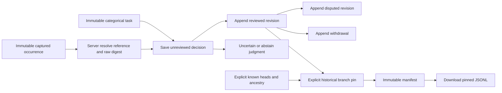

# Review one captured record

**Delivered with native/model/actor acceptance.** The earlier
[readiness gate](CAPTURE_RECORD_REVIEW_GATE.md) records the initial proofs.
See the [executable storyboard](journeys/365-capture-review.md) for genuine frames
and [validation](../VALIDATION.md) for executed checks and limits.

Open an exact stored log/span occurrence and expand **Review example**. Goo reads
review metadata and resolves the original capture member; it does not query
telemetry. The preview identifies the occurrence, capture, service/event time and
original source/custody clocks. Duplicate trace/span IDs do not merge occurrences.
A label on this record is not a label on its whole trace or future population.

## Record a local judgment

Load an exact task ID to reuse a vocabulary, or expand **Declare a task** to create
one immutable categorical task. Label keys/titles are explicit; changing vocabulary
requires a different task. A negative category must be declared, never inferred
from unselected records or absence of a positive label.

Choose a label, **Uncertain**, or **Abstain**, add an optional note and save a
decision. Save creates an **unreviewed** revision. Mark reviewed, Dispute, Withdraw
and corrections create further immutable revisions; old decisions remain available
by exact ID. These are local recorded judgments, not authenticated reviewer
attribution or objective ground truth.

| Meaning | Interpretation |
| --- | --- |
| Unlabeled | No decision has been selected/recorded; not a negative. |
| Categorical label | An explicit value from this exact task vocabulary. |
| Uncertain | Insufficient confidence to assign a category. |
| Abstain | An explicit choice not to judge. |
| Unreviewed / reviewed | Local review state, independent of category. |
| Disputed | Unresolved review disagreement; not exportable as accepted truth. |
| Withdrawn | Retired assertion with retained history. |

Known branch heads are explicit. **Resolve known heads** references those revisions
instead of choosing a winner by timestamp. Unknown or unselected branches are not
claimed absent. Metadata failures leave local drafts intact. A pending publication
can be retried explicitly with its original request identity; dismissing local retry
does not prove that an earlier server publication failed. Closed or superseded
inspectors cannot adopt late responses or publish through old handlers.

## Pin a historical reviewed example

Under **Pin reviewed example**, choose an exact active reviewed categorical decision
and supply other known heads when relevant. Publication reloads the stored task and
decision, resolves the exact capture occurrence and pins the selected branch and
bounded ancestry. Known disputed/conflicting pinned heads require explicit resolution.

The result is a **historical pinned manifest**, not current consensus, an exhaustive
training set or an atomic cut of all review knowledge. A later correction or
withdrawal does not mutate an existing manifest. Reopening an old reviewed revision
for a new historical pin must retain that historical meaning. Download pinned JSONL
uses only the manifest's recorded revisions; it does not reread telemetry, label
neighbors, infer negatives or perform feature projection/train-test splitting.

## Data and authority

A target is `{captureId,index}` with zero-based absolute retained index. The server
loads the digest-validated immutable capture and resolves the exact raw occurrence,
preserving raw numeric bytes rather than reconstructing evidence through browser
number parsing. The resolved reference, record digest and original receipt bind
decisions to evidence. Visual sort order and reported IDs are never substitutes.

Task, decision and manifest IDs identify immutable stored artifacts. Decisions
bind the task ID, target/evidence identity, parent IDs, judgment, review/lifecycle
states, note and local origin/recording time. Manifests bind the task, selected
reviewed decisions, explicitly known heads, bounded ancestry and resolved evidence.
Each task declares 1–16 labels. A decision has at most eight parents and the
loaded ancestry contains at most 64 distinct revisions. A manifest contains
1–32 distinct occurrences from one capture, with at most 64 pinned ancestry
references; artifact/HTTP bodies are bounded to 128 KiB and JSONL export to 4 MiB.
These are metadata/retention limits, not claims about full telemetry coverage.

Foreign task/member joins and malformed states are refused. Generic tags/notes,
source-code goo annotations and population definitions retain separate meanings.

No model runtime, automatic label propagation, authenticated multi-reviewer
consensus, generic ontology, new bitemporal store or completeness/causality claim
is part of this bounded feature. See the [design review](reviews/CAPTURE_REVIEW_DESIGN_365.md)
for readiness history and final source/frame acceptance.
