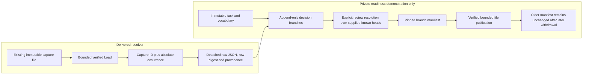

# Captured-record review: readiness gate 365

**Readiness foundation delivered; full review feature not implemented.** Focused
resolver/private file-publication demonstrations and forty generated resolver
cases pass. The main Go suite also passes; [validation](../VALIDATION.md)
records execution.
The reviewed UI, HTTP review routes, production task/decision/manifest artifact
families and downloadable export remain proposed.

The gate closes a bounded way to identify an exact retained occurrence and pin a
reviewed branch. It does not turn existing tags/notes into training truth, require
XTDB, or implement a review platform. Read with the
[architecture contract](reviews/CAPTURE_REVIEW_ARCHITECTURE_365.md) and
[design contract](reviews/CAPTURE_REVIEW_DESIGN_365.md).

## Delivered Go evidence resolver

`exploration.CaptureStore.ResolveRecord` accepts a plain `CaptureRecordRef` with
`CaptureID` and `Index`. The index is zero-based in the **complete retained row
bank**, not the displayed page. On a page starting at offset 100, its first row
maps to absolute index 100. Visual sorting, a reported span ID or a timestamp
cannot replace that occurrence reference.

```go
import "github.com/casselc/goo/exploration"

func resolveExample(dir, captureID string) (*exploration.CapturedRecord, error) {
    store := exploration.CaptureStore{Dir: dir}
    return store.ResolveRecord(exploration.CaptureRecordRef{
        CaptureID: captureID,
        Index:     100, // First retained occurrence on page two, not page-local zero.
    })
}
```

The resolver reads only the existing bounded capture store. It verifies capture
content identity through `Load`, admits exploration captures of logs/spans,
checks the 1,000-row ceiling and actual retained length, and clones the selected
`json.RawMessage`. The returned `CapturedRecord` includes the reference, detached
receipt, SHA-256 of the stored row bytes, source read clock, basis, observation
state, full matching count, retained count and retention-limit flag.

The existing capture load limit is 24 MiB. Invalid/missing/corrupt captures,
unsupported capture families and out-of-range indexes refuse resolution; no
telemetry reread or fallback row is substituted. Capture file access is stored
evidence I/O, not zero I/O.

Equal payloads at two indexes can have the same row digest but remain different
occurrences. The tuple of capture and absolute index supplies membership; a hash
checks bytes, not unique physical events or authenticated origin. Raw JSON number
tokens remain exact, including integers above 2^53. Do not resolve evidence through
`map[string]any`/floating-point conversion. Callers own the returned data; changing
its bytes or receipt cannot alter the stored capture or another resolution.



## Demonstrated contract, not a shipped review API

`workbench/capture_review_gate_test.go` uses private test types to demonstrate
task/decision/manifest publication through existing workbench file primitives.
It is not a production artifact schema or an alternative annotation backend.

- A task pins one categorical vocabulary version. Negative values are explicit
  vocabulary entries, not the complement of a query or all unselected records.
- Decisions distinguish a label, uncertainty and abstention; review state and
  withdrawal remain separate axes. Unreviewed, disputed, uncertain, abstaining or
  withdrawn decisions do not silently become training labels. No decision means
  unlabeled, not negative or abstaining.
- Concurrent append-only branches both survive. A reviewed resolution explicitly
  references the supplied competing heads. Neither timestamps nor last-write-wins
  choose truth. Unknown concurrent branches are not claimed absent.
- A manifest pins an exact task, decision, occurrence/hash and declared known-head
  set. Its meaning is **explicit selected branches, not current consensus**.
  A later correction/withdrawal cannot rewrite an already published manifest.
- The export proof reloads the task and decision pinned by the manifest, verifies
  their content IDs and target/task/row-digest join, then uses the stored decision
  label. A browser draft or prior in-memory label is not export authority.
- Publication verifies the loaded content-addressed winner; a filename collision
  alone is insufficient. Existing artifacts have a 128 KiB bound, and excess is
  refused rather than truncated. The prototype proves a JSONL-ready raw-record/
  label projection retains large numeric tokens; it does not ship an exporter.

These are local review assertions with unverified attribution, not objective
ground truth, telemetry completeness, producer conformance or causal proof.
Original event time, evidence custody/source read and review recording time stay
distinct. The prototype does not provide automatic latest-head export, a global
consistent cut, reviewer authorization or a general dataset/split system.

## Planned user storyboard — not implemented

The current foundation is the
[captured-page inspector](journeys/360-captured-span-waterfall.md), including its
[exact-occurrence narrow frame](journeys/screenshots/360-exact-occurrence-390.png).
That frame shows existing inspection only, not review controls. No new screenshots
are fabricated for the planned steps below.

| Step | Planned interaction | Current status |
| --- | --- | --- |
| Open retained evidence | Open a captured log/span page and inspect one exact occurrence, including a second-page or duplicate-ID record. | Capture inspection exists; the Go resolver now supplies authoritative absolute membership. |
| Review example | Open a contextual disclosure beside existing annotation actions; preview the capture, occurrence and original evidence. | UI and HTTP publication are not implemented. |
| State a judgment | Choose the one declared task version, a literal value or uncertainty/abstention; keep note/tag meaning separate. | Contract and private prototype only. |
| Review or correct | Append a decision, explicitly handle supplied conflicting branches, and preserve older revisions. | File-publication demonstration only, not a user workflow. |
| Publish a manifest | Preview eligible/excluded states and explicitly pin bounded task/decision/member references. | Production artifact family and publication UI are not implemented. |
| Reopen/export | Read the pinned interpretation and exact stored records with telemetry unavailable; a later withdrawal leaves this older manifest unchanged. | Prototype immutability/precision proof exists; downloadable export remains proposed. |

## Remaining delivery and verification

The main Go suite and final focused pinned-export proof pass; architecture and
design accept the bounded readiness gate.
`TestHegelCapturedRecord365` passes forty ordinary log/span banks with duplicates,
absolute index selection, exact raw bytes, immutable metadata and corrupt/out-of-range
refusals. The gate needs no browser campaign for nonexistent controls or a new
review lifecycle model; actual UI/HTTP publication will require its own acceptance.

After gate acceptance, implementation of the one bounded task workflow is
authorized, using the closed contract and existing file store. Final public bounds,
strict schemas, server timestamps/resolution, revision/reference validation,
verified publication/retry behavior, contextual UI and genuine responsive frames
still need production implementation. Keep 366's compact paired headers next; if
review scope grows beyond the bounded task, explicitly defer it and advance 366
rather than invent a registry, new storage platform or whole-product sequence.
