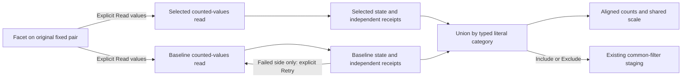

# Compare category populations across fixed windows

Status: implemented; source, generated semantics, native logs/spans, observed
model replay and actor acceptance pass (338).

A categorical facet on a fresh fixed-query count comparison uses **Read values**
to acquire values for both original questions. Selected and previous/fixed-baseline
counts share aligned rows and a common visual scale. Missing keys, present-empty
strings and literal strings keep separate identities. Baseline-only values are
available for the same **Filter both windows** action as other values.

The authored grammar stays the existing facet plus the two fixed questions.
There is no second filter language or saved runtime result. Include/Exclude
conjoins one bounded categorical intent with each original whole predicate; each
operand retains its window, environment policy and other selectors. Staging reads
nothing; Run explicitly acquires the revised pair.

Each successful counted-values response contains an independently read total and
complete bounded grouping, with positive unique counts whose sum equals the total.
The endpoint refuses more than 1,000 groups and inconsistent reads. These checks
establish a coherent observed grouping; they do not establish upstream telemetry
completeness or a transactional snapshot. Each side keeps both read receipts and
its own observation clock.

A category absent from a validated ready side is zero **within that observed
grouping**. An unloaded, loading, failed or refused side has unknown counts, never
inferred zeros. A healthy side remains visible if the other fails; explicit
failed-side Retry preserves that witness. No difference or rate is inferred from
an unavailable operand. The union can contain up to 2,000 categories and is formed
before local Find; search does not change totals or scale.

The passive component consumes supplied selected/baseline states. Application
owners acquire and retire reads using the whole pair and field identity. Returning
to a retained parent restores its supplied states and Find without rereading;
retired callbacks and controls cannot publish into another visit. Save/YAML/reopen
retain definitions only; reopening stages configuration and performs no value read.

See [roadmap](ROADMAP_2026_11_05.md),
[architecture](reviews/CATEGORY_PAIR_ARCHITECTURE_338.md),
[design](reviews/CATEGORY_PAIR_DESIGN_338.md) and [validation](../VALIDATION.md).
