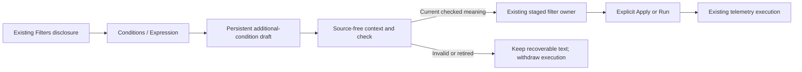

# Contextual condition editing

436.4 mounts CEL inside the existing Activity Filters and fixed-question filter
editor. Conditions remains the default. Expression (CEL) edits one additional
condition within the original scope; it does not convert or replace all filters.

## Operator flow

Open Filters, choose **Expression (CEL)** and type an additional condition such as
`log.body.contains("timeout")` or `span.duration_ns >= 100000000u`. **Check condition**
checks and stages the ordinary filter. The existing **Apply scope** opens a fresh
rolling Activity window; the existing **Run question / Run analysis** executes a
fixed question. Checking is not running, and there is no second Run or Save action.

The mode choice and labelled textarea use native HTML controls. The textarea stays
mounted across mode changes, preserving invalid text, selection and undo history.
A diagnostic is associated with the textarea and announced after explicit Check,
not on every keystroke. Long compiler output is available once under Diagnostic
details; the inline summary includes its location. Unsigned integers remain text
throughout authoring.

Switching back to Conditions retains the expression draft. Explicitly discard the
expression before changing the underlying visual conditions. Clear condition
removes only the owned additional condition and restores its original parent.
Repeated checks replace that condition against the same base; they do not append
nested copies. An external scope change locks the retained expression until an
explicit discard. Discard keeps the current ordinary filters and relinquishes
expression ownership; it does not guess which AST branch to remove. A later
expression starts a new additional condition. Hide/show preserves the original
base and requires a fresh check if its invocation authority was retired. Held results keep their existing execution and return owners.

## Shared implementation

`cel-expression-editor.mjs` supplies the shared contextual controls and local
validation. Its application adapter injects owner preparation, planning and staging;
the component does not fetch telemetry, save artifacts or execute a question.
`filter-editor.mjs` composes it with the existing visual conditions. Activity and
fixed-question adapters retain their separate scope, clock and execution policy.
Component styles live in `cel-expression-editor.css`, separate from page layout.

The adapter lazily calls `POST /api/cel/context` with the complete base. Go validates
that question and static ClickHouse support and returns its content identity and
compiler contract. The browser does not reproduce Go JSON hashing. Checking then
uses the existing pure `/api/cel/plan` operation. Both routes accept bounded strict
JSON and have no source/store dependencies; static support is not live readiness.

Private owner/check leases reject stale successes, errors and callbacks after an
edit, hide, changed parent, navigation or disposal. Cancellation is cleanup;
matching the originating invocation is what prevents a late response from
replacing a newer draft. Malformed Unicode and byte limits receive local feedback.

## Boundaries

There is no permanent CEL toolbar or new top-level navigation. A fresh Activity
entry still presents the stream before optional authoring. Attribute/presence
filters in the parent remain ordinary predicates; they are not silently printed
into unsupported CEL. Native measurements keep their own grammar.

Exact authored source is not yet persisted with saved definitions. Ordinary typed
questions continue through their existing save/export paths; revision-owned source
provenance is 436.5. Whole-product cross-surface acceptance remains 436.6.

See [checked planning](CEL_CHECKED_PLANNING.md),
[ownership](CEL_REPRESENTATION_OWNERSHIP.md),
[storyboard](journeys/cel-editor.md) and [validation](../VALIDATION.md).
