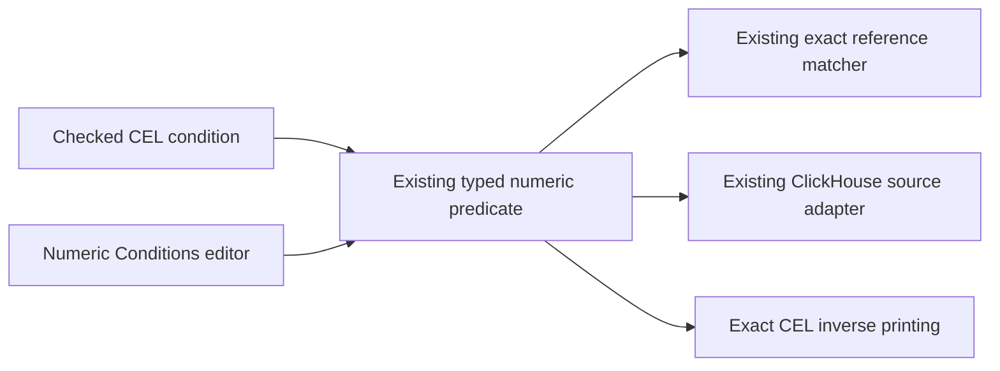

# Numeric attribute conditions in CEL

Use **Filters → Expression (CEL)** to declare how an exporter string should be
interpreted. **Check condition** stages the ordinary typed filter; **Apply** or
**Run** still reads telemetry. The existing **Attribute examples** disclosure
includes numeric examples. No new editor mode is needed. Conditions filter records; they do not automatically
add a numeric measure or chart.

```cel
record.attributes.uint64("http.request.body.size", "By").gte("1024")
record.attributes.int64("app.retry_count", "1").ne("0")
resource.attributes.decimal64("example.load", "1", 2).lt("1.20")
```

The first two arguments are the literal key and unit. Decimal64 additionally
requires a literal scale from 1 to 9. Thresholds are exact **strings**, including
values such as `"9007199254740993"` and `"18446744073709551615"`. There is no
JavaScript floating-point conversion or CEL integer-literal range dependency.

| Methods | Meaning |
| --- | --- |
| `eq`, `ne`, `gt`, `gte`, `lt`, `lte` | Compare valid parsed values against one canonical, in-range threshold string |
| `valid()` | Reported value parses under the declared type and scale |
| `missing()` | Key is absent |
| `empty()` | Key is reported with an empty string |
| `invalid()` | Key is reported, nonempty and fails the declaration's parsing/range rules |

```cel
record.attributes.uint64("http.request.body.size", "By").invalid()
record.attributes.uint64("http.request.body.size", "By").missing() ||
  record.attributes.uint64("http.request.body.size", "By").gte("1024")
```

Every numeric comparison, including `ne`, matches **valid values only**. Missing,
empty and invalid are distinct from zero and from each other. To include another
state, add that state explicitly. A type declaration is an interpretation of
exporter text, not a claim about the producer's original SDK type.

## Parsing and scope

The existing [numeric binding](NUMERIC_ATTRIBUTE_PLANNING.md) owns parsing:
canonical decimal integers or exact fixed-scale decimals; no trimming, leading
plus, leading zero, negative zero, exponent, float, overflow or implicit scale
conversion. Decimal thresholds use exactly the declared fractional digits and
an int64 coefficient. Units label values without rescaling them.

Resource and record maps remain separate. Dotted OTel keys are literal keys;
there is no automatic semantic-convention alias, unit inference or type inference.
This supports standard/custom attributes without Goo manifests. Changing unit
labels is not a conversion operation.

Keys, units, scale and thresholds must be literals. Computed keys, arithmetic,
map indexing, standalone numeric handles, native relational operators on handles
and arbitrary functions are refused with positioned diagnostics. The terminal
method must directly follow its declaration. Numeric text uses the existing
bounded reference input envelope: referenced strings over 64 KiB or malformed
UTF-8 cause an evaluation error, rather than gaining an invalid-state verdict.
Source execution retains its independent existing source budgets.

## One implementation across surfaces



CEL's internal opaque handle carries a declaration, not a second numeric engine.
Its reference terminal delegates to the existing matcher; the lowerer emits the
same `NumericBinding`/predicate used by visual conditions, links, saved definitions
and the source adapter. Full predicate printing preserves branch order, units,
type, scale and threshold spelling, or refuses without returning a partial result.
The existing expression-size, predicate and work budgets remain enforced.

Checking retains the parent question, environment, clock and revision-owned
condition slot. Invalid drafts remain editable and disable execution. Discarding
expression text keeps the staged typed filter available through the existing
Conditions controls. No source read follows from changing representation.

See the [real-source storyboard](journeys/cel-numeric-attributes.md) and
[validation](../VALIDATION.md).
