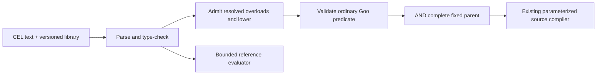

# Author a record predicate with CEL

Goo's bounded CEL pilot compiles checked expressions into the same typed predicates
used by the UI and ClickHouse compiler. It ships a real versioned CEL extension,
`goo.cel.otel/v1`, using the canonical `cel.dev/cel-go` module pinned to v0.32.0.

The [whole-product design](CEL_PRODUCT_INTEGRATION.md) now defines planned app
integration: contextual owned-condition editing, explicit source reads, honest
representation coverage and compact shared controls. It does not expand the
implemented library/CLI vocabulary described here.

## Plan a fixed question

```sh
goo plan-cel \
  -query examples/cel/logs.json \
  -expression-file examples/cel/errors.cel
```

The example uses a fixed 2026-11-14 12:00–12:05 UTC production log window, already
restricted to `api` OR `worker`. Its expression is:

```cel
otel.severityBand(log.severity_number) == "error" && log.body.contains("timeout")
```

The command emits a `goo.cel-plan/1` planning receipt with the library version,
original expression, detached lowered predicate, complete refined question and
parameterized ClickHouse plan. It reads only the supplied authoring files.
No telemetry is read or evidence captured. `-expression '…'` accepts an inline
expression instead of `-expression-file`; exactly one is required.

The complete parent selector remains inside an AND. The helper lowers to numeric
17–20, independently of SeverityText. No environment, fixed time bound, measure,
grouping, inspection limit or offset is silently changed. The output `question`
is an ordinary existing Goo question; CEL text is not an alternative API execution
payload. Direct UI authoring, text/visual round trips and a planning HTTP endpoint
are follow-on work.

## Supported vocabulary

| Expression | Meaning |
| --- | --- |
| `a && b`, `a || b` | Compose admitted predicates |
| `record.service == "api"` | Exact string equality |
| `log.severity_text != ""` | Exact nonempty producer text |
| `log.body.contains("timeout")` | Case-sensitive literal match |
| `log.severity_number >= 17u` | Exact unsigned comparison |
| `span.duration_ns <= 1000000u` | Duration comparison in nanoseconds |
| `otel.severityBand(log.severity_number) == "error"` | Exact OTel numeric band |

`==` and `!=` support a fixed field and a matching string/uint literal; `>=` and
`<=` support uint literals. Reversed comparisons preserve their meaning.
Use CEL's `u` suffix for uint64 literals, including values above JavaScript's
exact-number range. Field-to-field comparisons are not admitted.

Both signals expose `record.service`, `record.trace_id`, `record.span_id`,
`record.scope`, `record.scope_version` and `record.timestamp_ns`. Logs additionally
expose `log.body`, `log.severity_text`, `log.severity_number`; spans expose
`span.name`, `span.kind`, `span.status`, `span.duration_ns`. Timestamp and duration
fields are unsigned nanoseconds. Variables are typed, signal-specific bindings to
existing logical columns, not arbitrary object traversal.

Severity labels are exactly `trace`, `debug`, `info`, `warn`, `error`, `fatal`,
`unspecified` and `invalid`. Zero is unspecified; values above 24 are invalid.
The source compiler admits the helper only over `log.severity_number` and only as
equality with a known band label. It recognizes the checked versioned overload,
rather than matching expression source text.

## Go extension and compiler

```go
program, err := querycel.Compile("logs", expression)
if err != nil {
    return err
}
question, err := program.Apply(parent)
if err != nil {
    return err
}
plan, err := exploration.Compile(question)
```

`Predicate()` returns a detached ordinary AST. `Apply` clones and validates the
entire parent, checks signal identity, adds AND and revalidates the expanded
predicate budgets. Mutating a returned question or predicate cannot alter the
compiled CEL program. See the [external package example](../querycel/example_test.go).

`OTelLibrary{}` implements CEL's library interface and can be registered in an
ordinary CEL environment with `cel.Lib(querycel.OTelLibrary{})`. Its binding is a
pure constant-work Go function. Source lowering is separately allowlisted in the
Goo compiler: registering arbitrary CEL functions does not grant SQL capability.
This pilot supplies one reviewed extension; a user-installable extension registry
and arbitrary binary plugins are not implemented.

`Eval(map[exploration.Field]string)` runs the actual checked CEL reference program
over normalized fixed columns. All referenced columns must be present, strings
well-formed and bounded, and uint64 values canonical decimal strings. Missing or
malformed input is an error, including in a branch that could short-circuit.
Empty strings and NUL-containing record data remain actual values; NUL literals
are refused by the existing predicate grammar. Extra unreferenced fields do not
participate. The reference evaluator never fetches a bounded page as a substitute
for executing a source query.

## Explicit limits

Attribute maps are deferred: a missing CEL map key errors, whereas Goo has explicit
missing/empty predicate semantics. A future guarded-map form needs its own checked
lowering contract. Negation, strict inequalities, casts, arithmetic, regexes,
macros/comprehensions, dynamic fields and unsupported calls are rejected before
evaluation, even in an unreachable subtree. The root must be an admitted boolean
predicate; constant boolean expressions alone are not supported.

Expression size is at most 4,096 bytes, each referenced string value at most
65,536 bytes, with parser/AST limits and a 1,000,000-unit static/runtime CEL work
budget. Expanded predicates still obey Goo's 32-node/depth-4 limits, including the
parent when applied. Work units are CEL cost estimates, not a memory or wall-clock
guarantee for arbitrary host functions. The shipped binding performs no I/O.



The pilot changes predicate authoring, not grouping/aggregation/window semantics
or source planning. Databricks lowering of these record expressions, richer types,
derived measures and whole-query CEL builders remain proposed. Existing portable
prepared-fact compilation is a separate implemented subset.

## Shared domain refinement

The delivered [436.1 consolidation](REFINEMENT_CONSOLIDATION.md) makes standalone
predicate admission independent of a fabricated query. `Program.Apply` delegates
to `exploration.Refine`; predicate access returns a validated detached typed copy.
This remains additive AND refinement, with no app editor or map-presence extension.
