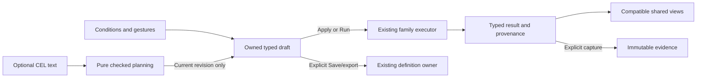

# CEL as part of the Goo product

Status: adopted design direction, 2026-11-14. [436.1](REFINEMENT_CONSOLIDATION.md), [436.2](CEL_CHECKED_PLANNING.md),
[436.3](CEL_REPRESENTATION_OWNERSHIP.md),
[436.4](CEL_CONTEXTUAL_EDITOR.md) and [436.5](CEL_SAVED_QUESTIONS.md) are delivered;
436.6 remains **planned**.
The delivered [predicate pilot](CEL_PREDICATE_PILOT.md) remains a Go library and
source-free CLI. Checked planning has in-process HTTP routes, and Activity/fixed
Filters mount the shared editor. Saved ExplorationViews now preserve checked source
through their existing store and YAML artifact. Whole-product acceptance remains planned.

Seven specialists contributed: [Go](reviews/CEL_HOLISTIC_GO.md),
[architecture](reviews/CEL_HOLISTIC_ARCHITECTURE.md),
[observability](reviews/CEL_HOLISTIC_OBSERVABILITY.md),
[UX/accessibility](reviews/CEL_HOLISTIC_UX.md),
[language/compiler](reviews/CEL_HOLISTIC_LANGUAGE.md),
[reliability](reviews/CEL_HOLISTIC_RELIABILITY.md) and
[product planning](reviews/CEL_HOLISTIC_PLAN.md).
Architecture and UX cross-reviewed the reconciled plan and accepted it; their
minor wording refinements are included here and in that plan.

## Product essence

**Watch telemetry → scope a population → inspect evidence → ask a question →
preserve or reuse it.** CEL is an optional representation of a filter in this
loop. A person can complete the whole investigation without learning CEL. An
expert can open expression editing in the existing Filters/Edit question surface.
Visual and text authoring lead to the same admitted typed meaning and existing
execution owner.

Keep the live stream as the entry. Language names, compiler versions and code
help belong inside authoring or technical details. Existing gestures—facet a
field, brush time/latency, choose severity, search a message—remain primary ways
to create conditions. Expression editing makes their meaning inspectable and
reusable; it does not replace those gestures.

## How it feels across the product

| Surface | Natural interaction | Boundary retained |
| --- | --- | --- |
| Activity | Watch first; open Filters, use Conditions or optional Expression (CEL), inspect the readable draft, Apply scope | Apply reads a new rolling window; editing pauses/holds without resuming or reading |
| Fixed investigation | Add/edit a condition in Edit question, see full parent and fixed bounds, Run analysis | Run uses fixed bounds; invalid text retains held evidence and cannot execute a partial draft |
| Services and resource dashboards | Start from discovered context/default panels, use existing record continuation, refine in the same editor | Record context keeps resource/environment/window qualification; it does not become a metric or causal join |
| Measurements | Retain native definition/kernel UI; optionally investigate associated records through its existing continuation | Counter resets, histograms, producer identity, units and quality keep native semantics |
| Trace and record detail | Inspect locally; add a named contextual condition or open an explicitly related population | Exact ancestry, reported links and time-nearby context remain distinct |
| Saved/investigations | Reopen configuration as a draft; inspect captured evidence as stored; edit through the ordinary question path | Editing creates new intent, not a rewritten capture or implicit fresh read |
| Definitions/packages/views | Reuse existing Save/export/import, retain admitted meaning and checked authoring provenance where promised | Applying presentation preserves destination scope; opening the donor question is a different action |

Ad-hoc OTel remains useful without a Goo manifest. Discovery supplies context,
not a requirement to adopt code weaving or write expressions. Annotations remain
assertions over exact targets; neither note text nor a CEL condition silently
becomes classifier ground truth or an application-health verdict.

## One draft with explicit ownership

The initial editor owns an **additional condition** inside an immutable parent.
It can keep any admitted parent, including attribute/presence/numeric predicates
outside the CEL pilot's vocabulary. The parent stays visible in a compact scope
summary/details; expression editing changes only the owned condition.

- Adding creates a slot with a stable identity and parent revision.
- Editing replaces that slot against its original parent. It does not repeatedly
  AND the new expression onto the last refined result.
- Clearing removes that owned condition and restores the parent. It cannot clear
  other filters, environment policy, clocks, grouping or measures.
- Editing a different existing condition explicitly adopts that condition's slot
  and base. No AST resemblance or text search guesses what is safe to remove.
- Whole-predicate text editing is offered only where complete conversion is
  supported and explicitly chosen. There is no initial Convert all Filters action.

The ordinary AST is executable authority. Exact authored text/comments, generated
canonical text, source revision and executed-question identity are separate facts.
Formatting changes do not imply a new population when the admitted identity stays
the same. Current identity retains predicate order and nesting; this review does
not introduce Boolean theorem proving or global algebraic normalization.

Every conversion declares coverage. A supported condition must pass
print → CEL check → lowering against the existing normalized identity. If structure
cannot be preserved, refuse conversion or require explicit adoption as a new owned
condition. Unsupported parents remain intact and editable through their existing
controls. Never generate plausible text while dropping clauses.

## State, feedback and reads

Keep source text and last valid IR separately. Invalid text remains recoverable
with its cursor/undo history. Switching to Conditions retains it; deliberately
replacing it with visual edits requires an explicit discard/adoption choice.
Held results retain their original scope/basis and remain inspectable, while
actions dependent on a current valid draft are withdrawn appropriately.

A compile result binds the editor/mount/route epoch, draft revision, parent
revision/identity, slot, signal and compiler/library/target contract. Abort is
cleanup; these bindings prevent stale success, stale failure and A→B→A revival.
Changing the parent retires compilation rather than silently rebasing the text.

| Action | Source/store effect |
| --- | --- |
| Focus, type, complete, switch mode, check, stage or Return | No telemetry/discovery read or store write |
| Compile transport | Pure bounded planning request; no source readiness probe |
| Apply scope | Existing explicit new rolling Activity read |
| Run analysis | Existing explicit fixed-question execution |
| Save/import/publish | Existing explicit publication owner; no hidden telemetry read |
| Capture/refresh evidence | Existing explicit independent read/custody protocol |

Diagnostics have stable code/phase, optional source span and domain path, plus a
concise repair. Syntax, type, unsupported lowering, combined budget and changed
parent are authoring failures; source access/readiness failures keep their own
surface. Validate quietly after idle or explicit checking, with native textarea,
visible label, linked error/help and no per-keystroke live-region announcements.
Successful background compilation does not steal focus.

## Make room by simplifying

The reviewed 320/390px frames show significant chrome before the first record.
Do not add a permanent language bar. Fold optional analysis controls with their
chart and put one compact scope/draft/read-state summary outside it. Keep full
predicates, exact UTC bounds and provenance in a nearby native disclosure. Remove
repeated staged-read warnings and duplicate selector displays.

Share supplied presentation, qualified-field metadata, error association and
intent shapes. Reuse the current record/inspector/table/chart components. Keep
Activity subscriptions, fixed execution, discovery and saved-custody controllers
separate where their contracts differ. Conditions show friendly labels/units;
exact `uint64` text, nanoseconds and generated CEL `u` literals remain available
without round-tripping through JavaScript Number.

## Architecture and language boundaries

Use a small shared record-authoring contract now, retaining closed semantic
families: record predicates, native measurements, lifecycle/prepared facts and
view declarations are not one universal CEL object. CEL never executes inside a
passive component to fetch, navigate or publish.

Separate language support, family lowering, adapter capability and live source
readiness. The first three can be checked from declared contracts without reading
telemetry; the fourth uses its existing explicit source owner. A successful
compile does not attest collection coverage, source availability or health.

Persist authoring metadata only in the selected existing owner for the concrete
record journey. Check source/AST pairing on creation/import under its declared
supported compiler; never trust independently writable source and AST. Reopen
retained admitted meaning without recompiling text with today's library. Missing
old authoring support can block text editing and offer explicit upgrade preview;
it cannot rewrite stored evidence. This needs no legacy evaluator matrix.

Guarded attributes are the next useful language extension after the bounded
bridge. First specify absent/empty/value/malformed truth tables and reference/SQL
parity. Exact numeric bindings, duration literals and derived identities require
their own declared types/units/state rules. Native stream evaluation, ancestry,
SLIs/health, arbitrary plugins and Databricks record lowering remain separate
decisions. Existing prepared-fact portability does not imply record portability.

## Finite implementation order

Adopt the [reconciled plan](reviews/CEL_HOLISTIC_PLAN.md) as six reviewable slices
inside the next 436 consolidation, not a competing language-platform backlog:

1. **436.1 — delivered:** shared ordinary predicate admission/refinement/cloning; align matching
   aggregate-selection/held-return contracts with one CEL and one non-CEL adopter.
2. **436.2 — delivered:** pure named planning use case, typed positioned diagnostics and bounded
   in-process transport; shared logical descriptors only where needed by this slice.
3. **436.3 — delivered:** declared printer/representation coverage and revision-safe slot owner.
4. **436.4 — delivered:** mount the shared contextual editor and compact scope/status presentation.
5. **436.5 — delivered:** one existing definition/artifact owner for checked source provenance
   and ordinary save/reopen/export; no speculative capture retrofit.
6. **436.6:** demonstrate the whole watch/refine/run/inspect/return/preserve/reuse loop,
   including existing Services and Measurements record context.

Each slice can ship independently with its own checks and review. The next
implementation task is 436.6. This finite sequence does not require a universal
field registry, rewriting every clone site, implementing maps or replacing all
controllers.
Keep the older 427–429 preservation contracts pending and do not mark them complete
merely because their owners are reused.

## Acceptance

Use existing compiler/CLI/Hegel/real ClickHouse parity, then deterministic authoring
state tests, a real OTLP request-observed storyboard, a bounded Bombadil actor and
observed Quint replay when UI state exists. Test stale success/error, ABA, dirty
parent, hidden/retired controls, repeated slot edits, invalid-mode recovery, exact
OR/environment/window retention and source totals exceeding the held page.
One explicit current Apply/Run dispatch is required; local gestures and held
Return read nothing. Ordinary saves preserve intent; captures retain custody.

Compare 320/390/1440 frames with authoring/analysis folded and open, plus keyboard
focus/error/return behavior. Actual AT/cross-engine results must be reported
separately. These are future acceptance gates, not tests executed by this review.
