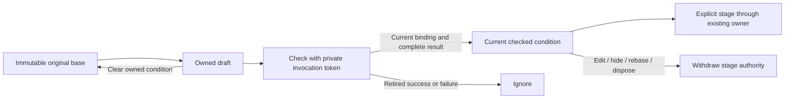

# CEL representation and condition ownership

436.3 prepares contextual editing without adding another query executor or visible
editor. It separates two questions: can this exact predicate be represented in
CEL, and does this mounted author still own the right to stage a checked result?

## Honest representation

`querycel.PrintPredicate(signal, predicate)` prints only its declared intersection
of ordinary predicates and checked CEL. It validates first, generates source,
checks and lowers that source, and refuses if the resulting structure differs.
A refusal returns no partial text: an unsupported leaf cannot disappear during
conversion. Unary wrappers and flat multi-child branches may refuse when CEL
would regroup them; explicitly nested supported binary branches retain their
shape. Noncanonical numeric spelling such as `01` also refuses.
Branch order and nesting are meaning-bearing identity facts here;
semantic resemblance does not authorize rewriting a user's original question.

The intersection covers declared fixed string fields with equality, inequality
and substring comparison, plus fixed unsigned numeric fields with supported
comparisons and exact uint64 literals. Attribute maps, presence checks, regex,
arithmetic, general negation and unsupported branch shapes remain outside it.
An unrestricted nil predicate has no printable `true` equivalent in the current
compiler. A new empty owned slot is still allowed; it does not convert the parent.

A parent may contain perfectly valid ordinary predicates that CEL cannot print.
Keep that parent and edit an additional condition. Do not offer whole-filter
conversion unless every part is representable. This is bounded coverage, not a
promise that arbitrary equivalent expressions round-trip.

## One owned additional condition

`ui/cel-authoring.mjs` owns authoring state independently of `QuestionSession`'s
execution generations. It has no DOM, network, timer, source or store dependency.
The base question and its opaque server content identity are retained separately
from text, draft revision, parent revision, slot, mount/route epoch and compiler
contract. Draft revisions are exact strings; no JavaScript number rounding.

The adapter uses `beginCheck()` to obtain `{request, token}`, submits only the
request, and passes the retained token to `accept(token, receipt)` or
`fail(token, diagnostic)`. Explicit `stage(token)` returns a detached question
only for the current accepted token. `clear()` returns its own fresh staging
token for the original base. Snapshots and returned requests are detached.

Every check receives a private invocation token. Success must match both the
originating request and all returned binding fields, source and complete ordinary
question. Failure is correlated through the originating token because diagnostic
HTTP envelopes do not echo a binding. An A → B → A edit cannot revive A's old
response. Hiding, disposing or changing parent/signal retires pending checks and
staging authority; aborting a request is only cleanup.

Text and last valid lowering remain separate. Invalid text can survive a mode
switch, and held evidence belongs to the existing execution owner. Last valid
meaning may remain inspectable, but cannot stage for a changed draft. Deliberate
visual adoption is required to overwrite a retained draft. Repeated edits apply
against the original parent, replacing the owned condition rather than growing
nested AND clauses. Explicit clear restores the detached parent alone.

## Boundary and next step

These contracts are now mounted by [436.4](CEL_CONTEXTUAL_EDITOR.md). The existing
Apply and Run owners still decide when to read telemetry. Shared Conditions /
Expression editing preserves native labels, keyboard focus, invalid text and
a single primary action. It must not put another toolbar
before the live stream. [436.5](CEL_SAVED_QUESTIONS.md) supplies checked publication/provenance through
the existing saved-view owner.

See [storyboard](journeys/cel-representation-ownership.md),
[integration design](CEL_PRODUCT_INTEGRATION.md) and [validation](../VALIDATION.md).
