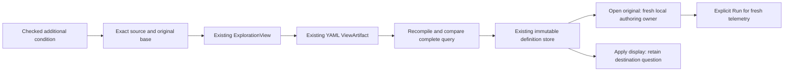

# Preserve authored conditions with saved questions

436.5 uses the existing saved ExplorationView and portable ViewArtifact. There is
no CEL document family, separate Save action or change to captured evidence.
Ordinary typed questions remain executable authority; source is checked metadata
owned by the same immutable definition revision.

## Save and reopen

Author and check an additional condition in fixed-question Filters, run explicitly,
and use the existing saved-view controls. A matching checked condition can travel
with that question. Its exact UTF-8 source, including comments and spacing, is kept
alongside its original base, compiler contract and admitted condition digest.

Open the saved view's original question to restore source and the original base.
This stages configuration without reading telemetry. It does not restore a live
invocation token or silently execute CEL. Editing requires a fresh check under the
current local owner; replacing that condition still uses its original parent.
A pending local draft requires an explicit keep/discard decision before recall.

Applying a saved display to another question keeps the destination question and
its authoring. It does not adopt the donor's source. Opening the original is the
explicit action for adopting the donor's question and authoring together.

The existing YAML view artifact exports/imports the same metadata. Import checks
it before publication. Unsupported library/compiler versions refuse; they are not
silently recompiled under a newer interpretation. To remove source intentionally,
use the ordinary typed definition path explicitly rather than treating invalid
metadata as a reason to drop it during import.

## Checked metadata, not a second query

`ExplorationView.authoring` is keyed by a configured record signal. Each entry
contains representation/version, exact source, original base, the planning
binding, parent revision and lowering digest. Validation recompiles that source
with its declared binding, verifies the digest and compares the complete resulting
question to the corresponding saved query. Changing a filter, environment, clock,
projection or page policy cannot leave an apparently valid source/query pair.

The original parent may contain attributes or presence predicates outside the CEL
vocabulary. Keeping the complete base avoids converting or weakening them.
Saving/importing does not query telemetry, probe readiness or write evidence.
Go callers can use `workbench.NewRecordAuthoring(request, parentRevision)` to
produce detached checked metadata. Edit source through the editor or this helper;
do not hand-edit a digest to make an inconsistent YAML pair appear valid.

| Identity | Meaning |
| --- | --- |
| Saved view content ID | Entire immutable definition, including exact source, bindings and presentation |
| Ordinary question identity | Admitted typed meaning; no Boolean theorem proving or predicate reordering |
| Base identity | Validated original parent used for this additional condition |
| Lowering digest | Admitted condition predicate, computed in Go |

Formatting-only source changes can produce a different saved revision while the
ordinary question and condition digest remain unchanged. Binding revisions are
correlation/provenance labels, not signatures or authentication. Rechecking under
a new local owner can also change definition content without changing population.

## Boundaries

This first owner is a fixed saved question. A rolling Activity check does not
silently rebase its provenance onto a later fixed window. Ordinary Activity
selectors, telemetry packages and captures keep their existing contracts.
Captured receipts remain immutable and need no speculative source metadata.
The whole-product acceptance loop is 436.6; delivering this owner does not finish
the older preservation backlog or imply all native metric grammars accept CEL.

See [contextual editing](CEL_CONTEXTUAL_EDITOR.md),
[storyboard](journeys/cel-preservation.md),
[independent review](reviews/CEL_PRESERVATION_436_5.md) and
[validation](../VALIDATION.md).
