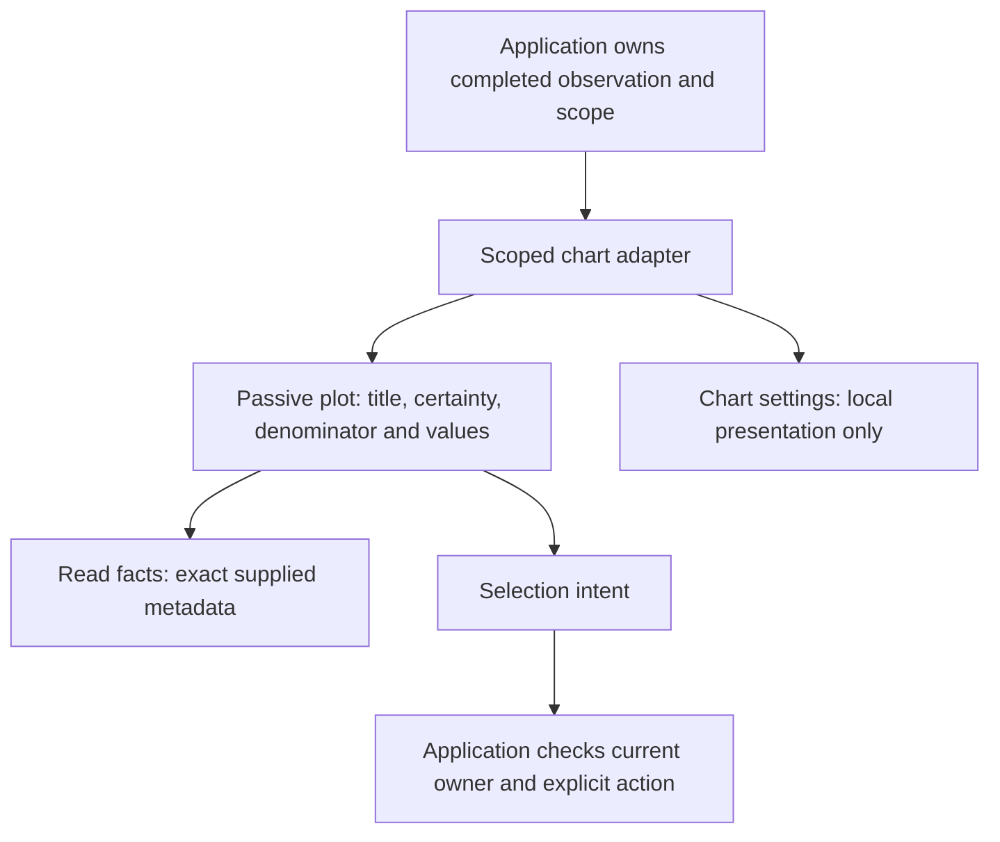

# Chart-first exploration

317 delivers this bounded shared surface. Measurements and completed checks
are in the [journey](journeys/317-plotted-values.md) and validation record.

The unchanged-source task measured narrow parent rows ending at 1,073/1,118px
and the selected-cohort row ending at 909px in an 844px viewport. A visible
chart container did not mean visible data.

A population should show its values before asking how to draw them. The shared
scoped chart surface puts plotted labels, values and marks before display settings.
The title and qualified field/measure explain what is plotted. Visible certainty,
a UTC capture clock and the captured-population denominator distinguish the
measured query result from unknown upstream coverage. No captured-count view claims complete telemetry.

**Chart settings** contains local kind, measure, scale, ordering, Find and
completeness requirements where those controls are supported. These are presentation
choices over supplied observations. They do not read telemetry. Selection and its
explicit next action remain owned by the application adapter; changing display
must not revive retired selections.

**Read facts** exposes full exact capture time, source origin and independent quality
facts. It does not hide partial, unavailable, stale or unknown coverage behind a
healthy-looking plot. It does not change the snapshot, selected scope or receipts.
An exact-values disclosure remains separate from read metadata.

The ordinary root canvas keeps its explicit Run and fresh-window acquisition
actions together. Only the known successful applied-state explanation is shortened;
staged, loading, partial and error messages retain their meaning. Authored titles
and composition order remain literal.

The shared frame and plot remain passive web components. Native disclosures work
with keyboard input; controls retain accessible names and coarse-pointer targets.
Queries, snapshot quality, source-read boundaries and saved grammar are unchanged.
