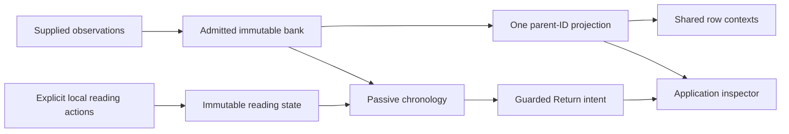

# Chronology consolidation (462)

The accepted Related held records interface now uses one immutable reading state
for Find, local page, related scope and the first-entry return point. Selection
stays application-owned; its saved occurrence key is independent of whether a
row is visible. Focus, DOM scroll and guarded Return/inspection events stay in
the view and application owner.

`chronology-reading.mjs` has explicit Find, page, enter, span-refine and leave
transitions. Re-anchoring or inspecting another occurrence cannot replace the
original return point. Find is refused while reading a related scope. Replacing
the supplied bank resets reading state. These transitions do not contain source
clients, navigation, clocks, storage or DOM handles.

The immutable admitted bank also owns one cached parent-ID projection. Rows and
inspectors reuse it, as does the shared record-list projection implementation.
Repeated span observations remain separate candidates; absent, unreported,
invalid and ambiguous parent states retain their original meaning.

Shared `goo-record-context` retains only projections created by the checked
internal helper without another copy. Arbitrary public arrays are still copied,
and public `.records` / chronology `.data` readback remains detached. Internal
rendering uses admitted bank identity, avoiding full-bank cloning on each render.
The cache is a WeakMap, so retired banks are not retained by the cache itself.
This is a structural reduction in copying, not a measured latency claim.

Acceptance includes generated reading campaigns, projection identity/mutation
checks, the unchanged real-OTLP storyboard and Bombadil exploration, and the
existing native chronology contract. The latter validates source authority; it
does not model every local reading transition. See [validation](../VALIDATION.md)
and [independent review](reviews/CONSOLIDATION_462_ACCEPTANCE.md).

No additional controls or prose were added to the operator interface. Compact row
context and paired-toolbar refinements from the UX review remain follow-up
candidates; they are not prerequisites for source-safe local reading.
