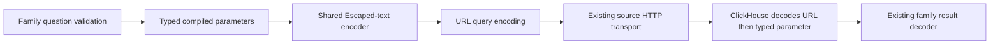

# ClickHouse parameter encoding

Both record and measurement sources use `internal/sourcehttp.EncodeParameter` for
literal parameter values. ClickHouse's HTTP parameter parser reads Escaped text
after URL decoding; percent-encoding alone does not preserve literal backslashes
or delimiters.

The helper doubles backslashes and writes ASCII controls (C0 and DEL) as lowercase
`\xNN`. Other bytes remain unchanged. Callers then use `url.Values` to encode the
`param_<name>` query arguments. Do not apply this helper to SQL identifiers, SQL
text, or an already encoded URL.

This is a byte-preserving transport operation, not Unicode normalization or
question admission. Public families retain their own valid-Unicode, NUL and size
rules. Numeric text, units, stream identity and semantic comparison remain in the
source models and compilers. The families also retain their distinct timeouts,
settings, source budgets, cancellation and error classification.

The previous record encoder escaped every ASCII control. The previous metric
encoder used short escapes for a smaller list and left other controls unchanged.
Those wire differences alone do not establish corrupted values. The actual audit
compares old and shared parameter decoding separately from the public source
round trips; [validation](../VALIDATION.md) records the measured results.

The existing ordinary-OTel literal bank supplies independent physical-byte,
identity, near-match and missing-value oracles. No UI, grammar, HTTP API or source
query semantics change, and no performance improvement is claimed.
