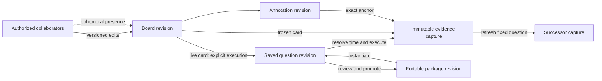

# Collaborative investigations: research and proposed direction

Research date: **2026-10-18**. Implementation update: local [ordered notes and deployment context](WORKBENCH_CONTEXT.md) now implement a bounded subset of slice 2 below; shared editing/presence remain proposals. This document proposes future work; it does not
claim that goo currently has boards, team accounts or multiplayer editing.
The implementation boundary is described in [Saved investigations](SAVED_INVESTIGATIONS.md)
and [Product gaps](PRODUCT_GAPS.md). General captures and stable saved paging now implement the
[first evidence foundation](GENERAL_CAPTURES.md); baseline-pair persistence remains
future work. This is not a prerequisite to finish an entire collaboration suite.

## Which feature matches the remembered whiteboard?

**Honeycomb flexible Boards are verified; a Honeycomb multiplayer whiteboard is
not verified by the sources accessible in this review.** Its vendor-maintained
Terraform documentation describes positioned query, SLO and Markdown text panels,
preset filters and named filtered board views. This is a useful investigation-board
reference, but does not establish simultaneous editing, cursors, freeform connectors
or a persistent investigation activity graph. Do not silently attribute those
features to Honeycomb.

A targeted follow-up also checked the vendor's public GitHub organization and
repository/issue searches for a newer investigation workspace. It found no
authoritative description that resolves the identification. GitHub code search
required sign-in, and normal requests to the vendor's hosted documentation and
marketing site were denied by the environment proxy. The guessed hosted paths
were not verified pages and are not citations. Terraform coverage may lag or omit
UI-only products: these research limits are **not evidence that Honeycomb lacks
the recalled functionality**. Confirm its current name and behavior against
accessible hosted product documentation before making a comparative claim.

There is a close, explicitly documented match in **Datadog Notebooks**: the docs
contain a section literally called “Multiplayer experience in Notebooks,” with
simultaneous editing, real-time named cursors, viewer avatars and indicators for
widgets being edited. Text and graph comments, mentions, version history and
templates support the surrounding investigation workflow. This may resemble the
remembered feature; it is not evidence that the user meant Datadog.

## Verified patterns and their value for goo

| Product and verified feature | Useful pattern | Boundary to preserve |
| --- | --- | --- |
| Honeycomb immutable Query objects; separate query annotations; flexible Boards with query/SLO/text panels, filters and saved views [H1–H4] | Separate reusable question identity, human descriptions and composition. Make the same question usable interactively and through IaC. | An immutable query definition is not an immutable result capture. A named view is not a source snapshot. These sources do not verify multiplayer. |
| Datadog Notebooks: live graphs alongside rich text, templates, anchored comments, multiplayer cursors/presence and widget editing indicators [D1] | Keep hypotheses, evidence and explanations together. Allow another engineer to continue the investigation without reconstructing its context. | Widget saves are documented as last-write-wins; presence alone does not prevent lost updates. A live graph can change underneath a narrative. |
| Datadog fixed-time graph image snapshots and notebook version history [D1,D2] | Preserve an understandable incident narrative beyond telemetry retention; inspect and restore document history. | Static graph images do not preserve structured evidence or enable re-evaluation. Notebook document versions and evidence versions are different histories. |
| Grafana Explore query history: persisted, private per user, searchable/commentable/starred, with rerun and shortened links [G1] | Personal recent work and saved questions are valuable before shared boards. Provide explicit rerun versus reopen. | Private query history is not a team investigation history. A link to a query does not freeze its returned evidence. |
| Grafana correlations: data-source values become another source query or external URL [G2] | Declarative cross-signal links and safe links into existing observability products can reduce duplicate UI work. | Exact trace IDs, declared subject identity and time proximity remain distinct relationships. A link should disclose its generated scope. |
| Grafana Canvas: positioned elements and connections bound to data [G3] | An optional spatial presentation can show an architecture or an investigation's evidence relationships. | A visualization canvas does not itself establish collaborative document semantics. Build accessible ordered cards first; freeform geometry can follow. |
| HyperDX: integrated logs, metrics, traces, replay, search and dashboards over ClickHouse [X1] | Integrate/deep-link broad operational exploration where practical; focus goo on shared measurement definitions and evidence continuity. | A README capability inventory is not proof of deployed compatibility or equivalent semantics. No integration was executed here. |

## Proposed object model

Use **Investigations** as the task, with a board/document as one view of the work.
Avoid a separate permanent navigation destination for every object type.

| Object | Meaning and persistence |
| --- | --- |
| Saved question | Named, versioned typed query plus explicit time policy. Reusable relative lookback is resolved into absolute bounds when executed. Editing creates a definition revision. |
| Evidence capture | Immutable server-created receipt: actual resolved question, source plan/parameters, basis, component states, bounded records and complete supported aggregates. Record what is retained and omitted. Reopen performs no source read; refresh creates a successor. |
| Board/document revision | Ordered cards referring to exact capture IDs, question revisions, portable package revisions, narrative and external links. A card explicitly chooses frozen evidence or a live question. A board revision does not claim to snapshot every external resource. |
| Annotation | Authored comment or hypothesis anchored to an exact capture/record/interval, with its own revision history. A hypothesis remains human interpretation; connector lines do not establish causality. Prefer an explicit anchor over free-floating pixel coordinates. |
| Investigation activity | Deliberate actions such as pin evidence, compare, annotate, refresh and publish a conclusion. This is distinct from private every-query navigation history and from access/security audit. |
| Presence | Ephemeral viewer/editor state with expiry. Does not change evidence bases or certify that a person reviewed a result. |
| Portable package | Reviewed, reusable measurement/question definition and declared dependencies. Promotion from a useful investigation is explicit; it does not export captured sensitive records or silently modify instrumentation. |

The same Go AST must underlie saved questions, package authoring and generated
source plans. Keep physical bindings in source adapters. A board does not add a
second expression language. CEL/KCL or other authoring choices remain independent
of the collaboration transport. Later Databricks lowering must disclose capability
gaps rather than changing a board measure's grain, units or population silently.

## Recommended ordered slices

1. **General evidence continuity (partly implemented).** Manifest-free span/log
   and inventory captures with stable stored pages now exist. Restoring comparison
   baseline pairs with their own bases remains future work.
   Make reopen, rerun with a new window and refresh the original fixed question
   distinct actions. Define stable paging honestly: pages over stored bounded rows
   are stable within a receipt; live keyset cursors alone are not a database
   snapshot and cannot guarantee immunity to late arrival or retention.
2. **Personal questions and investigation document.** List/search named questions
   and receipts; pin frozen evidence, add hypothesis/conclusion text and compare
   successors. Start with an accessible ordered list of cards and a shareable local
   deep link. Support explicit live-question cards with visible last-run time and
   capture ID. Keep this a single-user/local capability until authorization exists.
3. **Reusable investigation recipes and promotion.** Seed USE/RED and supported
   OTel convention recipes with declared required fields, grain and unknown states.
   Examples: slow downstream calls, queue delay, deployment regression, missing
   telemetry. “Promote to package” carries reviewed filters/grouping/measurement
   semantics, not demo service names. External correlation cards can link to
   HyperDX/Grafana before rebuilding all their features.
4. **Shared durable editing.** Before shared deployment add authentication,
   workspace/tenant scoping and server-enforced view/edit/export rights for documents
   **and every referenced capture/source**. Board access must not confer source
   access accidentally. Start with expected-version conflict detection and immutable
   document revisions, not silent last-write-wins. Add anchored comments, authorship,
   audit, retention, quotas and restricted exports. Local anonymous author labels
   cannot provide verified identity.
5. **Multiplayer when useful.** Add viewers, active-card indicators and optional
   “follow collaborator” navigation. Following must not rerun a query, change one's
   baseline or overwrite a draft without explicit intent. Collaborative text/CRDT
   editing or a freeform canvas is a later choice; do not assume CRDTs solve
   authorization, query cancellation, conflicting package edits or evidence custody.

Other high-value product work can proceed alongside these slices: ingestion
freshness/drop/sampling evidence; explicit root/request versus span measures;
broader typed aggregations and attribute-difference leads; declared service
dependencies; deployment annotations; query cancellation/concurrency budgets.
Durable SLO evaluation/notifications require a separate scheduler and delivery
design. RUM/replay, a general dashboard editor and an autonomous AI investigator
are lower-priority integrations until a concrete goo user journey justifies them.
This is a purpose-driven order, not a vendor parity checklist.

## Storyboard and verification requirements

The first collaboration storyboard should use unrelated OTel telemetry:
engineer A saves a slow dependency cohort and its baseline, pins a trace and a
time-context log capture, writes a hypothesis, and hands the investigation to B.
B reopens the frozen evidence after reload without telemetry reads, adds a
counterexample, refreshes after labelled late data, compares both receipts and
promotes a reviewed reusable package. Label time proximity separately from exact
trace links. Later add two independent authenticated browser contexts editing the
same document; one loses access during a read/edit.

Extend Playwright with that live-OTLP journey, screenshots and assertion of no
source reads on reopen. Bombadil needs board/question/capture/annotation actions
and data-aware invariants, with reachability requirements rather than only browser
error checks. Hegel state/swarm and Quint model/observed-trace validation should
cover immutable evidence, stale-response isolation, optimistic edit conflicts,
separate document/evidence histories and revoked-access behavior. Include negative
controls for changing an old receipt, silent lost edits, cross-workspace references
and treating a live rerun as the originally pinned evidence. Assert complete
aggregate counts independently of displayed pages.

## Sources and review limitations

Accessed **2026-10-18**, using vendor-owned public repository documentation.
Hosted vendor documentation and GitHub API were outside the enforced network
allowlist; raw GitHub and repository access were available. No hosted product UI,
edition/pricing entitlement, concurrency behavior or production integration was
exercised. Repository default-branch docs can describe unreleased functionality;
claims below are about the documentation reviewed, not a certified installed
release. Honeycomb's exact recalled feature remains an open identification question.

- **H1:** [Honeycomb flexible_board](https://github.com/honeycombio/terraform-provider-honeycombio/blob/d34a2410e0844479022303947101ebbf837a6f5b/docs/resources/flexible_board.md).
- **H2:** [Honeycomb board_view](https://github.com/honeycombio/terraform-provider-honeycombio/blob/d34a2410e0844479022303947101ebbf837a6f5b/docs/resources/board_view.md).
- **H3:** [Honeycomb query](https://github.com/honeycombio/terraform-provider-honeycombio/blob/d34a2410e0844479022303947101ebbf837a6f5b/docs/resources/query.md).
- **H4:** [Honeycomb query_annotation](https://github.com/honeycombio/terraform-provider-honeycombio/blob/d34a2410e0844479022303947101ebbf837a6f5b/docs/resources/query_annotation.md).
- **D1:** [Datadog Notebooks](https://github.com/DataDog/documentation/blob/2f8a623d7d84292b84f423e0b826fd8af37b836b/hugo/content/en/notebooks/_index.md), especially Multiplayer experience, Adding comments, Graph snapshots and Permissions.
- **D2:** [Datadog notebook version history](https://github.com/DataDog/documentation/blob/2f8a623d7d84292b84f423e0b826fd8af37b836b/hugo/content/en/notebooks/guide/version_history.md).
- **G1:** [Grafana Explore query management](https://github.com/grafana/grafana/blob/3920186ffd305507ae78ea7f035d0197e71d929f/docs/sources/visualizations/explore/query-management.md).
- **G2:** [Grafana correlations](https://github.com/grafana/grafana/blob/3920186ffd305507ae78ea7f035d0197e71d929f/docs/sources/administration/correlations/_index.md).
- **G3:** [Grafana Canvas](https://github.com/grafana/grafana/blob/3920186ffd305507ae78ea7f035d0197e71d929f/docs/sources/visualizations/panels-visualizations/visualizations/canvas/index.md).
- **X1:** [HyperDX README](https://github.com/hyperdxio/hyperdx/blob/main/README.md), default branch as fetched on the access date.
