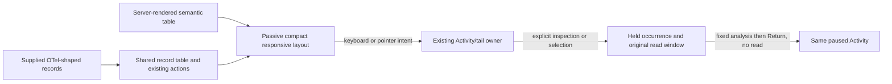

# Compact mobile Activity records

Activity’s compact record tables now opt into the passive
`goo-table[record-layout="compact"]` layout. At widths through 700 px, UTC and
service share the first line, the log/span summary follows, and existing action
buttons share a wrapped row. Short ordinary records fit within 112 px in the
measured 320/390/700 px viewports. Longer service names, bodies and chosen fields
may take more space; rows do not claim a fixed maximum height for arbitrary data.

UTC remains readable with its exact timestamp and original nanoseconds available
in the focusable time element’s tooltip. No time is rounded in the record model.
Actions retain their text, keyboard behavior and minimum 28 px targets, with gaps
between targets. Selection still refers to the exact observed occurrence.

Chosen extra fields retain qualified labels, missing/empty distinctions and their
existing filter disclosure. Hidden columns stay hidden. Mobile groups the core
UTC/service/summary roles; desktop retains the configured table order. Field
columns retain their supplied order. Resize and layout changes do not read data,
clear selected occurrences, or change selectors/windows.

## Reuse and ownership

`GooRecordPresentation.table({compact:true})` emits the attribute. Server-rendered
HTML can use the same attribute with cells marked `data-record-core` or
`data-record-field`; no SPA framework or new custom element is required. The
component reference includes an explicitly synthetic SSR example.

The responsive styles live in `record-presentation.css`. Older application tail
rules now apply only to tables without this opt-in, preventing stylesheet-order
collisions. Product CSS continues to own viewport height and surrounding layout.
No fetch, listener, subscription, navigation or persistence is added to the display
primitive. The existing Activity/tail owner still owns all actions and clocks.

## Executable storyboards

Journey [160](../journeys/mobile-activity.spec.js) ingests twelve ordinary traced
OTLP logs, independently counts them in ClickHouse, and opens a saved rolling view.
It explicitly starts and pauses the stream, then measures responsive behavior at
320, 390, 700, 701 and 1024 px. UTC/service alignment, row/action size and absence
of document overflow are checked separately from the source counts.

Keyboard selection and inspection retain exact timestamps, occurrence identity and
focus through fixed-question staging and paused return. Choosing a field, hiding
Service and staging/removing a filter do not add source requests. Explicit Resume
starts a new read with a disclosed gap. Observed Quint replay retains all five
entry-model rejection controls. A 25-second Bombadil campaign runs at an actual
390×844 viewport, starts once, pauses, selects and inspects while checking compact
geometry, bounds and no additional reads.

Journey [161](../journeys/compact-record-components.spec.js) is a separate synthetic
passive contract: SSR and detached/reinserted SPA records, long values, exact time,
column-header accessibility, keyboard actions and no API requests. It checks the
same five viewport widths with application styles loaded after component styles,
and retains the legacy tail layout for tables without the opt-in.

Actual outcomes and remaining limits are recorded in [VALIDATION](../VALIDATION.md).
