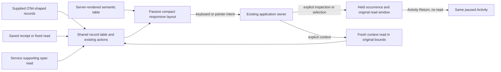
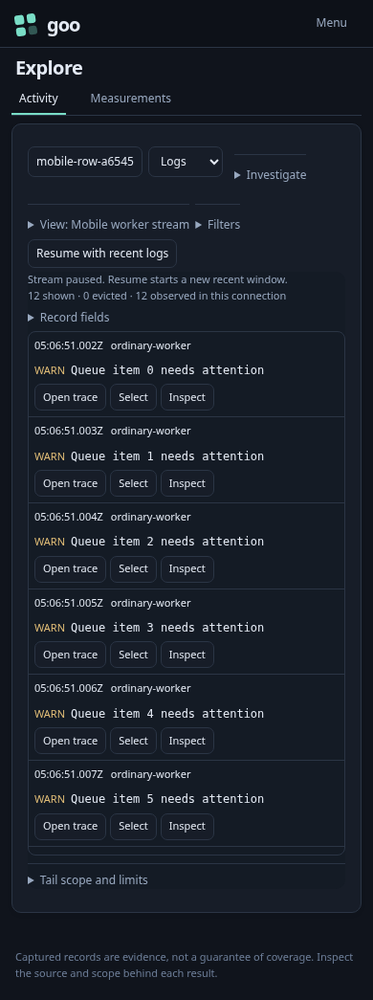
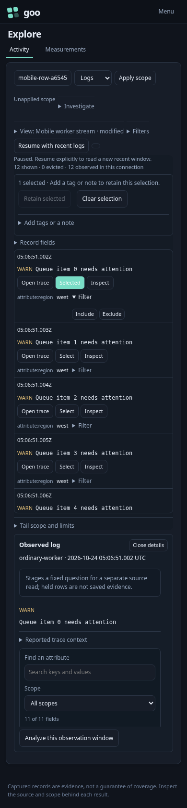
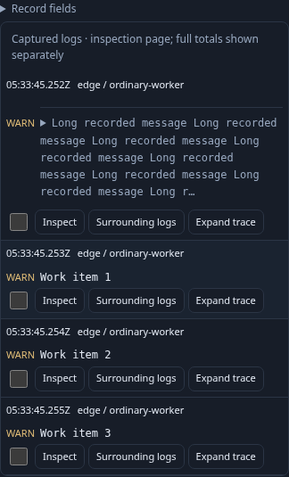
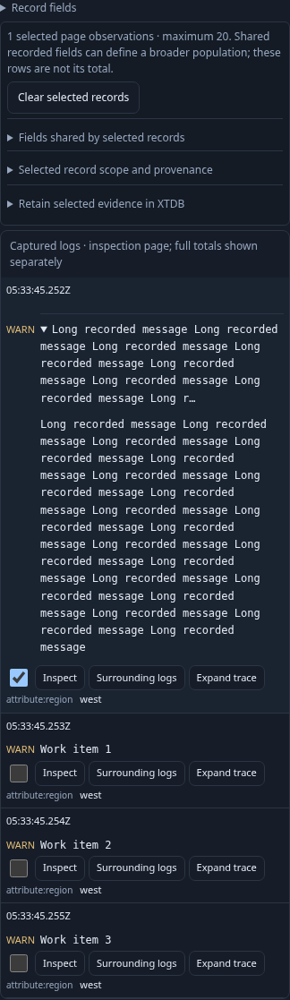
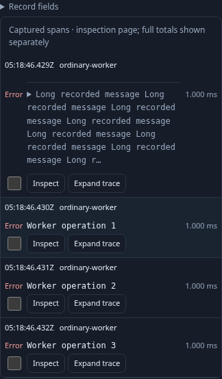
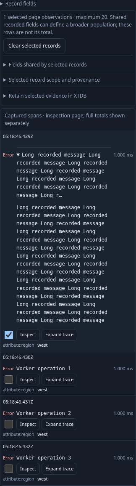
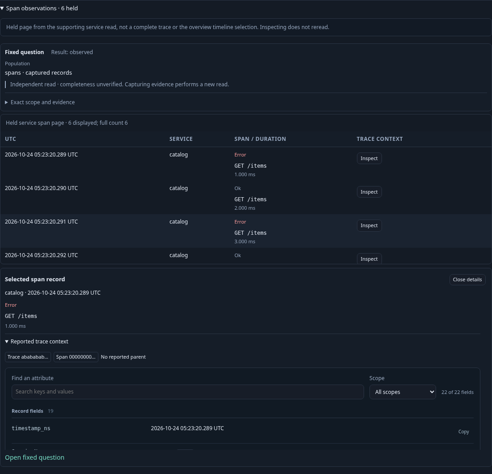
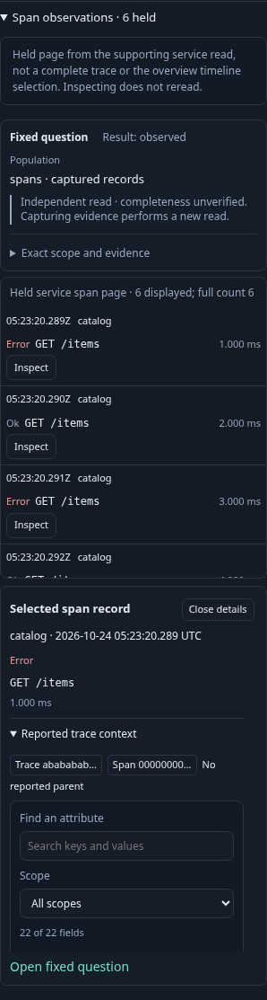

# Compact mobile record tables

Activity, fixed-query, saved-capture, explicit context and service observation tables use the passive
`goo-table[record-layout="compact"]` layout. At widths through 700 px, UTC and
service share the first line, the log/span summary follows, and existing action
buttons share a wrapped row. Short ordinary records fit within 112 px in the
measured 320/390/700 px viewports. Longer service names, bodies and chosen fields
may take more space; rows do not claim a fixed maximum height for arbitrary data.

UTC remains readable with its exact timestamp and original nanoseconds available
in the focusable time element’s tooltip. No time is rounded in the record model.
Actions retain their text, keyboard behavior and minimum 28 px targets, with gaps
between targets. Selection still refers to the exact observed occurrence.

Chosen extra fields retain qualified labels, missing/empty distinctions and their
existing filter disclosure. Hidden columns stay hidden. Mobile groups the core
UTC/service/summary roles; desktop retains the configured table order. Field
columns retain their supplied order. Resize and layout changes do not read data,
clear selected occurrences, or change selectors/windows.

## Reuse and ownership

`GooRecordPresentation.table({compact:true})` emits the attribute for Activity.
Fixed/saved owners use `{mobileCompact:true}` independently of message clipping: full
UTC date text stays visible on desktop, the short mobile time is visually shown
while the full date remains accessible, and long messages retain expansion.
Exact `datetime`/tooltip values remain unchanged. Server-rendered
HTML can use the same attribute with cells marked `data-record-core` or
`data-record-field`; no SPA framework or new custom element is required. The
component reference includes an explicitly synthetic SSR example.

The responsive styles live in `record-presentation.css`. Older application tail
rules now apply only to tables without this opt-in, preventing stylesheet-order
collisions. Product CSS continues to own viewport height and surrounding layout.
Expanded inspector rows use their existing spanning cell as a full-width block.
Trace/inspect buttons have short visible labels while keeping exact accessible
identity and tooltip text. The same action labels are retained in inspector follow-up
buttons. Captions occupy the full width, and non-preview messages expand without
inheriting the tail preview height.

No fetch, listener, subscription, navigation or persistence is added to the display
primitive. Existing Activity, fixed, saved and service owners still own actions and clocks.

## Executable storyboards

Journey [160](../journeys/mobile-activity.spec.js) ingests twelve ordinary traced
OTLP logs, independently counts them in ClickHouse, and opens a saved rolling view.
It explicitly starts and pauses the stream, then measures responsive behavior at
320, 390, 700, 701 and 1024 px. UTC/service alignment, row/action size and absence
of document overflow are checked separately from the source counts.

Keyboard selection and inspection retain exact timestamps, occurrence identity and
focus through fixed-question staging and paused return. Choosing a field, hiding
Service and staging/removing a filter do not add source requests. Explicit Resume
starts a new read with a disclosed gap. Observed Quint replay retains all five
entry-model rejection controls. A 25-second Bombadil campaign runs at an actual
390×844 viewport, starts once, pauses, selects and inspects while checking compact
geometry, bounds and no additional reads.

Journey [161](../journeys/compact-record-components.spec.js) is a separate synthetic
passive contract: SSR and detached/reinserted SPA records, long values, exact time,
column-header accessibility, keyboard actions and no API requests. It checks the
same five viewport widths with application styles loaded after component styles,
and retains the legacy tail layout for tables without the opt-in.

Actual outcomes and remaining limits are recorded in [VALIDATION](../VALIDATION.md).

## Fixed/saved adoption storyboard (162)

The [log and span journeys](../journeys/compact-fixed-records.spec.js) each ingest
four ordinary records of both signals and independently count them in ClickHouse.
A fixed link stages before explicit Run. Both fixed and saved results are checked
at 320/390/700/701/1024 px, including context-action geometry, full-width captions,
responsive times and absence of document overflow.

Saved reopen, long-message expansion, checkbox selection, inspection, field changes
and hiding Service remain source-free. The original receipt and captured
result are checked for exact equality after those interactions. The selected record’s
inspector retains its original question, exact event time and evidence basis.
Explicit Expand trace adds the existing span and linked-log reads in the original
fixed bounds; the linked-log table uses the same compact presentation. Close
restores opener focus. A 390×844 Bombadil campaign for each signal explores
selection, spanning inspection, close and column changes with zero source reads.

The synthetic 161 contract also exercises a population-styled fixed table with a
spanning detail row and preserved long-message disclosure while application styles
load last. Existing saved-owner journey 107 retains its observed Quint read/history
protocol and four rejecting controls, including stale context cancellation.

## Service observation adoption (46)

Service detail’s held span page uses `{mobileCompact:true}` and the same Inspect
action wording. It retains its supporting query, count, provenance and cached
inspector; no service query or layout component was added.

[Journey 46](../journeys/service-browser.spec.js) checks 320/390/700/701/1024 px,
keyboard inspection, readable exact UTC times, the original fixed-question link,
source-free return, cached detail and opener focus. Source request counts stay
unchanged during inspection and resizing. The existing service scope/convention
Hegel properties and observed Quint protocol remain in use. Its 390×844 Bombadil
workflow now checks compact service rows while discovering, inspecting, following
an observed-convention question and returning.

