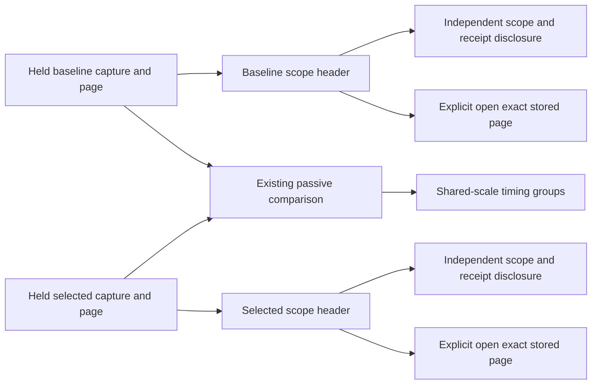

# Compact retained-page comparison

**Delivered with matched native/model/actor acceptance.** This consolidation
keeps the existing two immutable operands and comparison arithmetic. It changes
how the retained comparison presents their evidence before the timing bars.

Baseline and Selected each show their capture identity, environment policy, fixed
UTC window, supplied page rows/offset and partial/unknown/read-disagreement state.
They sit beside each other on desktop and stack on narrow screens. A shared scale
compares elapsed positions relative to each page's earliest timed supplied span.
These are observed page records, not matched invocations or complete traces.

Each side's closed **Scope and receipt** disclosure retains observation state,
exact fixed window, source-read and stored-custody clocks, supplied page size,
matching captured records and retained inspection records. Full question/receipt
metadata stays in a second closed disclosure. Counts keep their original grain;
page size never substitutes for the matching total. Exact bounds and clocks are
keyboard-focusable with their original values available as tooltips.

The existing passive `goo-trace-comparison` puts its short scale/partial notice
before timing groups and detailed interpretation afterward. The application
adapter keeps stored-page semantics separate. Display disclosures do not read
telemetry, publish metadata, change a question or replace an operand.

Exact side-opening locations, opaque page cursors, retained return, stale-action
refusal and independent custody remain owned by the existing saved-page adapter.
No new API, data format, timing kernel or lifecycle model is required. The
executable journey reuses the actual retained-comparison model and actor, adding
matched fresh-entry geometry, keyboard-disclosure and zero-extra-read checks.

Matched browser replay copies the same immutable capture files into a private
runtime. Catalog verification includes local file size/mtime, so copied catalogs
must be rebuilt with `goo rebuild-capture-catalog -dir <capture-directory>`.
That command verifies stored content and rebuilds metadata; the journey rechecks
that capture JSON bytes, IDs and original read/custody receipts remain unchanged.
Filesystem copy timestamps never replace those evidence clocks.

## Measured result

The first positive timing bar moves from 1254.328 to 464.234 px at 1280×1000,
and from 2023.094 to 759.078 px at 390×844. It is fully visible in both fresh
Compare entries, with no horizontal overflow. Scope/receipt disclosures retain
all seven human-readable facts and exact metadata, with zero additional API calls.
Later groups remain scrollable. See [the matched storyboard](journeys/366-paired-headers.md)
and [executed validation](../VALIDATION.md).
