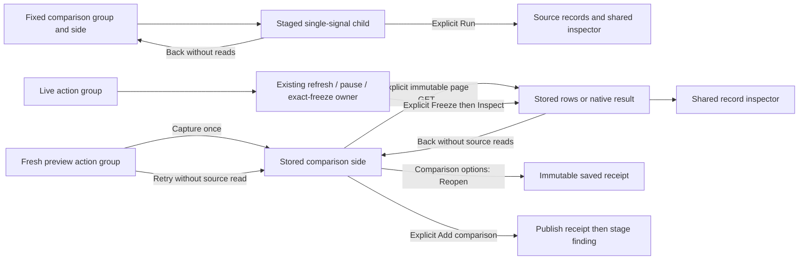
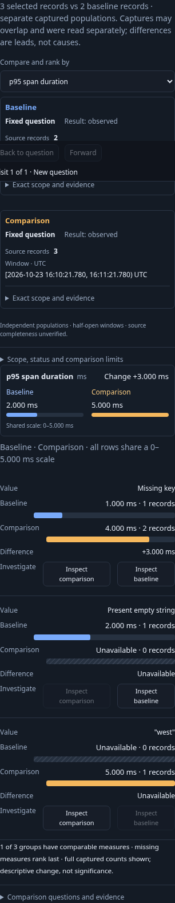
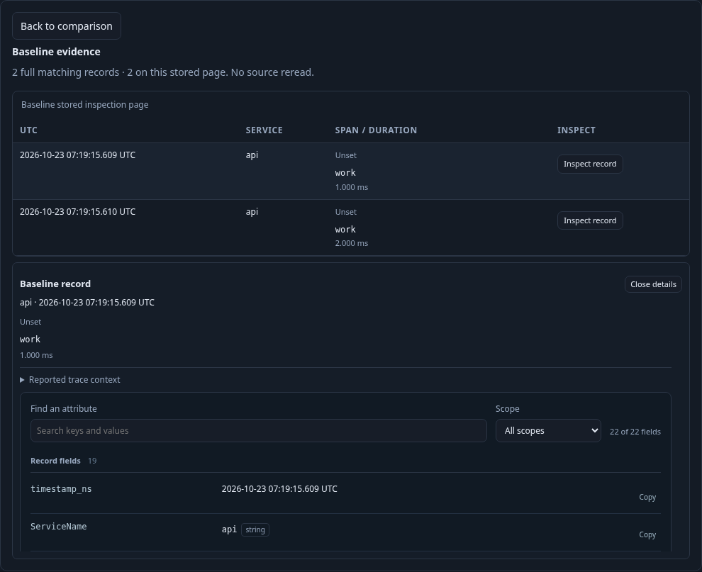

# Comparison actions and retained inspection

Fixed population comparisons keep Pin/Capture and Previous window together in the
existing action group. **Baseline options** holds replacement and clear commands;
its menu is absent before a baseline exists. This reuses `GooUI.actions` and retains
the same actual button nodes, validation and execution owners. Legacy fixed-question
comparisons retain their original filter-and-run row action as a compatibility path.

Population comparison rows now offer **Inspect comparison** and **Inspect baseline**.
Each opens one staged, single-signal child using that side's exact question/window,
intersected with the selected categorical group. Missing and present-empty values
stay distinct. A side with zero records cannot be inspected from that row. Run is
explicit; Back restores the paused comparison, ranking, baseline, companion selectors
and original action focus without telemetry reads. Child records use the existing
shared record table and inspector. The existing depth and predicate budgets apply;
no baseline window is silently applied to an independent companion signal.

Fresh-window previews also reuse the shared action group: Capture before publication,
Compare retained capture afterward, and Close under Preview options. Opening focuses
the baseline selector; closing restores the opener. Preview/retry/menu changes do
not read telemetry. The separate live execution group remains explicit.

Stored, fresh and saved comparisons put both side-inspection buttons in one
labelled **Stored comparison actions** group. Saved receipts keep **Reopen saved
comparison** under **Comparison options**, available after receipt-read failure
and disabled while reopening. Retry returns focus to the options summary. Manual
pairs keep their explicit Compare captures control; fresh previews retain their
existing outer retry. Fixed-pair selectors stay hidden. Finding entry and explicit
Add comparison publication remain together in a separate shared action group;
receipt-side Open/Add question commands also use that primitive.

Stored, fresh and saved comparisons offer the same two-side inspection entrance.
It explicitly reads the selected immutable capture's first stored page and renders
its supplied rows with the common record presenter/inspector. Full aggregate counts
remain separate from this page. Native captures use the existing saved native result
presenter. Back hides inspection and restores the side action's focus; it does not
navigate or reread telemetry. A new side, new comparison, Back, disposal or failed
request cannot publish an obsolete stored response. The previous duplicate native
“inspect both results” disclosure is removed. Original full-capture links remain in
the receipt disclosure for paging and exact receipt navigation; they are an explicit
navigation compatibility path, not a retained inline return workflow.

Live comparisons use the same action-group primitive, with Start/Pause occupying
one command position and Freeze retained beside it. Rescale appears only when a
fixed domain is exceeded. Start/Pause transfer keyboard focus to their counterpart.
After a successful Freeze, the same command group offers inspection of the baseline
and the exact frozen comparison. That reads immutable pages; it cannot silently
read newer telemetry. Start clears those frozen inspection controls and restores
Freeze for the next displayed read. Source polling, stale/unknown state, fixed
domains and exact displayed freeze keep their existing protocols. These action groups do not merge the three owners.

Journey 127 uses manifest-free OTLP spans over distinct fixed windows and an
independent companion. It inspects current missing values and a baseline-only empty
value, checks explicit reads and source-free return, preserves p95 ranking and
focus, then inspects stored rows and rejects a response completed after Back. An
observed Quint drilldown replay has six rejecting controls. Bombadil stages and
returns from a comparison child while checking that no hidden source read occurs.

The [D1 acceptance audit](D1_ACCEPTANCE.md) reconciles these adopted action groups
with the retained execution owners and documented compatibility paths.
