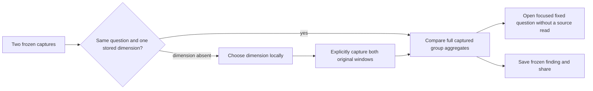
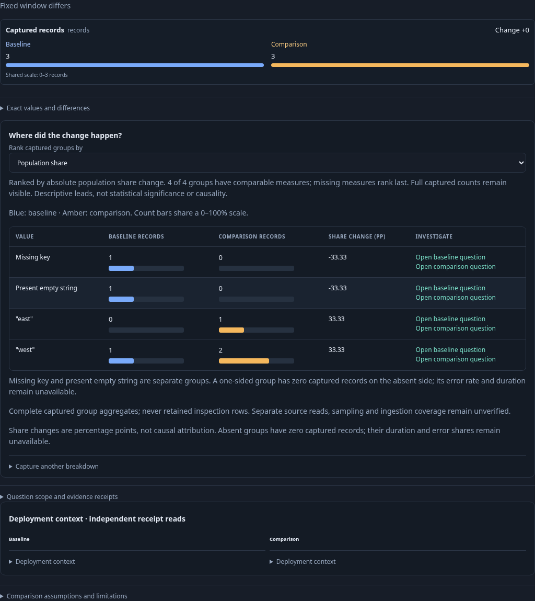
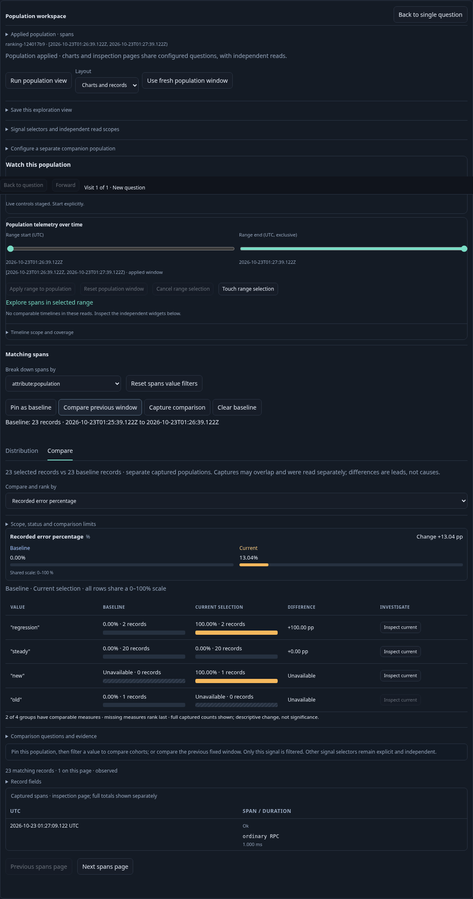
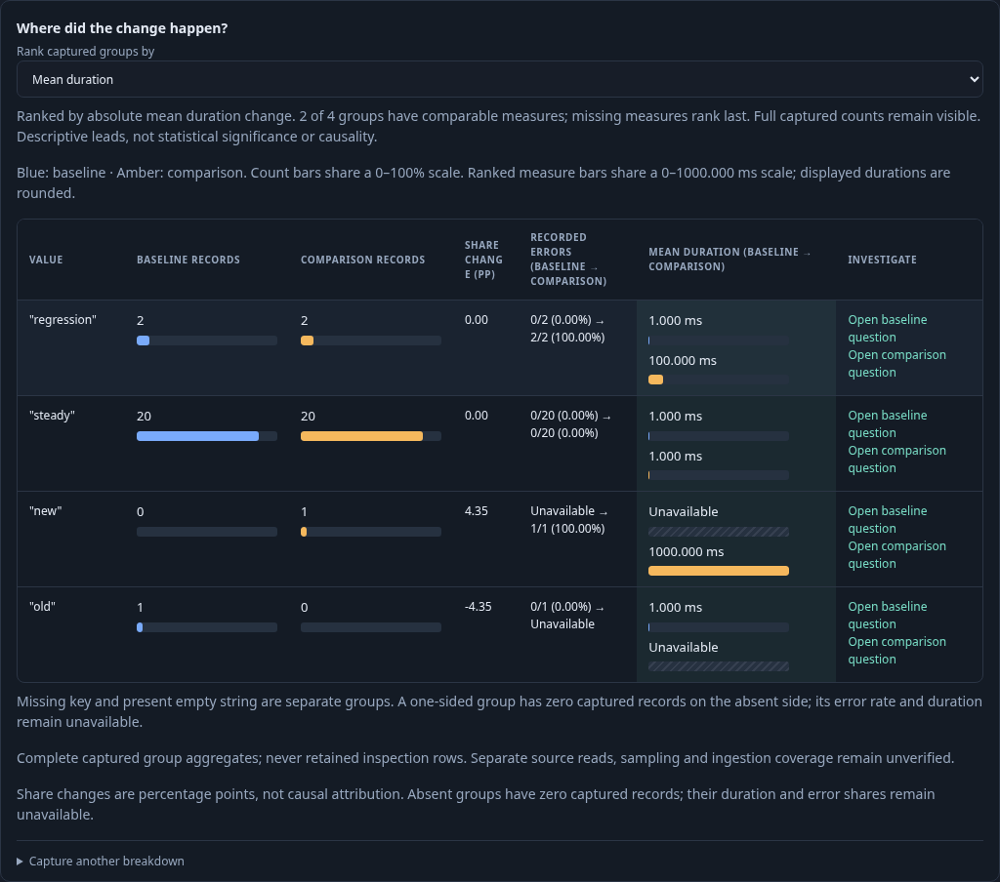

# Locate a change in captured populations

Implemented for span and log evidence with one matching captured grouping field.
The stored-evidence comparator reuses the complete group/count/duration/status
aggregates from each capture. It never reconstructs groups from retained rows.
The same group comparator powers live exploration and immutable evidence.

A comparison shows overall results first, then **Where did the change happen?**
with a union of values, both counts, population-share change in percentage points,
recorded error fractions and mean durations for spans where captured. Log
comparisons show count/share columns and focused-question links, without span-only
error/latency columns. Span measures missing from a capture remain explicitly
unavailable; log severity is not interpreted as span status. Default ranking is by absolute share change. The local ranking selector also
offers count change and, for spans, recorded error rate and mean/p95/p99 duration
change. Missing attributes and present empty strings remain distinct.
A one-sided group has zero captured records on the absent side, with unavailable
latency/error share. Missing telemetry is not health or a causal explanation.
Detailed question scope and receipt metadata are under a disclosure.

**Open baseline question** and **Open comparison question** preserve that side's
fixed window and original predicate, AND the selected group predicate. They open
an authored question without querying telemetry. Existing predicate budgets still
apply. Save that question or run it explicitly through the ordinary workflow.

If a dimension was not captured, **Capture a breakdown** offers standard service,
HTTP route, deployment version and region dimensions plus keys discovered in the
stored metadata. Choosing a key performs no telemetry read. **Capture both
windows** reads the two original fixed windows with the selected grouping and
creates two new immutable captures; originals and existing document cards remain
unchanged. Span recaptures request duration/status aggregates. Partial capture
failures retain completed IDs visibly; retry starts a new pair. Once both exist,
**Compare retained breakdown** retries without another source read.

Limits: at most 1000 groups per source capture; overflow is rejected, never silently
truncated. Two-field and numeric attribute comparisons do not produce single-field
breakdowns. Frozen comparison publication retains the existing 128 KiB receipt
budget; an oversized result must be narrowed, and its capture IDs remain usable.
Empty/inconsistent captures withhold numeric comparisons. New receipts
use comparison algorithm v3; v1/v2 receipts reopen unchanged. Frozen shared
comparisons render stored breakdowns source-free and offer focused questions;
they do not expose recapture controls. Read clocks remain independent; source
coverage, sampling and late-arrival effects remain unknown.

Story [58](journeys/README.md) uses real OTLP HTTP spans with 1200/1300 matching
records, exceeding the 1000 retained inspection-row limit. Review rationale is in
[comparison review](COMPARISON_PRODUCT_REVIEW.md); broader service/default dashboard
priorities are in the [whole-product review](WHOLE_PRODUCT_REVIEW.md).

## Signal-appropriate comparison presentation

Both live comparison controls and stored breakdown tables use the same pure
`GooComparisonBreakdown.recordMeasures` signal-capability adapter. Log comparisons
use population share; their redundant one-choice measure selector is hidden.
Span selectors retain their supported measures and disable ones lacking captured
data. Presentation does not alter either fixed question, count, grouping, receipt
or comparison ranking. Log breakdowns retain local horizontal scrolling on mobile.

Journey 119 ingests ordinary OTLP logs in two windows, compares full counts despite
a one-row exploration page, checks missing/empty group identity and opens stored
comparisons without telemetry execution. Bombadil exercises stored comparison and
local horizontal scrolling; the existing span journey 58 retains its observed
Quint recapture/share protocol and rejecting controls.

## Rank descriptive changes

Live comparison and stored breakdowns share exact rational ranking over complete
captured aggregates. Error rate/mean differences use their own denominators;
percentile changes use each population's captured quantile. Counts retain their
integer precision. No percentile averaging or float conversion defines ordering.
Descending absolute change includes both increases and decreases. Missing/zero-
support measures rank last; stable namespace-preserving value identity breaks ties.
Missing-key and present-empty groups remain distinct. One-sided count/share change
is valid; one-sided error/latency change is unavailable.

Count and sample support remain visible beside measures. Stored rank selection
highlights paired bars for the selected measure using one domain across all rows
and both sides; count ranking uses a common count domain. Missing bars are marked
unavailable. Duration labels are rounded for display; ranking uses exact values.
A coverage note reports comparable groups, without calling change significant or
causal. These are descriptive leads, with no minimum-support/significance filter.

Changing rank never reads telemetry or alters the two questions, full totals or
receipts. Saved population views retain the live `comparisonMetric` and baseline
configuration, including `count`; reopening stages before an explicit Run.
Stored-evidence rank choices are local presentation and reset on reopening the
receipt; they do not rewrite immutable evidence or document cards.

Journey 120 documents a two-span regression with unchanged population share,
saved/reopened error/count rankings, one-row inspection pages versus full groups,
and source-free local stored ranking. Hegel checks ordering/purity and saved-view
state/swarm transitions; Bombadil exercises local rank choices without record reads.

