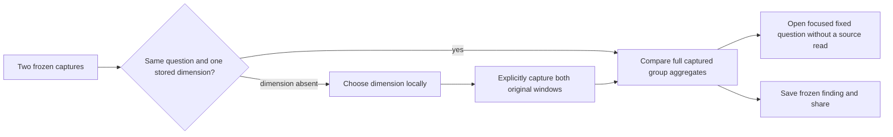

# Locate a change in captured populations

Implemented for span and log evidence with one matching captured grouping field.
The stored-evidence comparator reuses the complete group/count/duration/status
aggregates from each capture. It never reconstructs groups from retained rows.
The same group comparator powers live exploration and immutable evidence.

A comparison shows overall results first, then **Where did the change happen?**
with a union of values, both counts, population-share change in percentage points,
recorded error fractions and mean durations where captured. Ranking is by absolute
share change. Missing attributes and present empty strings remain distinct.
A one-sided group has zero captured records on the absent side, with unavailable
latency/error share. Missing telemetry is not health or a causal explanation.
Detailed question scope and receipt metadata are under a disclosure.

**Open baseline question** and **Open comparison question** preserve that side's
fixed window and original predicate, AND the selected group predicate. They open
an authored question without querying telemetry. Existing predicate budgets still
apply. Save that question or run it explicitly through the ordinary workflow.

If a dimension was not captured, **Capture a breakdown** offers standard service,
HTTP route, deployment version and region dimensions plus keys discovered in the
stored metadata. Choosing a key performs no telemetry read. **Capture both
windows** reads the two original fixed windows with the selected grouping and
creates two new immutable captures; originals and existing document cards remain
unchanged. Span recaptures request duration/status aggregates. Partial capture
failures retain completed IDs visibly; retry starts a new pair. Once both exist,
**Compare retained breakdown** retries without another source read.

Limits: at most 1000 groups per source capture; overflow is rejected, never silently
truncated. Two-field and numeric attribute comparisons do not produce single-field
breakdowns. Frozen comparison publication retains the existing 128 KiB receipt
budget; an oversized result must be narrowed, and its capture IDs remain usable.
Empty/inconsistent captures withhold numeric comparisons. New receipts
use comparison algorithm v3; v1/v2 receipts reopen unchanged. Frozen shared
comparisons render stored breakdowns source-free and offer focused questions;
they do not expose recapture controls. Read clocks remain independent; source
coverage, sampling and late-arrival effects remain unknown.

Story [58](journeys/README.md) uses real OTLP HTTP spans with 1200/1300 matching
records, exceeding the 1000 retained inspection-row limit. Review rationale is in
[comparison review](COMPARISON_PRODUCT_REVIEW.md); broader service/default dashboard
priorities are in the [whole-product review](WHOLE_PRODUCT_REVIEW.md).
