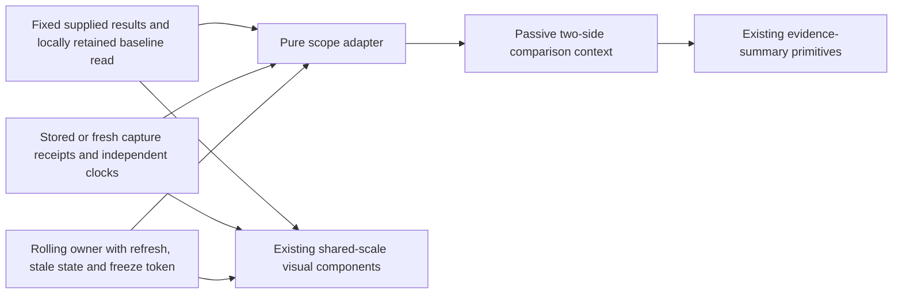
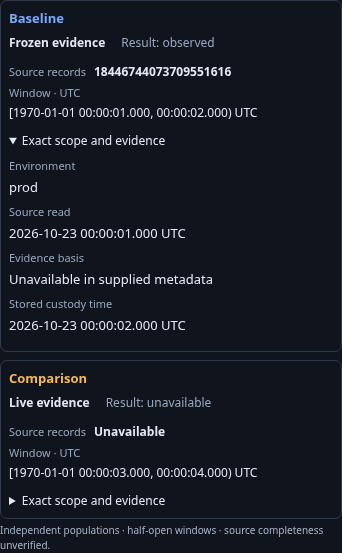

# Consistent comparison context

Fixed population comparisons, stored/fresh/saved capture comparisons, and rolling
record/native-counter comparisons now share a compact `goo-comparison-context`.
Baseline is blue; Comparison is amber. Each side shows its own mode, full source
record count, result state and half-open UTC window above the visual comparison.
Exact scope and evidence discloses source read, evidence basis and stored custody
when actually supplied. Nanosecond bounds remain exact in tooltip metadata.
Missing read/basis metadata is explicitly unavailable; a source read is never
substituted for custody time or an ingestion-completeness claim.

The component composes the existing passive evidence-summary primitive. Fixed
questions, frozen evidence and rolling reads still have different owners. Fixed
baselines keep their read time locally, outside the existing `/api/compare` snapshot
wire shape and saved view configuration. Rolling refreshes update a retained display
component so its provenance disclosure and keyboard focus survive. Failed reads
retain the previous result under the chart frame's stale state; the displayed window
and original source-read clock do not advance without a completed read.

Fixed comparison charts/tables now use Baseline/Comparison labels consistently.
The existing common domains, exact numeric tables, latency support and coverage
refusals remain authoritative. Incompatible questions still withhold numeric deltas;
zero counts and unavailable measures remain distinct. This cut does not introduce
new unit conversions, percentile aggregation, geometry or comparison algorithms.

Fresh comparison and breakdown recapture already own an explicit pair of retained
IDs. Their automatic result presenter now omits redundant capture selectors and
Compare controls; the parent owns preview/capture/retry. Editable stored comparisons
retain their selectors; saved receipts keep their explicit reopen control. Capture,
freeze, baseline replacement and linking remain application actions, not component
lifecycle effects. [Contextual actions and retained side inspection](COMPARISON_ACTIONS.md) now reuse
the shared action group and record inspector. [Retained activity series](COMPARISON_SERIES.md) now share count geometry across fixed and explicitly loaded stored/frozen captures. Rolling bucket transport and pinned selection are now delivered through the same retained chart owner; the bounded cross-surface action adoption is complete. The [D1 acceptance audit](D1_ACCEPTANCE.md) records its supported scope and compatibility boundaries.

Journey 126 checks server HTML and pre-definition/detached SPA properties, exact
large counts and nanosecond bounds, distinct clocks, focus/disclosure preservation,
known-to-unavailable updates and 390 px layout without any API request. Real-source
journeys 120, 52, 57, 53 and 69 cover fixed ranking, stored record/native evidence,
fresh capture, saved receipts and rolling refresh/stale/freeze; native counter
coverage remains in its existing journey. Existing Quint ledgers retain their
rejecting controls. Bombadil stored/live actions inspect the supplied context and
check modes and common scale invariants.

