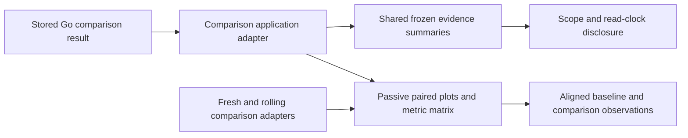

# Comparison presentation

Paired scalar observations now put baseline and comparison beside each other,
with equal-width tracks and the same zero-based scale. Values and signed changes
remain explicit; color supplements the side labels. Count, duration and error
share retain their own units and domains. Compact padding and table rows reduce
repeated chrome. The same passive pair renderer serves stored, fresh and rolling
comparison adapters; their read and persistence lifecycles remain separate.

Captured span latency retains its aligned Mean/P95/P99 matrix and one duration
scale. Percentiles are not averaged. Native histogram comparison retains common
bin/percentage scales and its separate exact-count heatmap. Different native
layouts still withhold bucket differences. An unavailable endpoint or incompatible
question never gains a zero or a numeric delta from layout changes.

Stored comparison metadata uses the shared evidence summary inside the existing
Question scope and evidence receipts disclosure. Both sides show frozen mode,
source-record count and UTC window; record predicates, native binding mode, source-read clocks,
stored custody and capture IDs stay labelled in detail. The adapter uses explicit
`EvidenceSide.readAt`, never storage as a fallback. The comparison-side transport
has no evidence basis, so the presenter does not fabricate one or fetch extra
results. Full exact stream attributes remain in the existing native viewers. Opening the stored capture remains an explicit adapter action.

Gauge endpoint and native-window timestamps use readable UTC and exact-value
nanosecond tooltips. Fresh native previews likewise retain exact bounds in their
tooltip. These are display projections; immutable questions are not rounded.

Journeys35/52/53/54/57 and the standalone component reference exercise the shared
presentation across record, gauge and complete native-window cases. Journey52
checks aligned track widths/positions, separately labelled source/custody clocks,
local inspection without source reads, immutable receipts and refusal after
selector drift. Existing observed Quint replay and rejecting controls remain the
semantic oracle. Bombadil additionally inspects comparison evidence disclosures
and checks frozen mode, separate clock fields and scale agreement. Screenshots
are captured from the actual OTLP-fed app.

[Stored latency and errors](journeys/screenshots/52a-stored-latency-error-comparison.png) ·
[Counter window rates](journeys/screenshots/54a-complete-counter-window-rates.png) ·
[Native histogram comparison](journeys/screenshots/54b-whole-window-histogram-buckets.png) ·
[Mobile frozen comparison](journeys/screenshots/53c-mobile-frozen-comparison.png)
