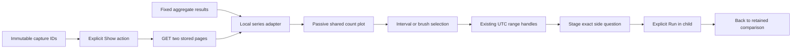
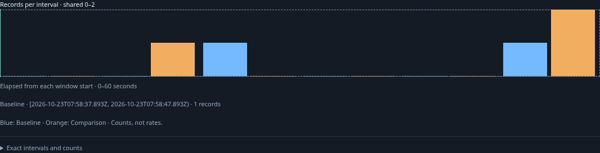
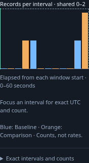
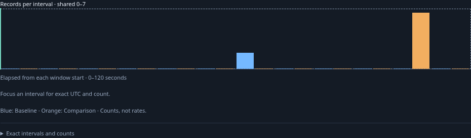

# Retained record activity comparisons

`goo-comparison-series` is a passive web component for two supplied sets of exact
record-count intervals. Fixed population comparisons retain their aggregate series
locally, outside the strict comparison request. Stored, fresh and saved capture
comparisons offer **Show captured activity comparison** when both record questions
requested buckets. Frozen rolling comparisons offer the same explicit continuation.
That continuation reads only the two immutable capture pages. Bucketed rolling record questions also supply these arrays during their existing refresh, before Freeze. Missing retained series produce an
explanation rather than a new telemetry query.

Both populations use one count domain. **Elapsed from each start** aligns their
starts without stretching shorter windows; **Absolute UTC** positions both on the
same UTC axis. Intervals keep their actual widths, including a shortened final
bucket. No interpolation, summing, normalization or rate conversion occurs. Unequal
bucket durations can have different raw counts: these are counts, not rates.

Hover or focus a native interval button for exact UTC half-open bounds and counts.
The expandable exact table is the nonvisual fallback. Observed zero, no captured
data, unknown intervals and absent intervals remain different. Unknown values are
striped and excluded from the count maximum; gaps have dashed boundaries. Counts
remain decimal strings through scaling with BigInt. A changed-between-reads result
renders its supplied intervals as unknown; completeness is never inferred.

Click an interval or drag from one to select a range for that population. Escape
cancels a drag. Touch scrolling remains native; touch and keyboard users can select
an interval and adjust the existing UTC range handles. Alignment changes, hovering,
selection and range adjustment do not read or publish evidence. **Stage selected
interval** opens a single-signal child in population comparisons, retaining the
source predicate and chosen side's bounds. Run makes the explicit source read;
Back restores the comparison, alignment, selection and focus. Stored charts stage
a reusable question link through the existing investigation trail, with Run still
required. They do not replace captured evidence with a fresh read.

## Executable storyboard

[Journey 128](../journeys/comparison-series.spec.js) reports ordinary OTLP spans in
adjacent UTC windows, with a one-row display limit and full aggregate counts. It
changes alignment, selects a baseline interval with the keyboard, stages and runs
one child, returns without rereading its parent, then loads the same retained
series from captures and stages a question from the comparison side. It also checks
mobile layout and brush selection. Actual frames:

[Journey 69](../journeys/live-comparison.spec.js) also loads the frozen rolling comparison and verifies its series sums to seven retained records after the source has advanced to eight. Journey 53 loads the chart from a saved comparison without source reads.

The passive component journey covers server attributes, pre-definition properties,
large exact integers, absent intervals, unknown values, pointer cancellation and
keyboard inspection without API requests. Hegel exercises actual JavaScript count
geometry and side-bounded brushes. The observed child/read/return trace reuses
`population_drilldown.qnt` through quint-go with five rejecting mutations. The
bounded Bombadil actor changes alignments, stages a selected interval and returns
while requiring a constant source-read count.

## Boundaries

[Rolling record comparisons](LIVE_COMPARISON.md#retained-bucket-series-during-refresh) now reuse this chart before Freeze when the stored question requests time buckets. Their existing read supplies the retained arrays; selection remains pinned to its original UTC question across refreshes. Native metrics retain their existing exact-stream/unit/temporality charts;
this component does not convert native endpoints into record counts. Older saved
population-comparison envelopes contain only cohort aggregates, so this cut cannot
reconstruct missing series. Stored chart loading is explicit and retains the
existing capture-page size and provenance constraints. The live response now optionally supplies `recordSeries`; stored capture formats are unchanged.
