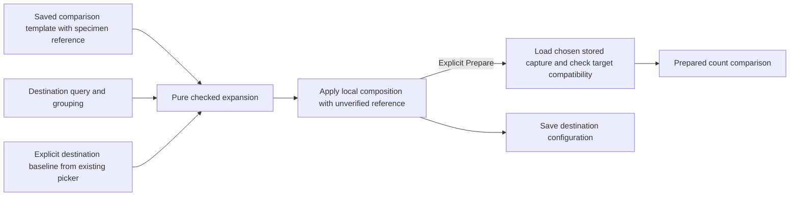

# Reuse a comparison with a chosen baseline

> Implemented in milestone 300. Executed checks are recorded in
> [VALIDATION.md](../VALIDATION.md#comparison-templates-with-an-explicit-baseline--300).

A reusable count-comparison view retains its aggregate, records and comparison
presentation. A fixed timeline may also remain when its existing interval rules
are satisfied. In Preserve, enable Reusable template and Save. The source capture
is a validation specimen, never a baseline default for another scope.

The template declares its required input explicitly:

```json
{"template":{"version":"goo.template/1","group":"destination",
             "profile":"ordinary","baseline":"destination"}}
```

The `baseline` binding is required exactly when the composition has a comparison,
including a hidden comparison. Other templates omit it. The comparison remains
count-only under its existing eligibility rules; requesting span durations does
not turn the comparison into a latency comparison.

## Choose in the destination

Use the current population's existing baseline picker or exact ID input. Set the
baseline explicitly, then inspect the saved template. If no baseline is configured,
preview directs you to those same controls; it does not create a second catalog.
The template uses the destination's existing single grouping, filters, environment
policy and time window. The category may differ from the specimen grouping.

Preview identifies the chosen reference as **unverified**. Apply changes the
composition locally without reading telemetry or stored capture content. The
existing explicit Prepare action loads the selected capture and checks it against
the destination root. Only compatible prepared evidence can produce a comparison.
A syntactically valid ID is not proof that the capture exists or matches. Run
retains its existing behavior: it reads the destination and can prepare its
configured comparison; Apply never starts that work.

A mismatched service, grouping, filter, environment, interval width or requested
measure is refused by the existing baseline compatibility rules. Fixed windows
and delivery pages may differ. Unequal windows remain raw count comparisons with
visible durations; no rate normalization is implied.

Changing the chosen reference retires old preview and prepared results. A fresh
inspection must use the new reference; late responses and reattached controls
cannot apply the old one. Pending selections, drafts and reads retain the current
application guards. Save/reopen pins the resulting destination reference, while
stored evidence and source acquisition remain explicit operations.

## Configuration-only expansion

The existing typed expansion endpoint accepts:

```text
POST /api/view-templates/expand
{ "source": <authored view>, "query": <destination query>,
  "baselineCapture": <explicit destination capture ID> }
```

`baselineCapture` is required exactly for comparison templates and is forbidden
for ordinary templates or the shipped `{template, version, widget}` arm. Null,
empty, malformed or mixed-arm input is refused. There is no source or latest-ID
fallback, even if the explicitly selected ID happens to equal the specimen ID.

Expansion validates the source/content ID and target declarations, clones the
composition and changes exactly its baseline reference. It preserves every other
presentation property and the destination query. It loads no catalog, capture or
telemetry, publishes nothing, and transfers no completeness witness. The browser
response validator permits this one substitution and still checks all other
presentation exactly.



See [captured-count comparisons](CAPTURED_COUNT_COMPARISON.md),
[authorable templates](AUTHORABLE_VIEW_TEMPLATES.md),
[architecture review](reviews/COMPARISON_TEMPLATE_ARCHITECTURE_300.md) and
[design review](reviews/COMPARISON_TEMPLATE_DESIGN_300.md).
