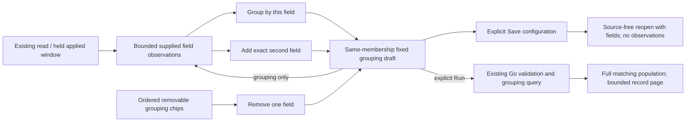
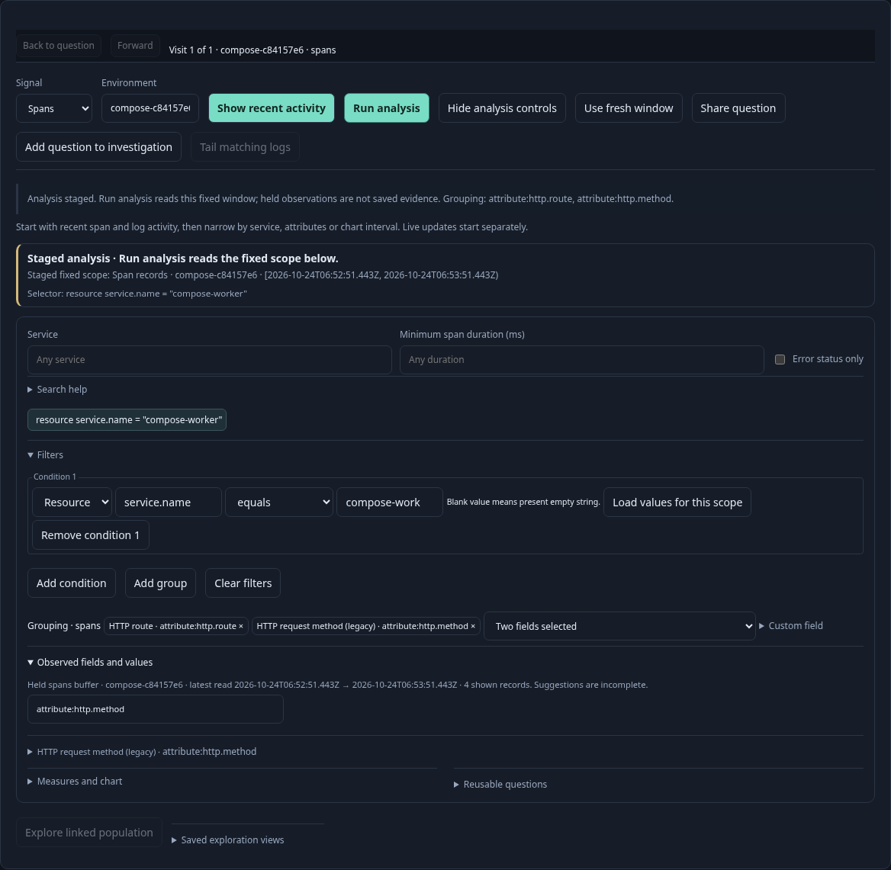
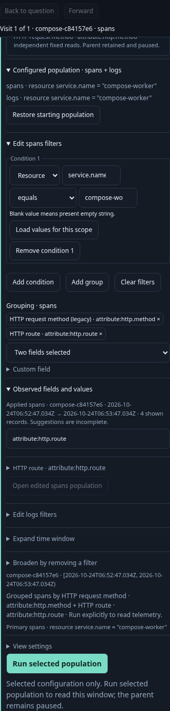

# Compose a two-field breakdown

Observed fields now offer **Add to grouping** alongside **Group by this field**.
The first action appends a second exact field; the second replaces the grouping
with one field. Grouping chips show the current fields in order, including their
qualified keys and legacy labels. Remove either chip to stage its removal.

Add is disabled for a field already selected and once two fields are selected.
The control explains why in its tooltip. Attribute and resource keys with the
same spelling are different fields. Removing and re-adding changes field order;
no alias substitution or value coercion occurs. Removing both fields clears the
breakdown. All grouping changes reset record paging and clear split grouped
timelines, while preserving the bucket width, selectors and fixed bounds.

The actions use the existing [observed-field grouping owners](OBSERVED_GROUPING.md):

- **Activity:** Group freezes the last completed applied window and opens fixed
  analysis. That explicit grouping handoff reveals its editing controls so a
  second field can be selected before **Run analysis**. The Activity entry itself
  gains no default controls or grouping subscription.
- **Single fixed question:** Add/remove/replacement stages the current draft.
  **Run question** (or **Run analysis**) executes the composed query.
- **Population view:** Changing an applied grouping opens a child. Subsequent
  changes to that unread child update the same draft instead of nesting another
  child per click. Its parent stays paused, and companion signal questions retain
  their own grouping and selectors. **Run selected population** performs the read.

A grouping edit does not change population membership. Owners can therefore keep
bounded field/value suggestions from the original read for that same selector
and fixed window while the grouping draft changes. Their labels still identify
that original observation source. They do not become fresh counts or aggregates.
Filter/environment/window changes withdraw or reject scoped suggestions;
explicit reads withdraw the held suggestions and replace them only on success.
Saved configuration reopen also starts without observations, even if its query
matches a previous draft. Run explicitly to discover fields again.

Population drafts preserve the selected editor/disclosure and local search while
composing. Saved configurations already support two grouping fields: Save stores
the query configuration, not the held suggestions, transient editing state or
parent rows. Opening the saved configuration stages both fields without reading
telemetry. Existing full-source group limits and missing/empty semantics apply.

`GooFilterEditor.mount` accepts supplied `grouping` fields, emits
`onGroup(field, opener, mode)` (`replace`, `add`, `remove`), and supports
`setGrouping(fields)` and detached `suggestions()` snapshots. It never changes
its predicate tree or reads telemetry when grouping. Owners implement query
transforms via `GooPopulationWorkspace.composeGrouping` / `groupQueries`; the
latter changes only the selected signal and clones companions. Guarded actions
still respect invalid drafts, pending selections, active owners and nesting limits.
Go remains the query validator. No API, saved schema or native executable changes
are required for this cut.

## Executable storyboard 167

`journeys/composed-grouping.spec.js` ingests four real OTel spans and a companion
log. It composes/removes/re-adds fields before any analysis read, verifies duplicate
and third-field refusal, preserves legacy `http.method` despite a conflicting
current-key value, and exercises both field orders. A saved two-signal parent
opens one child; multiple unread edits keep one child. Saving/reopening preserves
the composed fields without reading or carrying the observation sample.
Seven explicit source requests execute the workflow. Independent ClickHouse
compound grouping verifies counts, including a missing route.

Hegel state/swarm testing covers repeated add/remove/replace sequences, namespace
identity, refusal and immutable scope/companions. Quint checks the real read trace
and query pairs with nine rejecting mutations, including changed order, alias
substitution, a third field and wrong counts. A mobile Bombadil campaign reads
once, adds a second field, removes it and re-adds without another source read.
A separate synthetic controlled-adapter contract checks exact intent, no filter
edits and no API calls.

Arbitrary grouping depth, numeric transforms and saved observation samples remain
outside this cut.

Follow-up delivered: [one grouping control](GROUPING_CONTROL.md) now consolidates picker and chips, retains exact custom-key entry, and replaces the legacy immediate population dropdown with staged intent.
