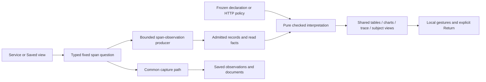

# Fold Operations and prepared HTTP into shared investigations

Status: implementation design, 2026-11-17. The user accepted **fold/unify, then
remove** for both parallel subsystems. No replacement below is implemented yet.
See [accepted decisions](reviews/understandability/implementation-plan.md#accepted-product-decisions).

## Operator flow

Services discovers ordinary telemetry without requiring a manifest. If an explicit
declaration matches a service, its service view offers **Inspect conformance**.
The operator chooses an exact instance/binding and fixed window, then Runs.
The result combines the shared record/trace views with a declaration-versus-observed
table. Subject events are another local view over the same admitted observation.
No separate Operations workspace is required.

Prepared HTTP summaries become shared policy-backed views, opened from a service
or Saved. Their policy is explicit: a custom failure-status range is not silently
replaced by a default RED error definition. Contextual Edit/Build and Saved own
reusable declarations; Definitions → App contracts is retired after parity.

Save definition stores the question/view. Capture explicitly reads and stores
observations through the common capture path. An investigation document can link
independently captured spans, counters and histograms; it does not invent one
atomic multi-source observation. Recall works without the source or current
configured package. Local Find, view changes, subject following and Return do not
read or publish.

## Existing reuse and actual gaps

| Current code | Reuse / gap |
| --- | --- |
| [`PlanServiceDashboard`](../exploration/dashboard.go) declaration widgets | Already generates declaration-matching ordinary span questions. These explicitly do **not** evaluate conformance. Their name/role filter cannot be the input to the replacement conformance evaluator. |
| [`exploration` row projection](../exploration/compiler.go) | Already retains scope, resource, reported status, exact timing, span events and links. Reuse physical field mapping instead of introducing another wire-level OperationSpan format. |
| [`Manifest.ObserveRows`](../annotations/clickhouse.go), [`Observe`](../annotations/observe.go), [`SubjectEvents`](../annotations/subjects.go) | Preserve pure admission/evaluation rules behind an adapter from ordinary span rows. Separate these from the old Fetch/SQL entry; do not rewrite the rules from UI aggregates. |
| [`PrepareHTTP` / `EvaluateHTTPRows`](../prebuilt/clickhouse_http.go) | Preserve duplicate/conflict, identity, policy and missing-value semantics. Replace the prepared subject-fact execution detour with a checked projection over the shared bank; lifecycle/warehouse execution remains an extension. |
| [`CaptureStore`](../exploration/capture_store.go), [`documents`](../workbench/documents.go) | Extend the existing closed capture family, paging, catalog and receipt path. Documents already link observations; no new operation-bundle repository or generic plugin registry. |
| [`investigations.Store`](../investigations/store.go) | A separate operation-evidence envelope today. Export/import handling and replacement capture journeys must exist before its routes/store implementation retire. |

## One reusable producer, not five renamed endpoints

Introduce a **complete bounded span-observation** profile. It is useful beyond
Operations: any complete-input view needs an admitted bank rather than a displayed
page. Keep ordinary record-query limits unchanged.

The proposed shared read route is `POST /api/span-observations`, with a corresponding
closed `span-observations` capture family. These names are proposed API additions,
not current endpoints. Unlike `/operations` or `/http-package`, the producer knows
nothing about operation packages, HTTP failure policy, fleet ratios or business
subjects. It accepts a checked fixed span question and returns ordinary records
plus execution facts. It reuses the existing source transport, budgets and query
compiler projection, with a private bounded acquisition path.

| Carrier | Required meaning |
| --- | --- |
| Question | Explicit narrow source scope, namespace/instance/scope-version predicates where required, fixed half-open window, canonical identity. No arbitrary SQL. |
| Admission | At most **1,000 raw rows**, using a 1,001-row probe in one source SELECT. Existing byte/deadline/JSON bounds also apply. Over-limit, torn or failed reads cannot produce a complete-bank receipt. No client-supplied completeness flag. |
| Records | Preserve original raw occurrences, events, exact timestamp/duration strings and reported status. Do not collapse duplicates in the stored raw bank. Browser pages remain bounded; a page never defines totals. |
| Read facts | Executed question/basis, source read clock, raw row count and bounded-read completion. This means complete for that executed bounded selection, not unsampled telemetry, complete traces, active invocations or future late arrivals. |
| Interpretation | A frozen, validated declaration/policy revision and its exact binding accompany a shared view/capture. They do not grant source-read authority or turn declared schema compatibility into observed proof. |
| Capture | Server re-admits and executes the typed question. Reuse common immutable receipt, catalog, paging, parent/revision and uncertainty handling. Never trust browser-submitted record JSON as a capture. |

Normal public Query/RecordPage limits stay at their existing values. The producer
must not simulate a complete bank by concatenating changing paged reads. Reuse
admitted-bank/runtime witness mechanisms, but scope any new witness to this exact
profile and executed question. A normal limited page or copied JSON cannot satisfy
the complete-input gate. First implementation supports explicit Capture; Keep is
only offered if the existing server-held membership machinery admits this profile.

## Conformance and subject rules

1. Freeze the declaration revision and exact resource binding: service,
   environment, namespace semantics, instance, instrumentation scope/version and
   declared schema assumption. Missing versus empty namespace remains explicit.
2. Read **all spans in that binding/window**, not only listed operation names,
   valid roles or successful outcomes. Additional filters that conceal mismatches
   cannot masquerade as the same conformance population. Check the question
   against the declaration binding before granting the interpretation.
3. Reuse exact identity validation. Identical repeated exports count once in the
   invocation projection and are reported as duplicates; conflicting trace/span
   identities refuse conformance. Raw occurrences remain inspectable. Malformed
   role/kind, undeclared operation/role or unsupported outcome is not ignored.
4. Keep declared outcome separate from exporter `StatusCode`. Invocation counts
   include retries; they do not count business subjects. An unobserved declaration
   remains unknown, not healthy, failed or zero verified instrumentation.
5. Subject navigation matches the declared tuple **environment, service, subject
   namespace, tenant, ID** in validated span events. Retain event time, parent-span
   extent checks and malformed/unbound diagnostics. Equality is a declared
   relation, not parentage, causality, commit or deadline evaluation.
6. Follow subject locally within the admitted bank. Expanding a trace or source
   scope is a separate explicit action. Retain the original bank, Find, selection
   and return point; page/geometry budgets cannot change conformance totals.

Conformance and HTTP-policy projections are pure checked view adapters into the
shared data/table/chart model, not new source clients or base widget families.
Use exact shared wire values; do not carry forward lossy JSON-number encoding of
nanosecond samples merely to match an old response format. A failed interpretation
can leave raw observations inspectable with a visible refusal; no partial
conformance totals or success claim may survive that failure.

## Metrics and HTTP parity

Native counters, error ratios, histograms and fleet comparisons use existing
measurement producers and shared views/captures. Preserve stream identity, units,
temporality, reset/gap handling, unknown operands and independent read clocks.
The old package reader is not removed until rejecting fixtures show that every
retained metric binding and fleet qualification has a shared equivalent. Close a
specific shared-profile gap if needed; do not keep a parallel counter executor.

HTTP parity includes exact resource/scope-version selection, server-span admission,
duplicate/conflicting identities, custom failure-status ranges, method/status
availability, and the current reserved/missing route rules. Do not substitute the
ordinary service dashboard's default error summary for that policy. Any deliberate
change to those rules needs its own explicit semantic change and tests.

## Replacement journeys and retirement gates

| Journey / control | Acceptance before retirement |
| --- | --- |
| Service with and without declarations | Ordinary OTel works in both. Declaration absence is not an error or hidden automatic read. Explicit exact binding/window precedes conformance. |
| Declared versus observed | Same compatible/unobserved rows and outcome distinctions as old fixtures. Undeclared name, wrong role/kind/scope, bad identity and conflict are rejecting controls. |
| Population bounds | 1,000 raw rows admitted; 1,001 refused. Display 100 rows without changing the 1,000-row evaluation basis. Failed/truncated source cannot grant complete-input rendering. |
| Duplicate handling | Identical duplicates remain visible as raw occurrences but do not double-count invocations. Changed duplicate payload refuses interpretation. |
| Subject following | Same subject across traces joins only within the full tuple. Wrong tenant/namespace, undeclared event and invalid event extent never invent a relation. Return preserves reading state with zero SQL. |
| Reported trace context | Shared waterfall/trace/log views retain exact IDs and unknown coverage; event-time adjacency is not a parent edge. Display budgets remain explicit. |
| Native comparison | Missing instance, gap/reset, incompatible unit/window, changed package revision and uncertain operands remain visible/refused as appropriate. No atomic bundle claim. |
| HTTP policy | Non-default failure band and missing/empty/invalid status/method/route cases preserve their actual classification and denominator. |
| Save / Capture / recall | Save does not store rows. Capture may reread. Source failure before publication does not create a success receipt; uncertain publication stays uncertain. Frozen captures reopen with source/config unavailable. |
| Authoring | Create/share/reopen/edit an equivalent view through Saved/contextual actions before deleting the App contracts/Definitions route to it. |
| Accessibility and integration | Keyboard, narrow screens, forced colors and non-color state cues through the Services/Saved flow. Playwright storyboards plus Bombadil actions/invariants cover actual OTLP; Hegel/profile properties and Quint trace controls target authority and rejecting cases. |

## Stored artifacts and implementation order

1. Implement the bounded generic producer and common capture carrier, with
   over-limit, mutation, false-completeness and source-failure controls first.
2. Port conformance and local subject views into Services/shared view adapters.
   Reuse existing pure rules and differential fixtures; retain frozen declarations.
3. Port HTTP-policy views and native bindings. Prove the shared replacement
   journeys, including offline recall and independent-component clocks.
4. Inventory old operation captures. Provide an explicit offline bounded converter
   or lossless export; never reread source to pretend to migrate historical facts.
   Where an old component cannot be mapped losslessly, preserve its original
   bytes/identity and report that limitation. Link supported new captures through
   ordinary documents; do not fabricate missing clocks or native measurements.
5. Retire `/operations`, `/operation-packages`, `/counter-rates`, `/histograms`,
   `/http-package`, old operation `/investigations` routes, app wiring and parallel
   store after those gates. Keep SDK/annotations and shared pure semantics.
   No indefinite compatibility gateway, new bundle format or silent file deletion.

The artifact inventory/handling result must be concrete before deleting the old
store implementation. No user data deletion is authorized. This design does not
choose the lifecycle/XTDB extension packaging or change training-review storage;
those are separate accepted cuts with their own implementation boundaries.

