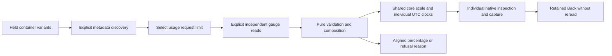

# Container CPU context

In development for milestone 207; live acceptance is pending. The pinned
[source research](CONTAINER_CPU_SOURCE_RESEARCH.md) defines the supported signals.
This extends the explicit [container memory workflow](CONTAINER_MEMORY.md) with
fractional CPU cores, independent observations and conditional percentages.

The Collector Contrib 0.137.0 kubeletstats receiver exports
`container.cpu.usage` as a gauge in `{cpu}`, averaged over the kubelet sample
window. Goo uses that reported gauge directly. The separately exported cumulative
`container.cpu.time` counter is not a substitute, and this view introduces no
counter derivative, reset handling or inferred sample interval.

The k8scluster receiver exports `k8s.container.cpu_request` and
`k8s.container.cpu_limit` as separate gauges in `{cpu}`. Fractional values are
expected. A missing entry has no sample; explicit zero remains zero. Neither
means unlimited capacity. Exported decimal precision is distinct from the
original Kubernetes Quantity or kubelet nanocore input before receiver conversion.

The interaction retains the original environment, fixed window and
qualified container identity. Choose exact already-held resource variants,
discover their metadata explicitly, then load up to three selected signals.
Loaded values lead the view; source setup remains available in a local disclosure.
Individual inspection, Run and capture use the existing native owners. Returning
to the held view does not reread telemetry. No combined CPU capture is introduced.

Source-domain policy accepts strict decimals of at most 128 characters and
exponents between -400 and 400, with nonnegative finite Float64-exportable
magnitude. Nonzero values that underflow to zero are invalid. Canonical decimal
output is bounded at 512 characters; exact percentage rationals at 1,024.
These are Goo admission limits, not Kubernetes capacity constraints. The
canonical decimal preserves reported source text numerically, including decimals
which round to the same Float64; it cannot restore pre-export precision.

A common zero-based core scale supports visual comparison. Each row retains its
own UTC observation time, quality, source read time and evidence basis. Unknown,
invalid and stale observations never become zero. Exact exported numeric values
remain available in tooltips rather than being replaced by rounded display text.

A usage/request or usage/limit percentage requires positive denominator, fresh
known samples and exact resource-map/schema, point-attribute, timestamp, window
and freshness-policy agreement. Matching observation timestamps do not prove
matching sample intervals or a transactional snapshot. Crossreceiver schema/maps
normally differ and therefore withhold percentages while showing independent
values. Ratios may exceed 100%; they are descriptive, not CPU saturation,
throttling, available capacity, allocation guarantees or application health.

CPU-time derivatives, throttling, resource configuration history, workload totals
and production receiver/enrichment deployment remain separate work.
