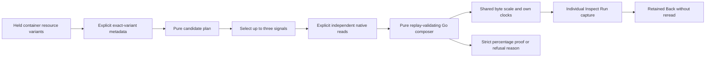

# Container memory context

Implemented in source; source and ordinary OTLP/browser acceptance are pending.
This is an explicit context view over independently captured working-set,
request and limit gauges. It creates no pod/fleet aggregation or combined capture.
[Source research](CONTAINER_MEMORY_SOURCE_RESEARCH.md) pins the receiver evidence.

## Sources and identity

| Role | Receiver 0.137.0 | Metric | Unit |
| --- | --- | --- | --- |
| Working set | kubeletstats | `container.memory.working_set` | `By` |
| Request | k8scluster | `k8s.container.memory_request` | `By` |
| Limit | k8scluster | `k8s.container.memory_limit` | `By` |

Reported scope version must be `0.137.0` and instrumentation schema empty.
The receiver scopes are the corresponding full Collector Contrib receiver module
names. Other names, units, versions and exported utilization gauges are not
aliases. Physical discovery remains gauge metadata. Explicit container gauge
packages retain actual nonempty bounded container ID, pod UID and container name,
complete exact stream/resource/schema, per-stream grain and no fabricated service.
Scalar unit rules remain unchanged. Stocks/counters/histograms are separate.

Kubelet container IDs require configured extra metadata. Cluster spec metrics
can be emitted before runtime status supplies an ID. Missing IDs cannot become
synthetic pod/name identities. Missing request/limit entries emit no sample;
explicit zero remains reported zero. Neither means unlimited capacity. Requests
are declared requests, not guaranteed available memory or free capacity.

## Explicit discovery and reads

From a known-schema Kubernetes resource variant, choose **Container memory**.
The app reads metadata for that chosen exact variant and derives the plan without
executing native candidates. Compatible already-held variants share literal
container ID, pod UID, container name and exact missing/empty/present cluster
UID/name and namespace states. Full resource maps/schemas remain separate.

Choose another reported source variant and explicitly discover it when needed.
At most four exact variants are retained in this panel, with at most 16 options
per role. Existing inventory/metadata/candidate omissions remain explicit;
undiscovered or omitted metadata is not proof a request/limit is absent.
No automatic cross-inventory source scan is added. Ambiguous role candidates
require an explicit choice; a unique candidate may be preselected without IO.

**Load selected signals** declares and performs at most three measurement reads,
then calls the pure `/container-memory/view` composer. These are opt-in contextual
reads; the existing two-default automatic budget is unchanged. Changing source
or role selection withdraws pending work and clears applied display. Late replies
cannot publish a view. Native Inspect stages the exact individual question;
existing Run/capture owners execute it. Retained Back does not discover or load
again. Scope/facet/row replacement disposes the context owner.

## Comparable bytes, conditional percentages

Three compact rows share a zero-based SI byte scale and retain individual UTC
observation times, quality and exact-byte tooltips. No unknown value becomes
zero; stale and invalid observations remain explicit. Invalid byte domain has
its own display state while `observationState` retains original freshness.
Original scalar evidence stays unchanged and inspectable.

The Go composer validates each result by replay, exact pinned role, original
window/environment and qualified container context. It accepts independent
values across differing full maps/schemas. A percentage additionally requires:

- Working set and denominator have known latest observed samples; no fallback
  to earlier good values for stale, conflicting or missing latest data.
- Full resource map, resource schema and point attributes are identical, as are
  exact sample time, fixed evaluation bounds and freshness policy.
- Original raw numeric strings certify nonnegative safe-integer byte counts,
  before Float64 rounding can manufacture an integer. Denominator is positive.

Each eligible percentage is an exact rational with server-supplied rounded text.
The renderer formats supplied values and never decides join eligibility. Working
set may exceed a request or limit; no health classification or clamping follows.
A zero numerator can yield zero percent; a zero denominator cannot.

The stock pinned receivers normally differ in resource schema (kubelet empty,
cluster OTel 1.18.0), full maps and sampling times. Their ordinary reports should
therefore show independent bytes and an explicit alignment refusal, not a
manufactured percentage. No schema normalization, tolerance join, interpolation
or held-forward denominator is used. Matching samples still come from separate
source reads/bases and do not certify a transactional snapshot or authenticity.

## API, custody and bounds

The pure view request has `parent` and optional `workingSet`, `request`, `limit`
results. Fixed three-row output includes role, original question, canonical byte
value when valid, display/observation states, time, reason and source read/basis.
Requests and composer inputs are bounded at 8 MiB; existing per-result source
limits apply, and oversized combined context refuses rather than truncates.
Missing inputs remain unavailable. Existing exact-source metadata and planning
routes are reused; role candidates never become automatic widgets.

Individual capture/replay retains original rows, clocks and bytes; there is no
paired memory-capture format. Native inspection can capture each selected source
independently. The passive table, comparison bar, byte and UTC primitives are
reused; app owners retain fetching, scope, navigation and cancellation.

[Journey 206](../journeys/206-container-memory-storyboard.md) records actual
acceptance status. CPU/throttling, request/limit changes, verified controller
facts, replica/workload totals, resampling policies and production enrichment
remain separate contracts.
