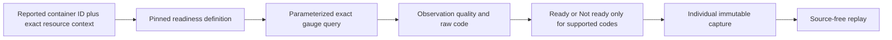

# Container identity and reported readiness — native prerequisite

Implemented in source: exact container authority, readiness decoding and existing
native API execution/capture/replay. Container discovery, planning, UI integration
and live ordinary OTLP/browser acceptance are not implemented in this slice.
The running lab remains on the accepted pod-phase build until that integration.
Existing screenshots still describe its unchanged interface.

## Receiver evidence and identity

This profile is pinned to Collector Contrib v0.137.0:

- [Metric metadata](https://github.com/open-telemetry/opentelemetry-collector-contrib/blob/v0.137.0/receiver/k8sclusterreceiver/metadata.yaml) declares `k8s.container.ready` as a unitless integer gauge.
- [Container emission](https://github.com/open-telemetry/opentelemetry-collector-contrib/blob/v0.137.0/receiver/k8sclusterreceiver/internal/container/containers.go) records `ContainerStatus.Ready` and reports `container.id`, `k8s.pod.uid` and `k8s.container.name` on the resource.
- [Pod status preparation](https://github.com/open-telemetry/opentelemetry-collector-contrib/blob/v0.137.0/receiver/k8sclusterreceiver/internal/pod/pods.go) omits statuses with empty container IDs. Lack of a readiness observation is not a reported false value.

The receiver strips a runtime prefix before reporting its container ID. Goo does
not strip, synthesize or otherwise normalize any reported ID. Resource binding
`{kind: kubernetes-container, id: <reported container.id>}` uses that actual value.
The exact stream must also contain bounded nonempty pod UID and container name;
pod name is optional context. Full raw resource map/schema, scope/version/schema,
metric/unit and point attributes remain isolated. A restart with a new ID is a
different authority even if the pod and container names stay the same. Repeated
IDs in different resource variants never establish global physical identity or
verified ownership.

## State contract

Use `kind: state`, `stateProfile: k8scluster-container-ready/0.137.0`, and
`grain: per-stream`. This initial container authority admits only this readiness
state profile, not scalar gauges, stocks, counters, histograms or lifecycle data.
It requires an exact stream, empty service selection and no namespace selector.
It fabricates no service/instance labels.

The physical profile requires scope
`github.com/open-telemetry/opentelemetry-collector-contrib/receiver/k8sclusterreceiver`,
version `0.137.0`, empty instrumentation schema, metric `k8s.container.ready` and
empty unit. Semconv count-like instruments, other receiver versions and
unit aliases are not interchangeable with this gauge.

| Code | Supplied category | Observation meaning |
| --- | --- | --- |
| 0 | Not ready | A reported false status, still observed telemetry |
| 1 | Ready | A reported true status, still observed telemetry |
| Other finite value | No decoded category; raw code retained | Unsupported domain code |
| Missing/conflicting sample | No code or label | Unknown observation quality |

Staleness remains separate from code meaning and is evaluated at the fixed
window end. Latest missing/conflicting/unsupported values never fall back to an
older Ready value. Empty input creates no series and overall `no_data`; it does
not invent Not ready. Unsupported values make overall result quality unknown,
while their individual sample preserves observed/stale quality.

This is reported container readiness, not pod readiness, application health or
proof that a readiness probe exists. Kubernetes can report Ready without a
configured probe. No ready-container ratio, fleet total, Boolean aggregation or
phase arithmetic is inferred.

The private categorical kernel shares timestamp grouping, conflicts, freshness
and no-recorded-value handling with pod phase. It uses an explicit profile/code
mapping. The source adapter checks the original bounded decimal before assigning
a supported code: tiny nonzero values that round to zero cannot manufacture
Not ready, and fractions rounding to one cannot manufacture Ready. Ordinary
scalar kernels retain their nonempty-unit requirement.

## Execution and custody

The existing compiler selects the gauge table using typed values, reported
`container.id`, environment, exact resource/schema and full point attributes.
Source rows must explicitly retain known physical identity strings, including
known-empty schemas/unit. Readiness also requires explicitly reported resource/
attribute objects with string values and flags: absent/null fields cannot become
empty maps or zero flags. Existing source bounds refuse partial measurements.
Readiness uses `states`, not a scalar result section. Existing individual capture
and source-free replay verify the original raw rows, question and read clock;
modified category labels fail replay. Generic categorical comparisons remain
unsupported.

The [API storyboard](../journeys/204a-container-readiness-storyboard.md) distinguishes
implemented native contracts from the next discovery/UI and actual OTLP/browser
acceptance work. No new UI surface, automatic read or deployment is claimed here.
