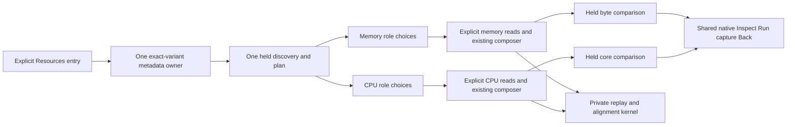

# Container Resources

Milestone 208 is in development; live acceptance is pending. This consolidates
[container memory](CONTAINER_MEMORY.md) and [CPU](CONTAINER_CPU.md) into one
Kubernetes Resources entry. Both existing composition APIs and individual
measurement/capture formats remain separate and retain their semantics.

## One discovery, independent loads

A single resource owner retains the original environment, fixed window and
qualified container identity. Its Sources control chooses an exact already-held
resource/schema variant for the next explicit metadata discovery. At most four
exact variant responses are retained. The same discovered plan supplies memory
and CPU choices; discovering metadata never reads native values.

Each family has its own bounded role choices, explicit Load (at most three
reads), pending-operation generation and held result. Loading or editing one
family cannot relabel, replace or reread the other family's accepted evidence.
The source picker selects the next metadata context; it does not rewrite the
questions behind already-held results. A new ambiguous automatic choice must
clear the affected selection; deliberate choices and skips remain deliberate.
Missing or undiscovered roles are not zero or proven absence.

Sources disclosure closure or changing the next discovery target withdraws only
pending metadata. Closing a family’s signal setup withdraws that family’s pending
load. Scope replacement and closing the whole view withdraw all pending work. Metadata,
family reads and pure compositions must check current ownership before
publishing, including when disclosure closure precedes its queued toggle event.
Completed evidence retains its own question, selected streams and read clocks.
Existing native inspection, explicit Run/capture and retained Back own navigation
and custody; there is no combined Resources capture or six-signal atomic read.

Memory rows share a byte scale; CPU rows share a core scale. They do not share
one numerical axis. Both retain original UTC observations, quality and exact
value tooltips. Strict per-family identity/resource/schema/attribute/time/window/
freshness and domain checks still govern percentages. No new capacity, health,
sample-interval, Kubernetes ownership or receiver authenticity claim follows
from showing the two panels together.

## Shared implementation, distinct domains

A private Go composition kernel handles bounded replay/detachment, exact
container authority, latest observations and alignment checks. Concrete CPU and
memory DTOs, versions, warnings, refusal ordering, omitted fields and serialized
HTTP fixtures remain unchanged. Domain callbacks preserve safe-integer byte
certification versus bounded exported fractional-core decimals, including
conflicting raw decimal strings which happen to round to the same Float64.
No new public endpoint, metric alias, source join or automatic default is added.

[Journey 208](../journeys/208-container-resources-storyboard.md) tracks executable
acceptance. CPU-time rates, throttling, configuration history, workload totals
and combined custody remain separate work.

## Historical journeys

The six standalone memory entrance specs from 206 and four standalone CPU
entrance specs from 207 describe superseded navigation/ownership controls and
are explicitly skipped on the consolidated app. Their assertions and generated
frames remain historical; reproduce at accepted releases `87c6293` and `8ccc951`,
respectively. Journey 208 replaces their current entrance coverage rather than
pretending the old effect journals describe the new shared owner. Existing
standalone family Node tests, frozen HTTP contracts, Hegel properties and
independent raw/custody replays remain active regression checks.
