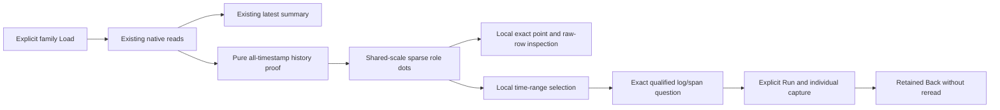

# Container resource history

Milestone 209 is implemented in source; live acceptance is pending. It extends
[Resources](CONTAINER_RESOURCES.md) with histories projected from the same held
native results used by the latest-value memory and CPU summaries.

## Read once, explore held observations

Each successful explicit family Load still reads at most three selected native
signals. After its existing latest-value composer, one pure
`POST /container-resources/history` request certifies all retained timestamp
groups. Metadata discovery, source selection and automatic default budgets are
unchanged. This pure follow-up performs no source query or custody write.

Each family has one compact dot chart showing working set/usage, request and
limit together on a shared unit scale. The full family domain and fixed time
axis stay stable across role focus and pages. At most 256 marks are displayed
per page; the visible count and navigation disclose the retained total. A page
is a display subset, not a complete-source cardinality or coverage guarantee.
Memory uses bytes; CPU uses reported fractional cores. They do not share an axis.

Individual timestamps remain individual dots. Empty time is unobserved, not
zero, downtime, or a constant carried-forward request/limit. No line, area,
interpolation or percentage history is generated. The latest summaries retain
their independent strict percentage contract.

## Quality and reported changes

The original gauge evaluator measures freshness against the original fixed
question end. Historical points labeled stale are not statements that those
points were stale when reported. Unknown/missing flags and conflicts remain
unknown. Domain-invalid values retain their original observation state and
reason separately from byte/core admission. No older good value replaces a
missing or invalid observation.

Each timestamp's original raw decimal group must certify one exact value.
Distinct raw decimals which round to the same Float64 can therefore be invalid
for history even when the scalar evaluator coalesces them. Memory keeps its
safe nonnegative integer-byte policy; CPU keeps its bounded exported-decimal
policy. Original raw rows and evidence remain unchanged.

Selecting a point shows its exact value, UTC time with nanosecond tooltip,
quality, read time, basis and zero-based indices into the original raw result.
A request/limit point may identify a different adjacent reported value, stopping
at unknown/invalid predecessors. This compares observations; it does not locate
a Kubernetes configuration-change event or establish continuity between samples.
The original measurement-question action stages that fixed question; explicit
Run/capture performs a new source read. The selected point above remains held
original evidence, not the result of that future read.

## Time-range investigation

Dragging stages an exact half-open nanosecond context range locally. A controlled
UTC time-range form supplies keyboard/touch fallback; ordinary vertical touch
scroll remains available. Point selection leaves the context range unchanged.
The default is the visibly labeled original fixed window, not an invented
interval around a gauge point.

Explore matching logs/spans stages a contextual question with literal container
ID, pod UID, container name and exact missing/empty/present cluster UID/name and
namespace qualification. Other unrelated resource fields are intentionally not
required. The original environment remains unchanged. An enclosing millisecond
query window plus `timestamp_ns >= fromNS` and `timestamp_ns <= toNS-1` retains
the exact chosen bounds without broadening record membership. Existing explicit
Run, capture/save and retained Back own source effects and reuse. Matching records
are context, not demonstrated contributors or causal relationships.

Role focus, paging, point inspection, range selection and staging do not read
telemetry. Family changes, reloads and withdrawal cancel obsolete pure history
work through the same generation as its latest summary. Unchanged sibling views
and their histories remain retained. Back restores the held chart and selection
without rediscovery. No new history capture, saved-layout format or live/SSE
subscription is introduced; derived record questions reuse existing save/capture.

## API and display bounds

The additive request has `parent` and optional `memory` (`workingSet`, `request`,
`limit`) and/or `cpu` (`usage`, `request`, `limit`) held results. At least one
family is supplied. Replay, exact role/stream, original window and qualified
container context are validated before detachment. Series are ordered by family
(memory then CPU) and role. Each retains its original question/read time/basis,
fixed bounds and `maxGapNS`; points retain original quality/reason plus distinct
domain state and all original raw-row indices at that timestamp.

Input and output are bounded at 8 MiB and computation at a two-second handler
context; more than 10,000 total points refuses the whole request. It does not
silently drop, aggregate or sample facts. Indexed timestamp grouping is linear
in held rows plus samples. Existing latest-view versions/bytes, metric profiles,
measurement execution and individual capture formats remain unchanged.

The framework-neutral `goo-value-timeline` receives supplied points, domain,
labels and series tokens only. Its opt-in domain/series support and compact
unknown-point glyph are generic display behavior. Source reads, history proof,
context predicates, pagination and navigation remain application adapters.

[Journey 209](../journeys/209-container-history-storyboard.md) records acceptance.
[Runtime recovery](RUNTIME_RECOVERY_209.md) distinguishes recovered tools/captures
from prior ignored journals lost when the environment reset `/tmp`.
