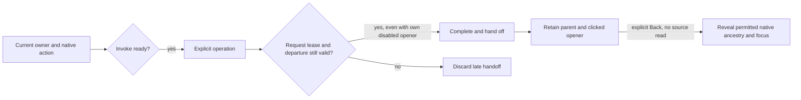

# Contextual actions and retained return

Milestone 420 aligns service widgets and record inspection with the existing
native action and disclosure patterns. Source adapters retain ownership of query
scope, cancellation and evidence. Display components do not acquire telemetry.

- Invocation requires a current owner and a connected, visible native control.
  Closed disclosure content, inert ancestry, disabled controls/fieldsets and
  explicitly disabled actions refuse saved handlers as well as ordinary clicks.
- Async customization keeps its request lease and rechecks parent departure
  permission. Its deliberately disabled opener may complete; a departed or
  withdrawn owner cannot hand off a late result.
- Explicit Back restores the clicked service action, revealing only the native
  disclosure ancestry needed to reach it. It does not unhide or enable withdrawn
  controls. The owning service must still retain that actual opener.
- Record-inspector context closes return to the actual clicked follow-up action.
  Record-row More actions deliberately return to their persistent menu summary;
  the menu stays closed. An unavailable origin uses the existing owner fallback.

The shared `revealFocus` helper opts into disclosure revelation with
`{disclosures: true}`. Ordinary invocation never reveals an action. Without that
option, a control inside closed content keeps the existing fallback behavior.
Focus candidates must remain connected, enabled and outside hidden/inert or
CSS-withdrawn ancestry. The first summary of a closed details element remains
available without opening its own content.

This is a bounded two-owner consolidation. It introduces no global action
registry, query engine, storage format or telemetry read. Shared helpers still
require application owners to enforce their current source/request lease.

[Storyboard](journeys/contextual-actions.md),
[independent review](reviews/CONTEXTUAL_ACTIONS_REVIEW_420.md), and
[validation](../VALIDATION.md) distinguish source checks and actual execution.
