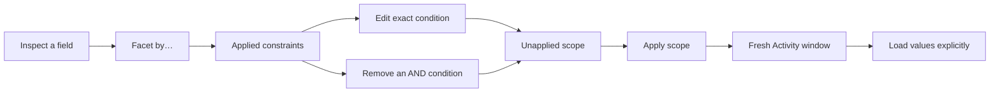

# Edit a field's applied constraints

Status: implemented for contextual Activity entry. Source/frame UX review is
accepted; executed browser, actor and model results belong in
[validation](../VALIDATION.md).

From an inspected Activity field, **Facet by…** opens the existing field controls.
A compact **Applied constraints** section identifies each condition on that exact
qualified field. Choose **Edit condition** to focus that condition in the existing
filter editor. Choose **Remove condition** only when removal broadens the scope
without discarding another condition. Neither action reads telemetry.

Each clause shows its operator/value and Boolean ancestry. Attribute and resource
keys with the same spelling remain distinct. Missing keys, present-empty strings
and literal strings retain their existing semantics. Numeric bindings refer to
their exact field rather than being mistaken for string conditions.

Editing opens the existing control without changing the predicate. Removing one
condition stages one atomic draft and retains the held records until Apply.
Previously loaded counts withdraw; they cannot describe the broader draft.
Activity keeps its rolling lookback policy. Apply explicitly resolves a new
current window and acquires that population; it does not rerun the older fixed
window used to identify the clause. Loading its counted values remains a separate,
explicit acquisition.

## Boolean safety and ownership

Removal is available only when every ancestor is an AND group. Removing a member
of an OR group can narrow the population; deleting that whole group would also
remove unchosen conditions. Such clauses retain **Edit condition** and an explicit
OR-group explanation. There is no automatic “remove all constraints for field”
action or arbitrary Boolean rewrite.

Every action is bound to the original complete question, exact clause path and
canonical clause content, plus the current visible owner. Duplicate-looking
clauses at different paths remain separate choices. Stale, hidden, withdrawn or
changed-scope handlers refuse rather than resolving to the first matching field.
The complete planned question is validated before one draft handoff. The pure
plan preserves its fixed window, environment policy, signal and every unchosen
condition. The Activity adapter stages its predicate into the existing rolling
scope; the held observation window remains intact until explicit Apply.

This is a local entry into existing scope editing. It introduces no new query
engine, source permission, capture or comparison primitive. The next roadmap item
remains counted selection into the existing selected/rest comparison.

[Executable storyboard and actual frames](journeys/field-constraints.md) follow
the operator journey. [Bounded architecture and UX review](reviews/FIELD_CONSTRAINTS_REVIEW_424.md)
records acceptance and its limits.
