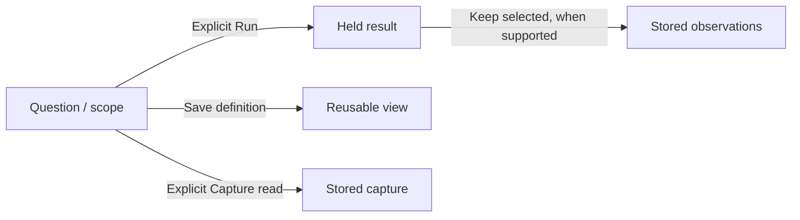
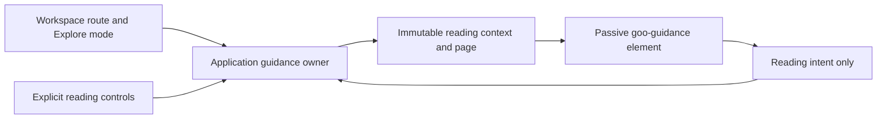

# Keep facts visible; teach workflows on demand

This is the consolidated outcome of the independent
[designer review](reviews/PROSE_GUIDANCE_DESIGN_459.md) and
[UX review](reviews/PROSE_GUIDANCE_UX_459.md), performed after the 459 UI polish.
The Activity disclosure and the 460 contextual reading surface are implemented.
The guide is manual reading assistance, not an observed workflow-completion system.

## What belongs where

| Keep visible during work | Explain on demand | Teach in an optional mini-guide |
| --- | --- | --- |
| Applied environment/service/filter scope and actual window | Rolling-window mechanics, late records and duplicate semantics | Start, pause and inspect ordinary OTel data |
| Live/paused, unknown/partial/unavailable, gaps/evictions and current failures | Definitions of coverage, source clocks and custody | Local Find versus a new filtered source read |
| Actual values, units/grain, denominators and both comparison sides | Histogram geometry, coordinate overlap and chart keyboard controls | Follow reported trace context or an original observation window |
| Local/not-saved or stored state, read/capture clocks and write outcome | Save/Keep/Capture/revision mechanics and detailed lineage | Save configuration or deliberately preserve observations |
| Draft state, explicit Run/Apply/Refresh consequence and relevant recovery action | Exact duplicated parent context and advanced compiler/reference material | Interpret metrics, comparisons and optional authoring |

The operator's records and messages are data. They stay in the result/inspector.
Actual failure reasons, expiry/conflicts and uncertain write outcomes stay visible;
a tutorial is not a substitute for recovery UI. The global coverage footer is
already visually hidden, so changing it is not a visual-density gain; generic
screen-reader-only teaching should also move to equally accessible help.

### Implemented first extraction

The Activity inspector now shows a closed native **Local observation · not saved**
disclosure in place of its boxed staging paragraph. That summary keeps custody
state visible; opening it reveals the complete existing explanation. It neither
changes scope nor reads data. Native keyboard activation and focus remain intact.

## Visual alternatives to repeated paragraphs

- **State label + marker:** use the shared neutral ring/filled marker and warning
  diamond with visible text. Observed telemetry never implies healthy service.
- **Actual labelled facts:** keep Window, Read at and Stored at distinct. Use native
  UTC timestamps/tooltips and expandable exact facts rather than repeating essays.
- **Applied scope chips:** one authoritative applied condition and a draft marker;
  show parent/edited-slot differences when they genuinely differ.
- **Aligned comparisons:** place each side's window, read clock, unit and denominator
  in the same visual order. Keep incompatible or partial states next to the values.
- **Read-lineage diagrams:** explain the different operations without implying that
  saving a definition stores the currently visible records.

This diagram is guidance, not an execution flow. Capture can read fresh source
records; Keep requires its supported occurrence/proof contract. A guide must not
perform either action or silently turn configuration into evidence.

## Implemented contextual help (460)

The header **Help** entry opens a full-width inline panel below the workspace
heading, with route-relevant content and a five-page **First investigation guide**.
The panel starts closed and preserves workspace lane widths.
Reuse native Read facts, Scope and receipt, Tail scope and limits, and contextual
`UI.disclosure` patterns. Exact current facts stay in their existing owners;
guidance explains them rather than copying another stale snapshot.

The opt-in, replayable reading guide covers:

1. Choose a source scope and Start explicitly.
2. Pause or Hold chronology; inspect a retained occurrence.
3. Find locally, then stage and Apply a field condition if desired.
4. Follow reported context or stage the original observation window; Run explicitly.
5. Save configuration or preserve observations through the appropriate action.

Previous, Next, Replay and Back to help change reading position only. Close
restores the Help trigger; Return to work focuses the workspace outside record
viewports. Route changes retain the current guide page while contextual topics
follow the route. There is no persistence across reloads, automatic tour,
highlighted-target activation or observed task completion. No source read,
subscription, filter edit or persistence action is part of guidance.

Services count definitions, comparison save mechanics and raw-gauge/histogram
geometry and keyboard lessons now use closed native contextual disclosures.
**Saves questions · not observations** keeps the configuration/evidence distinction
visible. Actual counts, units, windows, uncertainty, overlap/display limits,
refusal reasons and dynamic unsaved-comparison warnings remain in their owners.

See the [executable journey](journeys/contextual-guidance.md) for keyboard, live
stream, held inspection, refused source and responsive acceptance scenarios.

## Remaining boundaries

Duplicate applied/Parent predicate consolidation is deferred pending an
identity-aware UX review: similar text can carry genuinely different parent/slot
scope. It was not delivered in 460. Task-specific metrics, comparison and
authoring guides remain future work. The following 461 related-held-trace-context
depth step remains unchanged.

Validate migrations against their information inventory, browser focus/overflow
checks and source-side-effect assertions. See [validation](../VALIDATION.md).

## Ownership

The owner changes panel visibility and safe focus. Source acquisition, filter
application, navigation and preservation remain in their existing application
owners; this reading loop does not invoke them.
