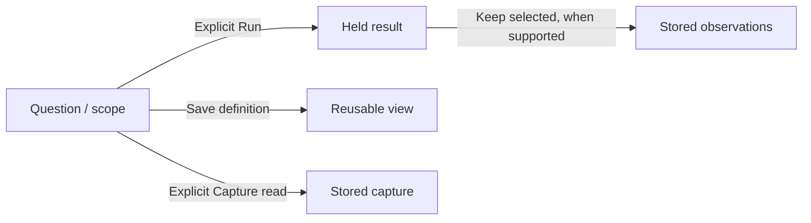

# Keep facts visible; teach workflows on demand

This is the consolidated outcome of the independent
[designer review](reviews/PROSE_GUIDANCE_DESIGN_459.md) and
[UX review](reviews/PROSE_GUIDANCE_UX_459.md), performed after the 459 UI polish.
The Activity disclosure below is implemented. The broader help panel and
walkthroughs are proposed, not shipped.

## What belongs where

| Keep visible during work | Explain on demand | Teach in an optional mini-guide |
| --- | --- | --- |
| Applied environment/service/filter scope and actual window | Rolling-window mechanics, late records and duplicate semantics | Start, pause and inspect ordinary OTel data |
| Live/paused, unknown/partial/unavailable, gaps/evictions and current failures | Definitions of coverage, source clocks and custody | Local Find versus a new filtered source read |
| Actual values, units/grain, denominators and both comparison sides | Histogram geometry, coordinate overlap and chart keyboard controls | Follow reported trace context or an original observation window |
| Local/not-saved or stored state, read/capture clocks and write outcome | Save/Keep/Capture/revision mechanics and detailed lineage | Save configuration or deliberately preserve observations |
| Draft state, explicit Run/Apply/Refresh consequence and relevant recovery action | Exact duplicated parent context and advanced compiler/reference material | Interpret metrics, comparisons and optional authoring |

The operator's records and messages are data. They stay in the result/inspector.
Actual failure reasons, expiry/conflicts and uncertain write outcomes stay visible;
a tutorial is not a substitute for recovery UI. The global coverage footer is
already visually hidden, so changing it is not a visual-density gain; generic
screen-reader-only teaching should also move to equally accessible help.

### Implemented first extraction

The Activity inspector now shows a closed native **Local observation · not saved**
disclosure in place of its boxed staging paragraph. That summary keeps custody
state visible; opening it reveals the complete existing explanation. It neither
changes scope nor reads data. Native keyboard activation and focus remain intact.

## Visual alternatives to repeated paragraphs

- **State label + marker:** use the shared neutral ring/filled marker and warning
  diamond with visible text. Observed telemetry never implies healthy service.
- **Actual labelled facts:** keep Window, Read at and Stored at distinct. Use native
  UTC timestamps/tooltips and expandable exact facts rather than repeating essays.
- **Applied scope chips:** one authoritative applied condition and a draft marker;
  show parent/edited-slot differences when they genuinely differ.
- **Aligned comparisons:** place each side's window, read clock, unit and denominator
  in the same visual order. Keep incompatible or partial states next to the values.
- **Read-lineage diagrams:** explain the different operations without implying that
  saving a definition stores the currently visible records.

This diagram is guidance, not an execution flow. Capture can read fresh source
records; Keep requires its supported occurrence/proof contract. A guide must not
perform either action or silently turn configuration into evidence.

## Proposed help model

Use a consistent **Help / Learn this view** entry with route-relevant content.
Reuse native Read facts, Scope and receipt, Tail scope and limits, and contextual
`UI.disclosure` patterns. Exact current facts stay in their existing owners;
guidance explains them rather than copying another stale snapshot.

Offer short, opt-in, replayable guides from Help or an appropriate empty state:

1. Choose a source scope and Start explicitly.
2. Pause or Hold chronology; inspect a retained occurrence.
3. Find locally, then stage and Apply a field condition if desired.
4. Follow reported context or stage the original observation window; Run explicitly.
5. Save configuration or preserve observations through the appropriate action.

Allow Skip, Back, Close and replay without losing scope, Find, selected data or
navigation. Keep focus on meaningful controls, restore it when help closes, and
respect reduced motion and narrow screens. Completion comes from observed state,
not merely clicking a highlighted control. No automatic tour, source read,
subscription, filter edit or persistence action is part of guidance.

## Suggested implementation order

1. Migrate repeated Services count definitions, comparison save semantics and
   chart keyboard/geometry lessons into one consistent contextual-help treatment.
   Keep units, actual limitations and action consequences visible.
2. Consolidate duplicate applied/Parent predicate prose while retaining genuine
   parent/slot differences and diagnostics.
3. Add one route-aware help surface and the five-step first investigation guide.
   Start with declarative content/targets and existing native components; no new
   tour SDK or tutorial language is needed for this increment.
4. Add task-specific metrics, comparison and authoring guides after the first guide
   has usable keyboard/mobile behavior and source-side-effect tests.

Validate each migration against a before/after information inventory, actual
browser focus/overflow checks, and assertions that opening or closing help never
reads or changes source data. See [459 validation](../VALIDATION.md).
