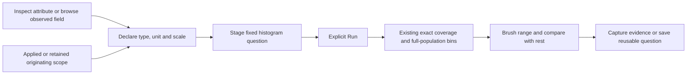

# Plot values from an attribute

Implemented and independently reviewed, with real OTel browser and native acceptance.

Open a record's attribute inspector, or browse observed fields, and choose
**Plot values** beside an attribute or resource key. Confirm its numeric type,
unit and, for decimal64, scale. **Open value distribution** stages a fixed
question. **Run** reads the full matching population using the existing numeric
summary and histogram pipeline. Brush a range to inspect it or compare it with
the rest, then capture evidence or save a reusable question.

The dialog adds no controls before the stream. It reuses the existing numeric
editor and passive charts; it introduces no API, numeric language or storage.
Ordinary OTel data needs no goo manifest or Go instrumentation for this flow.

## Which population is plotted

| Entry | Fixed scope |
| --- | --- |
| Activity record inspector | The inspected observation's original poll window and applied selector |
| Activity observed fields | The latest completed applied window and selector |
| Fixed record inspector or observed fields | The applied question, excluding unapplied editor changes |
| Saved record inspector | The original retained question; Run performs a fresh read of that scope |
| Population inspector or observed fields | That signal's scoped question; other signals remain in the parent |

The chosen field retains its exact namespace. `attribute:work.amount` and
`resource:work.amount` are separate declarations even when their names match.
Opening from a row does not filter to its value, trace, or service. The plot
covers all records matching the originating question's predicates, including
reported service-edge constraints, within the exact displayed UTC window.

Plotting resets pagination to the first 100-record inspection page and replaces
the previous grouping, bucket/split charts, duration/status measures and numeric
measure with one explicit numeric binding and its histogram. These are
presentation/measurement choices; the original membership selector is preserved.
Full counts and bins remain independent of the inspection-page limit.

## Explicit declarations and read ownership

Type and unit start blank unless this exact qualified field already has a valid
explicit numeric binding in its parent question. Decimal scale is also explicit.
The clicked value, numeric-looking strings and OTel hints never infer a type,
unit or scale. Invalid and empty observations can still open Plot values: the
result's valid/missing/empty/invalid coverage is often the useful question.
The selected field is locked in the dialog.

Opening, editing, canceling and confirming the dialog read no telemetry. Only
Run executes the staged question. Saved captures remain immutable; their scopes
can be reused without claiming the later values are the captured values.

Activity pauses for declaration. Returning preserves its held records, inspector
and opener focus without resubscribing. Apply, Resume, scope edits, navigation
and hidden/detached owners invalidate obsolete dialogs. A retained row callback
cannot regain authority merely because a later selector has the same text.

The contextual owner performs declaration and staging. Display elements neither
fetch nor subscribe. Numeric parsing, fixed-scale arithmetic, histogram geometry
and comparison compatibility remain governed by the existing
[numeric](NUMERIC_ATTRIBUTE_PLANNING.md) and [decimal](FIXED_SCALE_DECIMALS.md)
contracts. Held pages are samples, not completeness or health evidence.

## Accepted journeys and evidence

[Journey 181](../journeys/181-contextual-plots-storyboard.md) exercises both
signals from Activity through fixed/discovered fields, range comparison, capture,
saved-origin fresh plotting and paused return. Each fixture emits 400 ordinary
OTel records; the actual original windows match 387 spans and 382 logs. A separate
two-signal population journey verifies both record and observed-field origins
while retaining the parent companion.

[Actual frames](journeys/README.md) distinguish contextual declaration, a fresh
mobile resource plot, and a desktop captured attribute plot. The paired mobile
left/right views show horizontal scrolling and the positive outlier; all 128
exact ranges are available in the chart disclosure. Their provenance is recorded
separately, including source-free rendering and explicit fresh rereads.

Acceptance passes both full mains, ownership, synthetic hidden/detached guards,
population origins and a 50-second twelve-phase Bombadil campaign. Independent
client-to-Go properties cover 70 generated cases. Native raw-source/capture
validation and finite Quint/qobs replay reject all 96 corruption controls.
[VALIDATION.md](../VALIDATION.md) and [verification](../verification/README.md)
record actual receipts, custody hashes, observer corrections and model limits.
Source milestone: `b4d88db`. No new numeric arithmetic or API contract is added.
