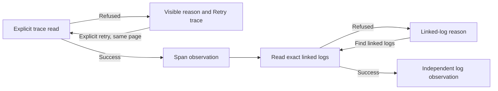

# Recovering trace and log context

Trace search, trace expansion, exact linked logs and surrounding logs use the
shared source-refusal reason and technical-details display. A failed read remains
unavailable evidence; it never means an empty complete trace or no related logs.
Recovery stays explicit and retains the current checked scope.

| Surface | Recovery gesture | Reads |
| --- | --- | --- |
| Find traces containing span conditions | Run trace search again | Same parent window/environment and current checked conditions |
| Trace inspector | Retry trace context | Same failed trace page; after success, the existing linked-log continuation |
| Exact linked logs | Find linked logs again | Same failed page and current trace/span scope; no span reread |
| Surrounding logs | Refresh surrounding logs | Same failed page within the current radius, original window, service and namespace |

Changing conditions, selected span, radius or context creates a new intent. It is
not a silent retry of the old failure. Paging recovery retains the failed offset
rather than starting again at page zero. Requests and successful observations keep
their own clocks and evidence bases; the failure itself supplies no new receipt.

Trace failure appears in the inspector's primary summary with an available retry
button. Details explain the source boundary without exposing raw transport URLs,
database exception prose or query text. A successful trace retry reads spans and
then linked logs, as the normal trace-opening flow does. A linked-log failure can
be recovered independently while the successful trace observation stays available.

Exact linked logs use reported trace/span identity. Surrounding logs use time
proximity with exact service/namespace and a radius clipped to the original
window. Neither establishes causality or completeness. Surrounding context omits
original message, severity, trace, package and arbitrary attribute filters by
design; retry preserves that same contextual question. Missing and present-empty
namespaces and typed environment policies remain distinct.

Cancel, Close, Back, context replacement and disposal retire old work. Late errors
cannot overwrite a newer inspector, and saved old retry handlers cannot read
again after a same-trace revisit. Local cancellation remains quiet under the
retired owner; current remote cancellation may show the shared cancelled reason.
No automatic retry, broader search or changed source budget is introduced.

The shared RecordResults owner renders the same diagnostics for ordinary active,
saved-record and live-inspection entry points; their acquisition wrappers preserve
the typed source error. This does not change live polling or every specialized
signal's recovery behavior. Source-declared runtime 502 remains distinct from
400/409/429 admission failures and browser response-scope validation.

Implementation, genuine source-fault recovery and desktop/narrow frame acceptance
pass for 345. The existing typed trace-search actor/model regression also passes;
stale driver images are excluded from visual acceptance. See
[validation](../VALIDATION.md).
See [source refusals](SOURCE_REFUSALS.md), the
[architecture review](reviews/CONTEXT_RECOVERY_ARCHITECTURE_345.md) and the
[trace-search contract](TRACE_SEARCH.md).
