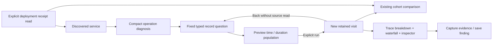

# From a service symptom to a retained explanation

This implements bounded first slices of all six recommendations in the
[product survey](CORE_EXPERIENCE_PRODUCT_SURVEY.md). It reuses Go aggregate queries,
existing comparisons, captures and passive display components. It adds no browser
measurement evaluator or new top-level analysis destination.

## Retained investigation visits

Explore has Back to question / Forward controls. Opening another population or a
record-question link creates a visit; up to eight views remain in memory in this
tab. Returning reattaches the retained application view, including draft inputs,
record inspector, attribute search, local disclosure/scroll and comparison state.
It does not execute the question again. The adapter preserves existing passive display child trees across reconnect rendering, restores nested scroll offsets afterward, and disposes external listeners when a visit is evicted. This is an application retention contract, not a new component subscription or storage feature. Running/editing inside a visit continues
to use the existing explicit draft/applied lifecycle. Traces and surrounding logs
remain independent reads with their own scope and basis.

Leaving stops live tailing, resets its live buffer and invalidates pending publications. Returning does
not restart a tail or finish a cancelled read. Opening another question after going back
replaces the forward branch. Evicted visits and reloads do not have durable
resume; use Capture evidence and saved investigations for that. Browser URL
history remains the shared-question staging mechanism, separate from the local
visit controls. Service pages remain available through Back to service.

## Compact service diagnosis

The default observed-dimension widget now exposes a compact ranked table with
captured span counts, recorded Error fractions, mean and p95 duration. Mean/p95
cells share one scale across all groups. Search and ranking are local; they do
not change measured totals. Open operation stages the precise group question;
By instance stages the same population grouped by resource service.instance.id.
Missing keys and present empty values remain distinct.

The existing planner prefers discovered HTTP route / RPC / database / messaging
keys. Without a discovered convention dimension, diagnosis uses generic span
names. These are matching captured spans including mixed span kinds and retries,
not an inferred server request SLI. Independently read results can disagree;
that state withholds diagnosis ranking. No percentiles are averaged.

## Follow a chart population

Selecting a time bar or grouped time cell fills a keyboard-accessible selection
form. Users can also enter UTC bounds and span-duration limits. The preview is
source-free. It preserves the original predicate (including OR), reported-edge
scope, environment, grouping and typed measures, resets paging and adds narrowing
predicates. Time and duration bounds are half-open; integer duration upper bounds
are lowered to an inclusive nanosecond predicate by subtracting one exactly.
Invalid, out-of-window or incompatible selections cannot run.

Run selected population opens another visit. With one grouping field and no
numeric binding, Compare selection to this baseline reuses the existing cohort
comparison against the retained original result. The baseline is not reread.
Populations may overlap and are separately read; differences are descriptive.
Native histogram metric cells cannot identify contributing spans; this workflow
is limited to record populations and does not manufacture metric exemplars.

## Coordinated trace breakdown

Expanded trace context now requests reported service-name/span-name groups, span-duration summaries
and recorded status through the existing Go aggregate endpoint. The table's
highlight controls coordinate with the returned waterfall rows without source
reads. Names can span multiple namespaces or instances; this is not a resolved service-identity map. Aggregate counts cover all matching spans in the fixed scope; a paged
waterfall can contain fewer rows. Inclusive duration sums can overlap and are
not elapsed execution time, exclusive time, CPU time or critical path. Source
read disagreement withholds the table.

## Reused context and actionable capability states

Service pages and both sides of stored evidence comparisons reuse the deployment
context lane with their own environment and fixed window. Receipts are loaded
explicitly, independently of telemetry, and selection opens the shared inspector.
Event time and recorded time remain separate; context never mutates a capture
or attributes a symptom to a release.

Unavailable convention suggestions name the expected keys and offer inspection
of the actual span attributes. Save reusable question then provides the existing
package/binding authoring path. Unsupported native instruments remain explicit
and discoverable. These are metadata/capability explanations, not inferred
instrumentation health or a new convention resolver.

## Executable explanation

[Journey 85](../journeys/core-refinements.spec.js) ingests ordinary HTTP-shaped OTel
spans from two services, narrows six spans to two using exact duration boundaries,
compares them, returns to retained DOM/attribute search without a source read,
expands the trace, ranks operations and pivots by instance. It also inspects an
authored deployment receipt and checks mobile overflow. Bombadil covers the
selection/return flow; Hegel exercises generated duration bounds and the existing
question-session state swarm. The observed ledger reuses the question-links Quint
model with rejecting scope/read mutations. Actual results are in VALIDATION.md.

Documentation frames:

- [Selected population comparison](journeys/screenshots/85a-chart-population-comparison.png)
- [Trace operation highlighting](journeys/screenshots/85b-trace-operation-breakdown.png)
- [Compact service diagnosis](journeys/screenshots/85c-compact-service-diagnosis.png)
- [Mobile visit controls](journeys/screenshots/85d-mobile-investigation-trail.png)
- [Independent comparison context](journeys/screenshots/85e-independent-comparison-context.png)

Journey 86 separately exercises visit eviction, forward-branch replacement,
retained unapplied drafts and unique active DOM identities without source reads.
