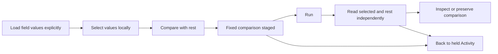

# Compare counted values with the rest of a scope

Status: implemented for contextual Activity entry. Bounded source/frame UX and
accessibility review is accepted; actual execution results belong in
[validation](../VALIDATION.md).

Select one or more values in the existing counted-field list, then choose
**Compare with rest**. This stages a fixed comparison in the existing investigation
workspace. **Run** explicitly reads both populations independently. The original
Activity observations remain held; **Return to paused activity** returns to the
actual comparison opener.

The selected population includes the chosen values within the parent scope. The
rest contains records in that same parent scope and fixed window which do not
match those values. Unchosen service, environment-policy and other predicates
remain intact. “Rest” does not mean all telemetry or another time window.

## Selection and data semantics

The input is bounded categorical intent, not an arbitrary Boolean complement.
Attribute and resource keys with the same spelling remain distinct. Missing keys,
present-empty strings and lookalike literal labels remain separate choices. Both
complete questions must pass existing AST and ordinary-count profile limits before
one staging handoff. Unsupported measures or a complement that exceeds those
limits are explicit refusals; no partial comparison is staged.

Loaded counts continue describing their original scope. Selection, search and
comparison staging do not change those counts or acquire telemetry. Neither operand
is manufactured from counted values, retained rows, or subtraction from a total.
The two fixed questions are logically selected/rest partitions; their later source
reads have independent clocks and can observe different telemetry revisions.
Existing unknown coverage, known-zero and unavailable states remain visible.

## Ownership and reuse

The shared filter editor supplies native selection/action controls. The composing
Activity adapter owns current scope/window leases, source pause, navigation and
retained return. The counted source owner separates its retained question identity
from active read/action permission: a paused parent can retain its exact controls
while a child is open, but hidden loads and late completions cannot acquire or
publish. A stale, hidden, detached or changed-scope action refuses. The
handoff reuses the existing fixed-query count comparison, its composition grammar,
explicit Run, scope/read facts and preservation workflow. There is no new query
engine, source permission, saved-evidence identity or comparison renderer.

[Executable storyboard and actual frames](journeys/counted-selection-comparison.md)
record the selected/rest journey. The fixture compares two missing/empty records
with 259 remaining records while preserving the original 261-record parent scope.
The source/frame review does not infer successful model or exploratory execution
from screenshots; those outcomes are recorded separately in validation.
