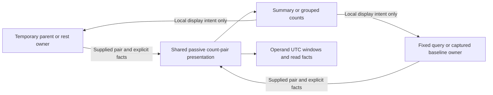

# One supplied count-pair presentation

323 consolidates temporary selected-versus-parent/rest and saved fixed/captured
count comparisons. The same existing display components present admitted counts
and groups. There is no new query model or comparison executor.

## Read a comparison

Each side names its actual role: held parent (overlapping), rest of parent,
previous window, fixed baseline or frozen capture, versus selected observations.
Both sides show their supplied whole-population count, exact UTC interval and
independent source-read clock. An absent read clock is explicitly unavailable;
no timestamp is inferred from the window or current time. Counts describe source records, not rates or
upstream completeness. A held observation is not silently reread or normalized
into a fresh question.

One **Summary / Groups** switch chooses the display for both temporary and saved
comparisons. Temporary display changes belong to that visit; they do not become
part of a saved view. Saved comparison display preferences remain owned by the
application's existing declaration. Local group Find and ordering inspect supplied
groups without reading telemetry.

One scope/read-facts disclosure retains full query context, basis, independent
read details and warnings. Frozen captures retain their custody clock and exact
capture link. Aggregate-only baselines retain aggregate receipts and do not claim
that baseline records or row-page consistency were inspected. Warning and unknown
states remain explicit. No scalar percentiles are averaged and no new statistical
claim follows from a count difference.

## Reuse without sharing source ownership

The passive composition lives in the existing `comparison-visual.mjs` module.
Hosts supply admitted comparison/group models and explicit operand facts. It
composes the existing measure/group components; it does not fetch, subscribe,
publish, plan a query, reinterpret a capture or manufacture source guarantees.

The two population-workspace callers keep their own acquisition and lifecycle:
Run/Prepare, selected/rest intent, held parent, fixed query, capture loading,
Include/Save, cancellation, action leases and group-side navigation. Shared visual
nodes do not acquire authority to stage or read another population. A retired
control cannot change a replacement visit or revive its source request.

This is consolidation of a current prerelease interface, without a compatibility
wrapper for the removed duplicated markup. Underlying query/declaration formats
change only when their product contract needs it.

See [comparison windows](PAIRED_COMPARISON_WINDOWS.md),
[fixed baseline reads](FIXED_BASELINE_READS.md),
[component library](UI_COMPONENTS.md),
[journey](journeys/323-count-pair-presentation.md),
[architecture](reviews/COUNT_PAIR_ARCHITECTURE_323.md) and
[design](reviews/COUNT_PAIR_DESIGN_323.md).
