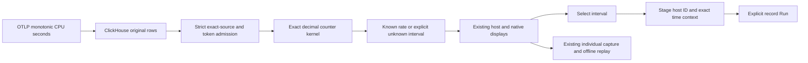

# Fractional counter rates and host CPU activity

Milestone 211 is source-reviewed; live acceptance is pending.

## Explicit arithmetic domain

An authored per-stream counter may opt into `counterDomain: nonnegative-decimal`.
Omitting the field preserves existing integer counter arithmetic, wire fields and
content bases. The native kernel records `valueDomain` only for the opt-in path.
Canonical kernel values are nonnegative base-ten strings of at most 512 bytes;
the source adapter certifies finite exported decimal strings, including bounded
scientific notation, before canonicalization. This preserves exported precision,
not precision already lost in OTLP/ClickHouse Float64 encoding.

Subtraction uses exact rationals. An `ok` interval carries its exact decimal
`delta`, reduced rational `exactPerSecond`, and a finite approximate `perSecond`
for display. A nonzero rate which underflows or overflows the display float is
`unknown / unrepresentable-rate`, never zero or infinity. Deltas can exceed an
input's length; wire limits allow 1,024 bytes for delta and 2,048 for exact rate.
The existing 10,000-point limit remains; new decimal kernel and full measurement
outputs refuse above 8 MiB rather than truncating facts.

Cumulative epochs, decreasing-counter taint, delta intervals, missing flags,
conflicting duplicates, late ordering, excessive gaps and boundary clipping keep
the existing counter rules. No interpolation or subtraction across epochs.
A same-epoch decrease stays unknown until a new reported epoch. Source admission
checks original JSON identity strings/maps, explicit flags, integer temporality
and monotonic true before canonicalization can round or default those facts.

Count-based error ratios/fleet and whole-window comparison/discovery do not
accept this domain; they refuse or show an explicit unsupported state. Decimal
values which happen to be integral do not become event-count populations.
Individual native capture and offline replay use the existing format.

## First pinned profile

Host `system.cpu.time`, unit `s`, monotonic cumulative sum, under the pinned
[OTel v1.37 system conventions](https://github.com/open-telemetry/semantic-conventions/blob/v1.37.0/docs/system/system-metrics.md)
opts into the decimal domain. Full host resource/schema, scope/version/schema,
metric/unit and point attributes remain exact. It needs no fabricated service or
instance labels. Logical CPUs and reported modes remain separate streams.

The existing host planner prefers its reported CPU-utilization gauge; CPU time
is a fallback when that profile is unavailable. Memory plus one CPU stream still
uses at most two automatic native reads. There is no hidden fallback after a
failed/invalid utilization read. Other modes/cores remain explicit candidates.

The UI labels CPU-seconds/s as CPU activity. This is an observed interval average,
not instantaneous utilization, saturation, a whole-host total or a capacity
percentage. It reuses the supplied-data resource renderer and native timeline.
Selecting an interval exposes exact delta/rate and UTC bounds.

## Record investigation

The pinned CPU-time inspector can stage logs/spans in the exact half-open native
interval. It uses reported `host.id` and the original environment, with enclosing
millisecond source bounds plus exact nanosecond predicates. Metric SDK labels,
mode/core, instrumentation and full metric resource maps are intentionally not
record filters. Equal reported IDs do not prove one physical host; this is
contextual search, not ownership or causality. Other resource/gauge context
contracts remain unchanged. Staging and retained Back are local; Run reads and
capture creates fresh evidence explicitly.

[Journey 211](../journeys/211-cpu-time-storyboard.md) tracks live acceptance.
