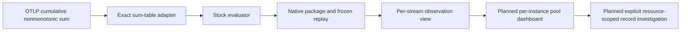

# Cumulative stock semantics

The pure Go evaluator in [metrics/stock.go](../metrics/stock.go) now has an
additive native measurement path: `kind: stock`, a direct sum-table source,
discovery, package planning/execution, frozen capture/replay and per-stream
observation presentation. Automatic pool/runtime panels remain planned.
Existing gauge/counter/histogram wire fields and historical saved bytes are
unchanged; `stocks` is omitted from results for those kinds.

For an explicitly bound stock instrument, its cumulative nonmonotonic OTLP sum
is observed as the exported tally at an observation time. The sum type alone does
not prove a physical stock or a meaningful initial baseline.
Connection releases and memory reclamation may decrease its value; such decreases
are not counter resets. The evaluator retains the accumulation start (epoch),
observation time, full resource/scope/schema/instrument/unit/attribute identity,
and signed finite fractional values. A new epoch is an independent observation;
no subtraction, reset compensation or interpolation is performed.

Only cumulative, nonmonotonic input is accepted. Delta sums cannot establish an
absolute stock without a separately justified baseline and remain unsupported.
Canonical nanosecond timestamps, a nonempty half-open window, positive freshness,
service and instance identity, scope/name/unit and at most 10,000 points are
required. Host/Kubernetes identity is not implemented by relaxing this contract.

Duplicate identical observations collapse. Conflicting values, epochs or missing
flags at one timestamp yield unknown without a winning value or epoch. Missing
values yield unknown; old observations retain their value marked stale against
the fixed window end. Empty input has no series, rather than a zero. Series state
is the last sample state. Gaps have no fabricated samples or continuity promise.
Negative values are valid generic nonmonotonic sums; a connection-count profile
will need a separate nonnegative domain rule. No fleet total or utilization ratio
is implied.



## Source and package contract

`kind: stock` selects `otel_metrics_sum`, retaining `IsMonotonic`,
`AggregationTemporality`, `StartTimeUnix`, flags and original rows. Evaluation
refuses any selected delta or monotonic report; the adapter does not hide such
reports with a successful empty result. Stock reads use the exact half-open
observation window, without counter lookback. Values follow the exporter's
Float64 representation; this is not new exact-integer arithmetic above 2^53.

Discovery classifies cumulative nonmonotonic sum observations as stock. Delta
nonmonotonic sums remain unsupported. Eligibility is metadata planning, not
proof of metric values, valid instance identity, physical stock or convention
conformance. Public execution verifies actual rows. Exact stream selection keeps
resource/schema/scope/unit/attribute identity. Generic service-native widgets
accept stocks within their existing two-instrument budget; this is not an
automatic named-pool profile or a new source-read owner.

A package can bind an ordinary exported instrument without a Goo manifest:

```yaml
apiVersion: goo/measurement-package/v1alpha1
name: pool-connections
title: Pool connection observations
kind: stock
environment: production
lookbackMinutes: 2
maxGapMs: 60000
grain: per-stream
source:
  services: [api]
  scope: ordinary.sdk
  version: ""
  schemaURL: ""
  metric: db.client.connection.count
  unit: "{connection}"
  attributes:
    db.client.connection.pool.name: main
```

The service, environment, scope/version/schema and attribute values must match
actual exports. An omitted attribute selector retains all matching independent
streams; it does not collapse their identities. The package name is not proof
that the instrument follows a particular semantic convention.

Results add an optional `stocks` family with fixed bounds and per-stream samples.
Stored replay recomputes that family from the retained rows at the original read
clock and rejects altered values, epochs or mixed result families. Capture
creation remains a fresh source read; reopening remains a file-backed read of
original evidence. The presentation reuses passive observation timelines, with
UTC observation/epoch times, retained stale values and explicit unknown samples.
Stock observations do not gain counter-rate comparisons or interval-to-record
links. The live acceptance fixture includes a negative signed value under
`db.client.connection.count` with generic `pool`/`state` labels as an engine
probe. It does not establish valid nonnegative physical connection counts or
semantic-convention conformance; a named-pool profile must enforce its domain. Saved evidence uses the same display without executing sources.

Next vertical slice: show per-instance named-pool connection states using
ordinary OTLP in generic mode. Keep pool states separate, require actual aligned
capacity before a ratio, and preserve missing/empty pool identity. The catalog's
v1.37 development names are candidate bindings, not proven exporter conformance.

Planned user journey: Services → chosen service → named pool/instance → observed
connection-state series → selected observation → explicitly scoped logs/spans.
That automatic-panel journey remains planned. The current native integration
journey instead discovers a stock, explicitly reads its observations and freezes
the result for source-free reopening. Its source fixture includes releases, new
epochs, stale/missing/conflicting reports, multiple pools/instances and unsupported
delta sums. Captures preserve original bytes and epoch semantics.

Validation: fixed semantic/validation/isolation cases in
[metrics/stock_test.go](../metrics/stock_test.go), plus generated descending
signed/fractional stocks, epoch changes, reordered arrival and duplicate replay in
[verification/stock_test.go](../verification/stock_test.go). These are in-memory
kernel checks. Source adapter/replay and HTTP tests add integration boundaries;
the live journey records actual OTLP/ClickHouse/browser acceptance separately.
There is no new stateful owner requiring a Quint model in this cut.

Actual OTLP/browser, immutable capture, actor and independent raw-fact acceptance
are recorded in [journey 195](../journeys/195-cumulative-stocks-storyboard.md).
