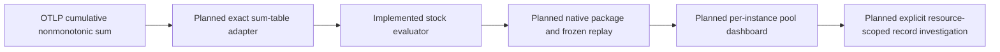

# Cumulative stock semantics

Implemented prerequisite for C2c: the pure Go evaluator in
[metrics/stock.go](../metrics/stock.go). Source discovery, measurement packages,
HTTP contracts, capture/replay and automatic pool/runtime panels are still planned.
Existing native gauges, counters, histograms and saved bytes are unchanged.

For an explicitly bound stock instrument, its cumulative nonmonotonic OTLP sum
is observed as the exported tally at an observation time. The sum type alone does
not prove a physical stock or a meaningful initial baseline.
Connection releases and memory reclamation may decrease its value; such decreases
are not counter resets. The evaluator retains the accumulation start (epoch),
observation time, full resource/scope/schema/instrument/unit/attribute identity,
and signed finite fractional values. A new epoch is an independent observation;
no subtraction, reset compensation or interpolation is performed.

Only cumulative, nonmonotonic input is accepted. Delta sums cannot establish an
absolute stock without a separately justified baseline and remain unsupported.
Canonical nanosecond timestamps, a nonempty half-open window, positive freshness,
service and instance identity, scope/name/unit and at most 10,000 points are
required. Host/Kubernetes identity is not implemented by relaxing this contract.

Duplicate identical observations collapse. Conflicting values, epochs or missing
flags at one timestamp yield unknown without a winning value or epoch. Missing
values yield unknown; old observations retain their value marked stale against
the fixed window end. Empty input has no series, rather than a zero. Series state
is the last sample state. Gaps have no fabricated samples or continuity promise.
Negative values are valid generic nonmonotonic sums; a connection-count profile
will need a separate nonnegative domain rule. No fleet total or utilization ratio
is implied.

Next vertical slice: bind actual `otel_metrics_sum` rows without routing them
through the gauge table or counter rate kernel; add an additive stock measurement
result and replay contract; classify eligible cumulative sums in discovery; then
show per-instance named-pool connection states using ordinary OTLP in generic
mode. Keep pool states separate, require actual aligned capacity before a ratio,
and preserve missing/empty pool identity. The catalog's v1.37 development names
are candidate bindings, not proven exporter conformance.

Planned user journey: Services → chosen service → named pool/instance → observed
connection-state series → selected observation → explicitly scoped logs/spans.
The source fixture must include releases, new epochs, stale/missing/conflicting
reports, multiple pools/instances and unsupported delta sums. Capture/reopen must
retain original bytes and epoch semantics. Browser screenshots and Bombadil
coverage belong to that UI slice; this pure evaluator changes no screen.

Validation: fixed semantic/validation/isolation cases in
[metrics/stock_test.go](../metrics/stock_test.go), plus generated descending
signed/fractional stocks, epoch changes, reordered arrival and duplicate replay in
[verification/stock_test.go](../verification/stock_test.go). These are in-memory
checks, not ClickHouse/OTLP integration or a completed dashboard. There is no new
stateful owner requiring a Quint model in this cut.
