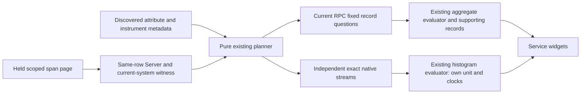

# Current RPC observations

[367 reusable current RPC views](CURRENT_RPC_VIEW_TEMPLATE.md) now extends this
same pinned span profile into Customize, saved presentation reuse and explicit
Run on another compatible service. It retains conditional method groups and the
whole destination scope; no additional conformance or native binding is implied.

357 is implemented and validated. The convention is pinned to
[OpenTelemetry v1.45.0](CURRENT_RPC_CONVENTION_357.md). See the
[executable storyboard](journeys/357-current-rpc.md) and
[validation record](../VALIDATION.md).

| Profile | Span population | Method grouping | Recognized native duration |
| --- | --- | --- | --- |
| Current RPC (`rpc-server-current`) | Reported Server kind and nonempty `rpc.system.name` | Literal `rpc.method`, including missing, empty and `_OTHER` | `rpc.server.call.duration`, Histogram, seconds |
| Legacy RPC (`rpc-server`) | Reported Server kind and nonempty `rpc.system` and `rpc.method` | Literal `rpc.method` | `rpc.server.duration`, Histogram, milliseconds |

The current rule is `goo/rpc-server-current-span-observations/v1`. Method is
conditional in the pinned convention: missing does not exclude a current RPC span,
and `_OTHER` is never synthesized for an absent method. `rpc.service` is not joined
onto method names. A reported group is not a globally unique operation identity.

A discovered key alone makes a candidate available. Automatic selection requires
a positive witness from the already held page or a recognized native instrument;
it performs no extra probe. Witnesses check service, namespace, environment policy
and half-open time bounds on the same row, within the supplied page limit. False
means unknown, not absence. Automatic precedence is HTTP, current RPC, legacy RPC,
database client, messaging consumer, messaging producer, then All spans.

Current RPC can also be selected explicitly from candidate metadata. Its actual
read may be empty or fail; neither outcome silently switches to another profile.
All spans remains an explicit choice. Narrowing the window retains the chosen
profile even if the held page no longer supplies a positive witness.

Record queries preserve the complete service scope and current-key predicate.
Dual-emitted records can belong to both explicitly selected populations; the
profiles do not union aliases or deduplicate calls. Recorded span Error, Unset and
Unknown are not a universal protocol success/failure policy. Span records include
sampling, retries and streaming lifetimes; they are not unique requests or messages.

Native recognition checks exact name/type/unit through the existing instrument
binder. It does not certify all required exporter attributes. Delta/cumulative
forms follow the existing histogram engine, retaining stream identity, resets,
intervals, coverage and source clocks. Milliseconds do not become current seconds
by alias conversion; native and span results have independent populations.
Inconsistent temporalities within one bound stream remain an invalid source;
separate producer streams must retain distinct instrumentation identity.

Existing independent widget Retry and saved-template entry remain available when
their own contracts admit the result. Supporting-record links stage the whole
fixed query; Run reads explicitly. Returning through Services restores a completed
overview without source reads.
