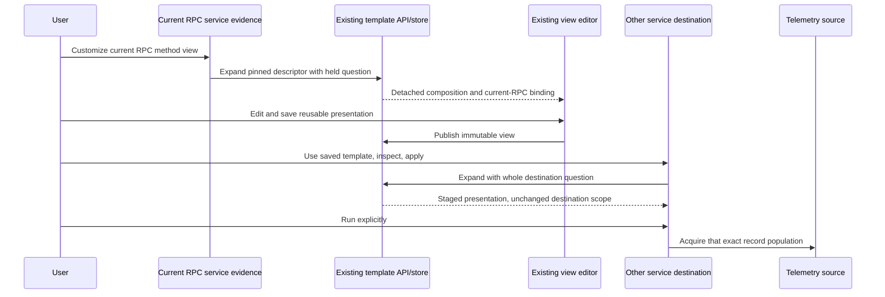

# Reusable current RPC service views

**Delivered with genuine native/model/actor acceptance.** The current
RPC service profile now offers **Customize current RPC method view** through the
same template handoff as HTTP routes and database operations.

The shipped preset `otel.rpc-server-current-methods` groups by reported
`rpc.method`. Its reusable binding is `otel.rpc-server-current`: exact nonempty
service, reported Server kind, and nonempty current `rpc.system.name` are required.
A method is conditional. Missing, empty and `_OTHER` method values remain distinct
populations; the preset does not add a method-existence/nonempty filter.
Legacy `rpc.system` alone and Client spans do not satisfy this profile. A profile
selects observations; it does not certify instrumentation or protocol success.

Use the existing service dimension's Customize action, edit the composition,
and save it as a reusable view. On another compatible service, **Use saved
template → Inspect template → Apply** stages the selected presentation against
that service's complete current question. **Run** explicitly acquires records.
Planning, expansion, local staging and metadata saves do not query telemetry.

The destination retains its service/namespace, environment policy, predicates,
fixed window and current grouping. The donor supplies presentation and an explicit
destination-category binding, never a specimen service, source rows, coverage
witness or execution authority. The current RPC profile does not accept a native
histogram, specialized numeric binding or unrelated role as an authored ordinary
record template. Existing ordinary count/duration semantics remain unchanged.

An old or hidden service action cannot adopt a late expansion or replace the
current destination. Existing current-owner, response-identity and staging checks
remain the boundaries. This adds one profile/preset rather than another query
engine, renderer, template registry or convention-alias union.

Service evidence uses the existing canonical record-question identity when matching
an actual Go response to its request. An omitted inert scalar environment and
Go's echoed empty scalar alongside the same typed selector compare equally;
nonempty conflicting scalars, changed policy/window/predicates and cross-service
rows remain invalid. This comparison does not rewrite questions or receipts and
does not change native measurement identity. Span-only services can therefore
supply their actual current-role witness without a native instrument masking a
wire-format mismatch.

See the [executable storyboard](journeys/367-current-rpc-template.md) for current
frames and [validation](../VALIDATION.md) for the independent six-record oracle,
query-identity regression and observed action/read checks.
