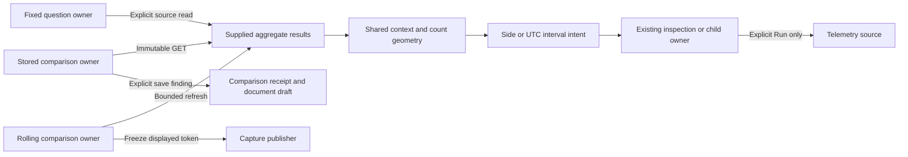

# D1 comparison acceptance — 2026-10-23

Scope reviewed: `f802ec3`, following the context, ranking, retained-series and
comparison-action cuts. This audit evaluates the D1 row in the
[active implementation plan](IMPLEMENTATION_PLAN.md), not every comparison idea in
historical product reviews. The selected checks passed. Bounded D1 is accepted; the remaining capabilities
listed below are explicit boundaries, not unfinished requirements of this cut.

## Acceptance map

| Requirement | Implementation and evidence |
| --- | --- |
| Consistent two-sided presentation with independently named windows and bases | `GooComparisonVisual.context` composes `goo-comparison-context` across fixed population, stored/fresh/saved and rolling record/counter comparisons. Each side supplies its own scope and clocks. Journey 126 checks exact nanosecond tooltips, large counts, separate read/custody clocks, upgrade, focus, disclosure and unavailable updates without requests. Journeys 120, 52, 53, 57, 69 and 72 exercise the actual adapters. |
| Fitting inspector and contextual-action adoption | Population rows stage either side's child; stored/fresh/saved and frozen-live sides read immutable pages into the existing record/native presenters. Shared action groups retain the owners' actual buttons. Journeys 127 and 53 check source-free Back/focus and obsolete completion or receipt-outage recovery. Fresh preview focus/retry is covered by journey 57. |
| Shared count-series geometry with two real consumers | Fixed aggregate results, explicitly loaded stored captures and rolling bucket responses use `goo-comparison-series` through `GooComparisonSeriesOwner`. Journeys 128 and 69 cover selection, independent windows, alignment, fixed-domain overflow/rescale, pinned UTC intent, explicit child Run/Back and exact Freeze after newer source data arrives. Saved adoption is checked in journey 53. |
| Error/latency ranking and appropriate log capabilities | Fixed and stored breakdowns share exact count/share/error/mean/p95/p99 ordering. Journey 120 finds a low-share regression, preserves ranking across saved views, labels unsupported groups and keeps full totals despite a one-row page. Journey 119 omits span error/latency choices for ordinary logs. Native values retain their separate presenters. |
| Refuse incompatible kinds/units and unsupported coverage | Stored comparison compatibility remains in the engine. Journeys 52/53 refuse unit mismatches; journey 54 withholds reset/gap/layout deltas. Journey 72 transitions from a valid native rate to unavailable coverage, repairs it and freezes the displayed rate without reading newer source data. No component converts units or invents fleet percentiles. |
| Exact fallback, shared domains, large values and known-to-unknown updates | Comparison metrics keep exact tables; count intervals have an expandable exact table, focusable marks and exact UTC/count status. The passive series test covers gaps, unknown intervals, counts above JavaScript's safe integer range, cancelled brushes and removal of obsolete marks. Hegel exercises actual JS ranking/geometry, bounded brushes, fixed ceilings and unknown values. Journey 126 covers valid known-to-unavailable context updates; journeys 69/72 cover stale transport versus completed unknown/coverage results. |
| Explicit continuation and separate execution/publication owners | Fixed comparison reads two explicitly requested populations; stored inspection/reopen reads immutable pages/receipts; rolling refresh retains one displayed snapshot and Freeze publishes its token. Passive elements do none of these operations. Journeys 53/57/69/72 and their observed Quint traces check these boundaries, with rejecting mutations. Source inspection confirms source state, document context and publication remain in the application owners. |

## Ownership retained

Shared display is deliberately smaller than a universal comparison state machine.
Native counter rates, histogram buckets and record counts retain their own
compatibility, coverage and units. The remaining execution adapters are not
accidental duplication to remove in this milestone.

## Boundaries carried forward

- Stored inspection is the first retained page. Full-capture paging remains an
  explicit navigation path; displayed rows do not define aggregate totals.
- Old cohort-only comparison envelopes cannot reconstruct absent bucket series.
  Missing series are explained without querying telemetry.
- Raw interval counts are not normalized rates. Unequal buckets retain their actual
  widths; native endpoints are not converted into record counts.
- Legacy single-question row continuation still refines and runs explicitly.
  It does not promise the newer population owner's retained-parent workflow.
- Arbitrary numeric-attribute comparison, nested predicate editing, statistical
  attribution, automatic native instrument discovery and new live metric families
  are outside this D1 cut. Existing numeric exploration remains available;
  these are not implied by the error/latency ranking acceptance requirement.

## Verification

The immediately preceding stored-action round passed journeys 127, 52 (record and
native), 53 (record and native) and 57, with their relevant Quint replays and stored/
saved Bombadil campaigns. Its initial stale-selector timeout and the real saved
retry-menu bug, correction and focused reruns are recorded in
[VALIDATION.md](../VALIDATION.md). This audit reuses that current evidence rather
than rerunning those same unchanged owners.

This audit additionally runs journeys 126, 120, passive 128, 69, 71 (two cases),
72, 119, 54 and 114: ten cases covering the other D1 acceptance boundaries and
the exact native-question preview. The pure checks are five Node files
and four Hegel tests: ranking, series geometry, bounded native state/swarm and
record-window compatibility. The native state/swarm check protects underlying
metric semantics; it is not a substitute for browser state coverage. No new
semantic implementation or model protocol is introduced by this audit.

The initial rolling-record run was stopped when it reached an outdated direct
Close preview click. Both rolling record and span-measure journeys now open the
actual Preview options menu and assert opener focus on return. The question-wire
Bombadil actor also uses the actual menu. A stale native-window Reopen selector
was a no-op; it now opens Comparison options and requires a second observed receipt
request, while refusing source/comparison-engine requests. The focused native
actor uses a disposable document referencing existing real retained evidence;
creating that test document is separate from the actor's source-free checks.

### Executed results

| Checks in this audit | Result |
| --- | --- |
| Journeys 126, 120 and passive 128 | Three passed in the initial run. |
| Journeys 69, 72, 71 (two cases), 119 and 54 | Six passed in the continuation after correcting the preview interaction. |
| Journey 114 | Passed with the corrected question-preview actor. |
| Targeted Node files | Five passed. |
| Hegel ranking, geometry, native state/swarm and record-window compatibility | Four passed. |
| Observed Quint replays from rolling records, native counters, span measures and native windows | Passed, including their rejecting controls. |
| Bombadil ordinary logs / native counter / native question / native-window Reopen | Passed for 15 / 30 / 25 / 30 seconds respectively. |

The initial interruption is retained with its diagnostic trace; it is not counted
as a pass. The corrected continuation checks the obsolete-response boundary through
the actual menu. Refreshed journey frames remain in the storyboard collection;
the native coverage-refusal frame was visually reviewed. Compact pure-test logs
are retained under `artifacts/d1-acceptance-contract`; browser/replay evidence stays
with its owning journey under the existing diagnostic retention policy.

## Disposition

**Accepted: bounded D1.** No remaining implementation blocker was found against
the active D1 acceptance row. The audit repaired two journey interactions and two
Bombadil actions, without changing production behavior, wire formats or models.

**Next: E1 native instrument discovery**, through the existing Measurements/Services
entry points and existing metric-discovery boundary. Start with a pinned HTTP-server
convention plus generic fallback, distinguishing declared, observed and verified
support. D2's documented partial population operations and capability-gated custody
work remain separate. This disposition does not authorize every historical
comparison or discovery research idea as a new milestone.
