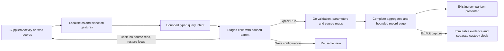

# D2 population operations acceptance — 2026-10-23

Scope reviewed: `5d4bce3`, including record columns, raw-span rectangle selection,
time widening, categorical partitions, whole-condition broadening and time/duration
region partitions. This audit evaluates the bounded D2 row in the
[active implementation plan](IMPLEMENTATION_PLAN.md). Bounded D2 is accepted after
the checks below; arbitrary Boolean editing and numeric attribute transforms are
outside this milestone.

## Acceptance map

| Requirement | Implementation and evidence |
| --- | --- |
| Supported column chooser and ordering | `goo-record-columns` projects supplied records, keeps qualified resource/attribute fields separate, preserves missing/empty/exact values, and changes no source predicates. Core and added columns reorder independently; UTC and Summary remain available. Saved population layouts retain at most eight supported added fields. Journey 118 checks Activity → fixed analysis → saved population, server/detached element composition, staged filtering and source-free return; Hegel checks shared field intent and immutable view state/swarm. |
| Time/duration rectangle with keyboard equivalent | The supplied count heatmap emits indices; `GooPopulationSelection.rectangle` maps complete buckets to exact bounds. Drag and Space/Shift + arrows/Enter share the same transform; Escape cancels local intent. The precise UTC/duration form is an alternate entry. Journey 121 covers both gestures, one-row inspection, exact Go execution and capture; passive 121b covers detached data, reverse selection and cancellation. |
| Explicit time widening | `widenQueries` requires an enclosing aligned window within the 120-minute budget; it preserves both signals' independent predicates. Journey 122 checks older/newer records, invalid/narrowing bounds, unchanged companions, local staging and source-free parent return. Hegel validates actual widened queries through Go. |
| Broaden without changing the paused parent | Only whole direct conjuncts can be removed. Root OR and nested groups stay atomic; removing the last condition removes `where`. Staged facets must be applied/cleared first. Journey 125 checks exact membership, preserved companion queries, one-row pages, keyboard focus, last-condition removal and saved configuration reopen. Hegel checks parent membership is a subset of the child, including missing/empty values and nested ORs. |
| Exact categorical selected-versus-rest | `partitionQueries` complements only generated categorical intent inside each parent. Missing and present-empty remain separate; unselected companion questions stay unchanged. Journey 123 verifies complete membership beyond its one-row UI page, empty remainder, saved configuration and immutable comparison capture. Hegel checks disjointness and coverage through Go's interpreter/compiler; the observed Quint ledger rejects seven mutations. |
| Exact time/duration selected-versus-rest | Both questions retain the entire parent window. Generated timestamp/duration predicates select the rectangle or its complement, never the arbitrary parent expression. `column:timestamp_ns` is an exact typed Go event-time field. Journey 134 verifies a 2+3 partition, exact time/duration upper edges, zero duration, excluded parent records, saved/captured evidence and source-free Back. Hegel checks UInt64 extremes and reported-edge preservation; Quint rejects five forged traces. |
| Distinguish narrowing, overlapping comparison and disjoint partition | Run selected population narrows the question; Compare selection to this baseline uses supplied parent aggregates and may overlap; Compare with rest stages independently read disjoint definitions in the parent window. The controls retain their existing owners. No page subtraction, silent parent broadening or implicit reinterpretation of a saved baseline is introduced. |
| Keep source execution and publication explicit | JS creates bounded typed intent; Go validates and compiles every applied question and evaluates source results. Opening a picker, staging a selection, paging local presentation or returning to retained parents does not read telemetry. Saving a view stores configuration; capture explicitly reads/freezes evidence according to its own contract. Reopening immutable evidence does not execute source queries. Observed Quint and Bombadil campaigns check the touched navigation/read protocols. |

## Small fixes found by this audit

The new timestamp predicate was exact on the wire but displayed raw nanoseconds
in selector summaries. Shared field presentation now shows **Event time (UTC)**
with all nine fractional digits, preserving the original predicate value. Malformed
or out-of-range values remain literal; attribute fields with the same name do not
inherit timestamp semantics. Unit checks cover epoch zero, submillisecond boundaries,
UInt64 maximum and invalid input without rounding or coercion.

Returning through the question trail also did not restore focus to the control
that opened the child. The trail now retains an in-view focus target before
suspending a question and restores it on Back/Forward if still connected. Journey
134 checks focus returns to **Compare with rest**; its Bombadil actor focuses the
opener and requires focus restoration as well as source-free navigation. Population
children retain their separate existing opener/focus owner.

Neither fix changes query bytes, membership, execution order, publication or
component data ownership.

## Ownership and clocks

Event time defines membership. Fixed source reads and comparison sides have their
own bases/read clocks; capture adds custody time. Independent reads are not a
transaction: late or corrected records can change observations between sides.
Disjointness and union properties describe fixed record values under the same
parent definition. Displayed rows/fields never define population totals.

## Boundaries retained

- Column discovery inventories supplied rows or the held buffer, not the full
  source schema. Activity layouts remain per-signal and page-local; cross-session
  live preferences and arbitrary transforms are not implemented.
- Raw span duration is a required UInt64 source column. Zero is valid; arbitrary
  missing/invalid numeric attributes are not coerced into this domain. Native
  metric histograms do not imply trace membership or share a record complement.
- Whole conjunct removal is deliberate. Nested OR branch deletion, arbitrary NOT,
  expression simplification and numeric-attribute complements remain outside the
  bounded operations. Existing node/depth/child budgets refuse unsupported intent.
- Comparisons preserve independent windows/bases and existing compatibility checks.
  Counts are not health verdicts, normalized rates or statistically significant
  attribution. Empty remainders retain the existing no-data behavior.
- Question trails and paused parents are tab-local. Reload does not recover an
  unsaved local selection. Saved views retain definitions, not a frozen source
  snapshot; immutable captures retain their original evidence contract.
- Exact selected Activity-row custody remains capability-gated. Connection-local
  row handles are not durable event IDs or server membership proof. No tail
  retention, cross-store recovery or training-label guarantees are added by D2.

## Verification in this audit

The previous round's unchanged heatmap and region/categorical partition evidence
remains current: journeys 121, passive 121b, 123 and 134 passed, including real
capture/reopen, Quint rejecting controls and the corrected region Bombadil actor.
This audit reruns record columns (two cases), widening, broadening and mobile
selection, with configured record-column/widening/broadening Bombadil campaigns.
After the two presentation/focus fixes it reruns the region path and its stronger
Bombadil assertion, plus the shared question-trail heatmap regression.

Pure checks cover Go exploration/view/API contracts, record columns, population
selection/workspace and field presentation. Seven Hegel checks exercise widening,
broadening, categorical/region membership, rectangle mapping, shared field intent
and immutable view state/swarm. Existing observed Quint drilldown models are reused;
no new execution protocol is invented for this audit. Actual results and artifact
locations are recorded in [VALIDATION.md](../VALIDATION.md).

## Next prerequisite

The next S3/F1 cut should assess one concrete target: an exact bounded selection
of observed Activity rows. Before exposing retention or retry recovery, define and
prove a server-issued membership capability, canonical payload/occurrence identity,
read basis/window, expiry and idempotent publication. Reuse existing retention and
citation contracts only where these prerequisites fit. This is prerequisite work,
not permission to substitute a reread or fabricate a native result token. Broader
labels/export and generalized browser write recovery remain deferred.
