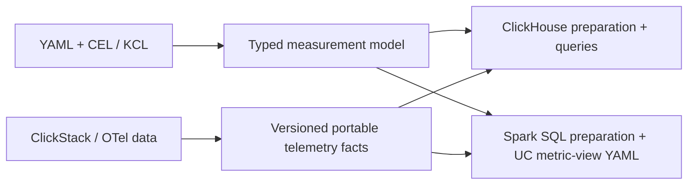

# Databricks metric-view compatibility

Research date: 2026-10-16. Status: design recommendation with a bounded
[offline aggregate compiler pilot](PORTABLE_COMPILER.md), not a Databricks
deployment certification.

## Recommendation

Make Unity Catalog metric views an explicit compiler target. Keep a portable,
typed measurement model between YAML+CEL/KCL authoring and backend output.
Compile supported dimensions and aggregate measures into Databricks YAML, with
Spark SQL preparation views/tables for subject and temporal semantics. Generate
ClickHouse SQL from the same model. Do not translate by replacing function names
in the prototype's SQL.

The intended path is:

This makes definitions and data independently portable. Publishing a metric-view
definition does not move ClickHouse data into Unity Catalog or supply an ingestion
pipeline, authorization, completeness proof, or alarm scheduler.

## Evidence and access limits

The requested [Databricks documentation][overview] was blocked by this environment's
HTTP policy (proxy CONNECT 403). `docs.databricks.com` was saved as the sole custom
domain addition in the configuration draft; the package-manager presets were
preserved. That save does not establish runtime access. Direct documentation
review remains pending until the setting is applied.

Instead, the following public Databricks-owned sources were inspected:

1. [Metric-view creation patterns and field reference][create], and
   [query patterns][query], at `databricks/databricks-agent-skills` commit
   `aea6a1b9bd88eefc7e858941fb98b2d3b01fbd80`.
2. [Metric-view advisor, including boundaries for dynamic computations][advisor],
   at the same commit. Read as research material; no deployment workflow invoked.
3. [Metric-view DDL and query implementation][tools], at
   `databricks-solutions/ai-dev-kit` commit
   `b059fd017a2c5743c31a0ff30dc8a618723aae4f`.
4. [CLI SQL execution implementation][sqlexec], at `databricks/cli` commit
   `4244322a261413a52e28e9e6834ca6744291a69c`.

These are implementation/reference evidence, not a substitute for testing the
target workspace. In particular, older AI-dev-kit test expectations describe
window measures as experimental/version 0.1, while the current agent-skills
reference describes them as GA/version 1.1. Do not infer current release status
or feature availability from the older test corpus. Pin and verify a capability
profile before deployment; the initial portable subset need not use windows or
materialization.

## Model and mapping

Databricks defines a catalog object using `CREATE VIEW ... WITH METRICS LANGUAGE
YAML AS $$ ... $$`. Its YAML describes a source, optional global filter and joins,
dimensions, and measures. Dimensions are non-aggregate SQL expressions; measures
are aggregate SQL expressions. Measures can compose other measures with
`MEASURE(name)`. Query-time grouping determines the requested grain.

The inspected current reference uses YAML specification `1.1` for DBR 17.2+,
with some metadata fields requiring 17.3+. This is a candidate target profile,
not a verified minimum for every warehouse or advanced feature.

| goo concept | Databricks lowering | Required constraint |
| --- | --- | --- |
| Source profile | UC table/view or SQL-query source | Explicit physical-schema and type mapping |
| Row field / derivation | Dimension `expr` | Supported, deterministic Spark SQL lowering |
| Population filter | Global `filter`, preparation SQL, or measure-local `FILTER` | Preserve where it occurs in the computation |
| Grouping | Dimensions selected and grouped at query time | Group only by dimensions permitted for that measure |
| Count, sum, extrema | Aggregate measure `expr` | Preserve subject grain, units, and null rules |
| Success / eligible ratio | Composed measures using `MEASURE()` | Divide aggregated counts; preserve unknown and zero-data states |
| Distinct subjects | Exact distinct expression or deduplicated subject facts | Never sum overlapping per-group distinct counts |
| Dimension enrichment | Star/snowflake joins | Prove many-to-one cardinality; do not fan out subjects |
| Deadline outcome | Prepared per-subject facts, then measures | Fix evaluation basis, deadline, cohort, and evidence cutoff |
| Rolling / cumulative result | Window measure if profile supports exact semantics | Verify endpoints, ordering grain, filter interactions, and semiadditivity |
| SLO target / burn rate | Measures plus external resource metadata | Scheduler, incident state, and routing remain external |
| Counter rate / distribution | Prepared deltas or compatible distribution representation | No direct sum of cumulative points or average of percentiles |
| Trace links / evidence drilldown | Separate detail tables and queries | A metric view does not replace a trace investigation model |
| Runtime-dependent multi-stage calculation | Parameterized SQL function/query plan where needed | Return an explicit non-metric-view capability result |

Metric-view queries use `MEASURE()` for measures and grouping for dimensions.
Dimension predicates belong in `WHERE`; aggregate-result predicates belong in
`HAVING` or an outer query. A UI filter on outcome must not silently alter the
denominator of a deployed SLI: expose a separate inspection surface or disallow
that filter for the objective resource.

The current Databricks reference describes many-to-one enrichment joins and
nested snowflakes, and disallows a `joins` block with a SQL-query source. Complex
temporal joins belong in prepared SQL. Joining acceptances directly to all
terminal attempts in metric-view YAML risks multiplying the denominator.

## Prepare subject facts before aggregate measures

For the reservation example, preparation should produce one row per
`(evaluation_id, environment, tenant_id, service_name, reservation_id)` after immutable-event
deduplication and conflict checking. Use exact subject keys; hashing alone is
not proof of identity equality.

Include acceptance and terminal times, classification, maturity, attribution
dimensions, definition/profile revision, and evidence-quality flags. Keep a
separate evaluation receipt with evaluation time T, evidence basis, data
snapshot/version, cohort bounds, deadline D, allowance L, invalid-record counts,
coverage assumptions, and quality state. Records without usable subject keys
still need diagnostics and scope-quality effects; they cannot simply disappear
from the subject table and make the result look healthy.

Apply RFC 0002's mature cohort `[T-D-L-W, T-D-L)`. Resolve terminal evidence for
those subjects through the recorded evidence cutoff, including terminals outside
the acceptance interval. Preserve the inclusive deadline-success boundary. A
Databricks trailing window is not automatically equivalent to this population.

Choose explicitly between immutable evaluation snapshots and corrected
per-subject facts. With snapshots, every query must select exactly one compatible
evaluation basis; counting all snapshots counts the same subject repeatedly.
With corrections, select/merge the right generation before aggregation. Counts
from different definition revisions, overlapping accounting windows, or mixed
evidence cutoffs must not be combined implicitly.

Avoid `current_timestamp()` in portable measurement definitions. Capture time
once and bind it through the evaluation plan or pinned prepared source. Fixed,
enumerable definition parameters can generate prepared facts plus metric views.
Arbitrary runtime deadlines, selection-dependent classifications, or multi-stage
set operations may need a parameterized query/function target instead.

## Illustrative target output

The companion [SQL example](../examples/databricks/reservation_metrics.sql)
shows a version-1.1 metric view over an assumed prepared subject-fact table.
It is a proposed compiler output, not accepted syntax for the existing Python
API. That earlier example is hand-authored; the Go pilot now generates its own
artifacts from a validated definition. No target table or Databricks object has
been created.

It retains good/bad/unknown/impaired and eligible counts. A strict success ratio
returns SQL NULL for impaired/unknown evidence or a zero denominator. That NULL
does not encode the entire evidence state: callers must retain counts and the
evaluation receipt to distinguish unknown, invalid, and no-data. Empty scopes
need receipts even when there are no subject rows to query.

Do not expose grouping/filtering across evaluation IDs as an ordinary user
operation. The example query selects a single evaluation ID. A production target
should enforce the basis-selection contract through generated serving surfaces
or the query API rather than relying only on a comment in the YAML.

## Physical data portability is a separate requirement

The sibling `observability` repository already has useful Parquet and query-basis
work. Its `otel-chdb/parquetgo/README.md` records a real Spark 4.0.1 test:
`TIMESTAMP(NANOS,true)` Parquet fails default ingestion. With
`spark.sql.legacy.parquet.nanosAsLong=true`, timestamps are read as bigint and
UInt64 columns as decimal(20,0). Its statement that Databricks behaves the same
is explicitly an estimate, not a Databricks test.

Therefore define a versioned lakehouse adapter rather than promising that the
existing files load unchanged:

- Retain exact signed epoch-nanosecond values for deadline comparisons and
  reproducibility. Add a UTC microsecond timestamp projection for standard
  platform time operations; do not silently round exact comparison inputs.
- Test the actual Databricks Parquet reader and configuration. Rewriting a
  timestamp column must be an explicit schema migration, not an ad hoc SQL cast
  that loses the original precision.
- Map unsigned values to checked decimal/integer representations. Preserve
  trace/span IDs as stable binary or normalized hexadecimal values.
- Preserve resource/scope attributes, event versus received time, nested links
  and events, and schema version. Project common dimensions to typed columns
  while retaining the raw attributes for future investigations.
- Define handling for invalid UTF-8, NaN/Infinity, missing versus empty map
  values, enums, timestamp range, and nulls. The sibling's hostile-data fixtures
  already exercise many of these cases and are a useful import-test corpus.
- Preserve metric instrument identity, unit, start time, temporality,
  monotonicity, and histogram representation. OTel metric points and semantic
  metric-view measures are different concepts.
- Consume only committed/published lake objects, preserve received-at and
  completeness/basis provenance, and reconcile corrections. A file listing or
  successful copy alone does not establish a complete population.

Keep raw telemetry in a durable ingestion layer, normalized events and subject
facts in a semantic preparation layer, and metric views over those facts. Choose
the UC-supported table/storage mechanism separately. Databricks metric-view
materialization is a performance feature, not the long-term data-retention or
evidence contract. The inspected reference also lists metric views as unavailable
through Delta Sharing: plan to share portable facts and definitions separately,
and verify that restriction against the target platform release.

## Authoring and compiler constraints to adopt now

1. Make Databricks an explicit backend profile alongside ClickHouse, with
   `direct`, `requires-preparation`, and `unsupported` outcomes per resource.
   Include reason, required artifacts, and semantic differences in `explain`.
2. Type expressions by phase: row, subject/temporal preparation, aggregation,
   and post-aggregation arithmetic. Track grain, keys, units, nullability,
   lineage, time precision, evidence basis, and reaggregation behavior.
3. Treat CEL as a checked expression frontend if selected. Translate only a
   documented subset through its parsed/typed AST. CEL errors, missing fields,
   integer overflow, and null behavior require explicit SQL semantics. KCL can
   generate validated resource data; neither runtime is assumed to execute
   inside Databricks measure expressions. Reject unsupported functions or move
   them into declared preparation; never silently substitute an approximation.
4. Keep aggregate structure explicit. A scalar CEL expression alone does not
   specify population lineage, aggregate phase, or a ratio's denominator.
5. Generate SQL structurally with backend-specific functions and typed value
   parameters. Keep metric identifiers and display labels distinct; serialize
   YAML with a real encoder and quote version strings and ambiguous keys.
6. Define exactness policies. Do not imply cross-engine equality for approximate
   quantiles/sketches or interchangeable binary aggregate states. Preserve raw
   observations or define a tested portable representation and tolerance.
7. Preserve definition revision, ownership, descriptions, units, and deployment
   metadata in a manifest. Emit supported UC metadata rather than inventing
   arbitrary YAML fields. Deploy DDL through the supported SQL execution route.

## Acceptance work before claiming clean translation

Start with a server-request success ratio and then the deadline-outcome SLI.
For each, compile one normalized definition into ClickHouse and a Databricks
preparation plan plus metric-view YAML. Compare both with independently authored
expected outcomes and the reference evaluator, under one frozen evaluation basis.

Required fixtures: more than 1000 subjects; duplicate events; cross-tenant IDs;
conflicting facts; missing IDs/timestamps; zero traffic; evidence loss; late
arrival; terminal evidence outside the acceptance interval; a tick before/at/after
the deadline; snapshot replacement/correction; and multiple grouping/page sizes.
Compare identities, cohort bounds, counts, quality and no-data states, not just
the final ratio. Test that ratios recompute from counts across dimensions, that
join fanout is rejected, and that query filters cannot change deployed objective
meaning. Test Parquet ingestion separately using actual existing exporter output.

Before adopting windows, materialization, UDFs, or advanced composition, verify
those features on the selected warehouse/runtime and test their semantics. A
local YAML parse cannot certify Databricks SQL acceptance or execution parity.

## Validation performed for the initial research

Inspected the pinned public sources and both local RFCs, the sibling query-service
README, and the sibling Parquet compatibility record. Parsed the example YAML
locally and checked its measure references and required fields. No Databricks
workspace, SQL warehouse, or credentials were configured or used. The initial
research did not execute a compiler, ingestion, deployment, or parity test.

On a subsequent documentation retry, the direct docs URL still returned proxy
403. The pinned official creation reference remained accessible on GitHub. The
new [Go pilot](PORTABLE_COMPILER.md) now executes prepared-fact reference and
ClickHouse aggregate parity checks and structurally checks generated Databricks
artifacts. Databricks execution and physical-ingestion tests remain unrun.

The subsequent Go lifecycle pilot implements normalized-event preparation,
strict `received_time_ns < cutoff` custody bases, provenance digests, and
correction-link validation. Generated aggregate queries now bind an explicit
`evidence_impaired` receipt guard so an empty impaired scope cannot turn into an
apparently healthy/no-data objective. See [lifecycle preparation](LIFECYCLE_PREPARATION.md)
and [bitemporality](BITEMPORALITY.md). SQL preparation and the Databricks runtime
still need their own eventual integration tests.

[overview]: https://docs.databricks.com/aws/en/uc-semantics/metric-views/
[create]: https://github.com/databricks/databricks-agent-skills/blob/aea6a1b9bd88eefc7e858941fb98b2d3b01fbd80/skills/databricks-metric-views/references/create-patterns.md
[query]: https://github.com/databricks/databricks-agent-skills/blob/aea6a1b9bd88eefc7e858941fb98b2d3b01fbd80/skills/databricks-metric-views/references/query-patterns.md
[advisor]: https://github.com/databricks/databricks-agent-skills/blob/aea6a1b9bd88eefc7e858941fb98b2d3b01fbd80/skills/databricks-metric-views/references/metric-view-advisor.md#when-a-metric-view-is-not-the-right-tool--governed-function
[tools]: https://github.com/databricks-solutions/ai-dev-kit/blob/b059fd017a2c5743c31a0ff30dc8a618723aae4f/databricks-tools-core/databricks_tools_core/unity_catalog/metric_views.py
[sqlexec]: https://github.com/databricks/cli/blob/4244322a261413a52e28e9e6834ca6744291a69c/libs/sqlexec/sqlexec.go
