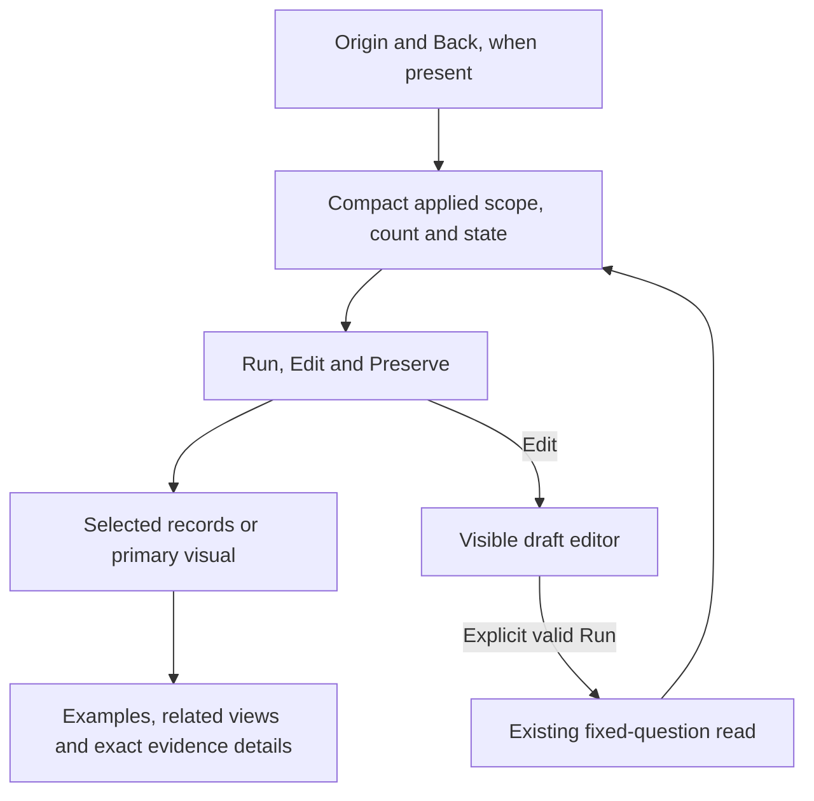
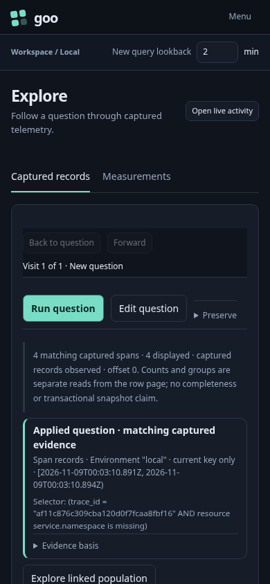
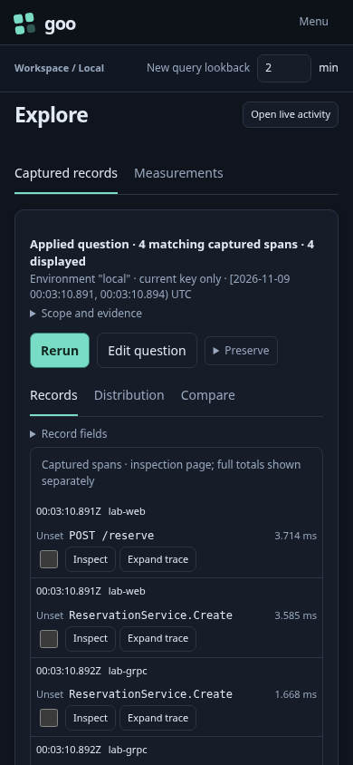
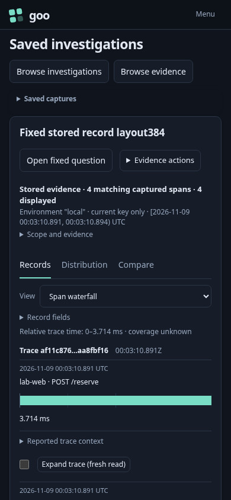

# Data-first fixed results

Implemented in milestone 384. [Actual acceptance](../VALIDATION.md) checks
ordinary, Activity, Saved continuation and stored-record views with desktop and
narrow screenshots, source budgets and retained-parent replay.

A fixed record question opens around its evidence: a compact applied scope/count
header, one action row, then the selected record page or primary visual. Ordinary
Explore, Saved record evidence and Activity's fixed continuations use the same
ordering. An origin/Back control stays above the current question when present.

Exact bounds, predicates and independent read facts remain inspectable. Trace
examples, deployment context, reusable views and selection instructions belong
below the primary content or in contextual disclosures. A selected distribution,
histogram or timeline remains primary; compactness does not override the chosen
visual. Partial or changed-between-reads states remain visible.

Editing keeps the draft separate from applied evidence. Dirty, invalid, failed or
canceled questions expose the editor and its required controls. Collapsing
secondary context cannot hide a draft that needs attention. Presentation changes
keep the exact question, full counts, read clock and source basis intact.

Single-visit history chrome is omitted; available history and origin/Back actions
remain. Population entry and saved-view controls live in secondary context while
fixed results are primary. The same controls move above the active population
workspace while it is open, retaining their library and action ownership.

Stored waterfalls can use the public display's `summaryProvided` embedding option
because the shared header supplies the count/scope/read facts. Relative scale and
coverage remain visible; full interpretation stays in **Timing scope**. Standalone
waterfalls retain their full default summary.

The existing question session and retained visit own requests, cancellation and
Back. Display components receive supplied data. Layout and disclosure do not
acquire read or navigation authority. Returning from a child restores the held
parent DOM, expanded context, citation and focus.

Acceptance measures the first actual row or selected visual at the natural top of
the real scroll container, on desktop and narrow screens. Scrolling the row into
view is not a layout pass. Geometry checks accompany keyboard, no-read disclosure
and kind changes, invalid editor visibility and retained Back tests.

## Measured result

At 390×844 and natural scroll position zero, the complete first ordinary record
moved from 1433–1521 px to 550–638 px. The stored table moved from 1791–1878 px to
603–691 px; the full selected stored-waterfall item fits at 608–814 px. The matched
frames use the same fixed question and independently read source data, not a
transactional snapshot. Desktop and narrow source/Back behavior remains checked
in the [executable storyboard](../journeys/384-fixed-result-layout-storyboard.md).

