# Contributed categorical facets — 310

> Delivered in 310. See [validation](../VALIDATION.md) and the
> [executable storyboard](journeys/310-declarative-facet.md).

In **View settings → Facet**, choose a qualified **Facet field**, optionally add a
title, then **Add facet**. New facets appear before long record lists; updating an
existing facet keeps its authored position. Add/Update/Remove change local view
configuration without reading. Removing the control leaves applied filters intact.

A service view can declare the field that is most useful for narrowing its
population, alongside its charts and records. The first scope-control role uses
the same validated view definition as interactive authoring, Save and portable
YAML. It does not introduce a private filter language or a second query owner.

## One field, one applied scope

A composition may include one `facet` child with a pinned `categorical-facet` kind:

```yaml
facet:
  version: goo.view/1
  scope: {kind: record-query, signal: spans}
  kind: {name: categorical-facet, version: 1}
  field: {kind: attribute, key: http.route}
  display: {basis: applied, title: Route}
```

The declaration stores a qualified string field and presentation. The primary
question owns signal, environment policy, fixed time and predicates. Selected
values, counts, read clocks and temporary selections are not facet configuration.
Resource and record attributes with the same name remain different fields.
The checked [service log example](../config/views/service-log-facet.yaml) declares
a Service facet next to HTTP-related record fields, using the same Go/YAML/CLI
admission as files contributed by a team.

The first cut supports ordinary single-query logs/spans compositions. It allows
records plus a facet, or an aggregate/records composition with a facet and an
existing compatible timeline. Numeric/histogram, reported-edge and grouped-time
profiles remain outside the facet contract. Existing summary/status/time-bucket
projections do not change the counted-record population: the existing counted-
values recipe derives its query from the applied scope and declared field.

Facet plus comparison remains refused, even when hidden. At least one data child
must remain visible; a facet alone is a control, not a data result. Ordinary
presentation reuse retains the declared field and checks it against the destination;
it copies no source question or observations. Since 311, an aggregate-and-records
category template may retain the same literal facet field while rebinding its
category. The facet is not a category parameter and is not rewritten. A raw
records-plus-facet view without an aggregate still cannot become a category
template. The [HTTP service view](HTTP_SERVICE_VIEW_TEMPLATE.md) is the first
shipped default using this combination.

## Read, stage, then apply

Opening a saved view or mounting its facet does not acquire data. Run reads the
configured population through its existing acquisition path. **Read values** is a
separate explicit read of values/counts across that exact applied scope, not the
inspection page. Counts include existing filters, including any applied filter on
this field. They do not exclude the facet's own field automatically.

The existing counted-values owner checks separate count/group receipts, scope,
read basis and exact total accounting. Missing and present empty values remain
distinct. Changed, incomplete or over-budget lookups cannot become selectable
source counts. The passive element receives admitted supplied data; it does not
fetch, subscribe or infer completeness from rows.

Include/Exclude actions add pending choices to the existing selection tray without
reading. The existing Apply action reads the selected question; Open stages a
retained child for explicit Run. The query predicate is always the scope authority.
**Clear staged facet** clears only that facet's pending choices. It does not remove
an existing applied condition or another control's same-field selection. Applied
filters are removed explicitly through the existing filter editor/broadening flow.

Values that cannot be represented by the existing predicate limits remain visible
with their counts; Include/Exclude are disabled with a reason. The control never
truncates or rewrites a source value to make a different filter.

Search within loaded values changes only the local list. It does not change the
source query, denominator, count coverage or saved predicate.

## Reusable intent and explicit effects

Save/export retain the declaration and current query, without observations or
private selected-value state. Reopening/importing stages the same definition.
Fresh data, counted values and subsequent scope changes remain explicit actions.
Scope changes and owner replacement retire old counted values and callbacks;
late reads cannot publish against a different question.

```mermaid
flowchart LR
  Y[Team YAML or UI authoring] --> D[Facet field and presentation declaration]
  D --> V[Existing saved-view catalog]
  V -->|Open: no read| Q[Staged question and composition]
  Q -->|Run| A[Applied population]
  A -->|Read values| C[Checked full-scope counts]
  C --> P[Passive facet element]
  P -->|Include or Exclude: no read| T[Existing pending selection tray]
  T -->|Apply or Open then Run| A
  T -->|Clear only facet choices: no read| T
```



See [view grammar direction](VIEW_GRAMMAR_PROPOSAL_260.md),
[architecture review](reviews/DECLARATIVE_FACET_ARCHITECTURE_310.md) and
[design review](reviews/DECLARATIVE_FACET_DESIGN_310.md).

## Compact supplied-value controls — 315

The [compact facet/canvas presentation](COMPACT_CANVAS.md) keeps explicit Read
values and Include/Exclude actions. Local Find announces matching loaded values
separately from the full captured-record count. Read details remains a native
keyboard-accessible disclosure of the independent receipts. These presentation
changes add no model fields, source reads or inferred completeness.
