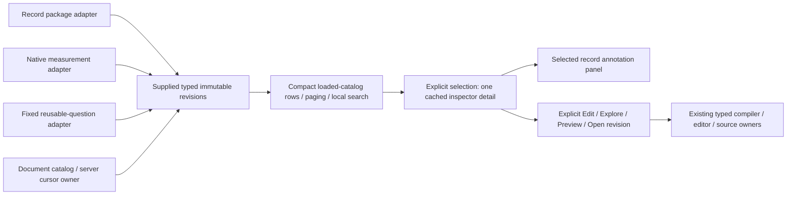

# Compact definition libraries

B1 adopts one supplied-data presenter in the record telemetry-package and native
measurement catalogs on Definitions, the fixed reusable-question list and the
investigation revision catalog. Each compact row retains its exact
revision; selecting it opens one detail with explicit Edit/Explore or Preview actions.
Selection itself does not validate, execute telemetry, publish annotations or replace
the package editor draft. Native Preview retains its existing source-free compiler
step; record Explore retains its existing explicit execution contract.

The application adapters own list requests, refresh generations, authoring and
execution. `GooDefinitionLibrary` owns only loaded-row paging/search and the shared
inspector. There are 25 displayed rows per page; search covers the loaded catalog,
not a global index or all evidence. Its pure page model preserves order, exact IDs,
missing matches and typed record/measurement/document identity without merging titles/names.
Native and record refreshes reject older responses. A failed refresh retains old
rows and the selected detail, with an unavailable notice.

Only the selected record revision has an attached annotation panel. The existing
inspector caches up to 32 visited details in this tab, so switching revisions can
restore an unsaved annotation draft. Filtering/paging does not silently change the
selected target; a notice identifies an out-of-page/filter selection. Close returns
focus to its row when that row is available. This cache is not durable draft recovery;
eviction/reload loses local drafts. Annotation history, explicit parallel heads,
pinned old revisions and native retry/await-token semantics remain in their existing
owners. No new retention or review semantics are introduced.

Journey 110 creates unrelated same-title record/native definitions through the real
Go APIs. It checks exact selection, one attached annotation panel, editor and
annotation-draft preservation, no source/publication reads on selection, mobile
containment and a delayed real catalog response overtaken by a newer refresh.
Journeys 40 and 98 protect native continuation and existing annotation branches/
history. The library Bombadil campaign inspects, filters and pages without execution.
Hegel generates loaded catalogs/pages to protect exact identity, complete paging,
literal search and non-mutation. Existing annotation Quint ledgers protect unchanged
publication semantics; the DOM composition is not exhaustively modeled.

The fixed reusable-question list now uses these same rows and selected detail.
Selection/close invalidate its pending compiler plan; workspace/mode changes and
fixed-owner suspension do the same, with explicit non-loading status on return. A plan must still belong to the current owner
and resolve the exact selected revision before its explicit Run can dispatch a
source query. Inspection/filtering/paging never run a source. The existing Run
semantics still use a fresh default-lookback window, not captured evidence.

Journey 111 holds real compiler responses across selection/close/workspace changes
and fixed suspension into Activity, proving zero obsolete queries. A mismatched returned revision is refused. A subsequent
explicit Run reads exactly one fresh question. Core journey 33 and its Bombadil/Quint
ledger protect full-population measures and real definition reuse.

B1 remains open: compatible document/retained catalogs,
selected contextual editors and touched retention-owner separation remain subsequent
B1 cuts. Backend catalogs still return their existing revision arrays; this slice
adds no server cursor, family/lineage API, inferred head, global search or store migration.

Investigation rows inspect already supplied revision metadata without opening the
editor or loading referenced evidence. The separate **Open investigation revision**
action retains the document owner's pending-note/dirty/busy guards. Inspection can
therefore coexist with a pending draft; an explicit refused open leaves it intact.
Rows show UTC custody time; the inspector carries the full selected and parent IDs.
Titles never imply family membership or a latest head. The server's **More revisions**
cursor remains separate from the presenter's 25-row local pages. Search explicitly
covers only the current server page. Selected detail survives local filtering or a
server-page change; unavailable refreshes preserve existing rows. Retained evidence
catalog ownership, retry journals and pinned review citations remain the next B1 cut.
